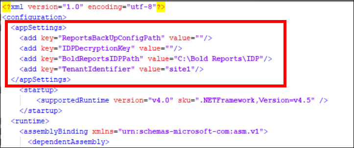
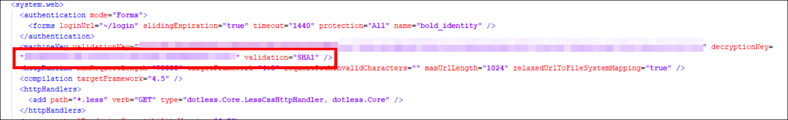
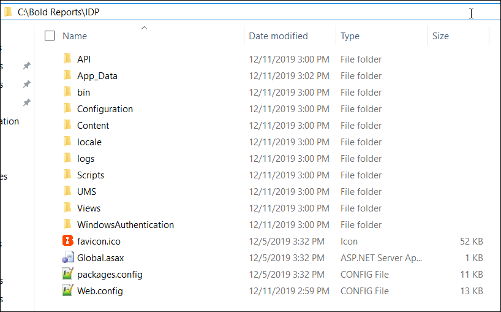
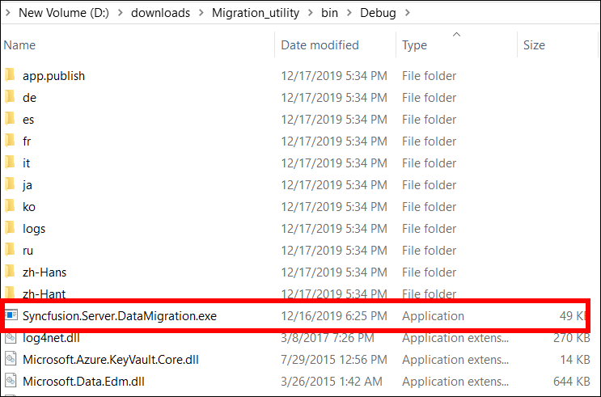

# Migrate Bold Reports® On-Premises Edition

You can migrate your resources from `v4.1 (Syncfusion Reports Server)` or `v1.2 (Bold Reports Single Tenant)` to `v2.1 (Bold Reports Multi Tenant)` with the data migration utility.

## What do I need before I migrate?

Before you run the Bold Reports® data migration utility, back up your data and set up a fresh Bold Reports® Report Server.

* Take a backup of the database and resource files from the following folder locations:

<table>
<tr>
<th>
Product
</th>
<th>
Location
</th>
<th>
Back Up Example
</th>
</tr>
<tr>
<td>
Syncfusion® Report Server
</td>
<td>

`C:\Syncfusion\Report Server\ReportServer.Web\App_Data`

`C:\Syncfusion\UMS\UMS.Web\App_Data`
</td>
<td>

`C:\backup_syncfusion\Report Server\App_Data`

`C:\backup_syncfusion\UMS\App_Data`
</td>
</tr>
<tr>
<td>
Bold Reports® Report Server (Single Tenant)
</td>
<td>

`C:\Bold Reports\Report Server\ReportServer.Web\App_Data`

`C:\Bold Reports\UMS\UMS.Web\App_Data`
</td>
<td>

`C:\backup_boldreports\Report Server\App_Data`

`C:\backup_boldreports\UMS\App_Data`
</td>
</tr>
</table>

> For an Azure App Service, take a backup of the `App_Data` folder by using the FTP application. Place the backup folder on the machine where you installed `bold reports v2.1`.

* After you take the backup, uninstall the current Syncfusion® / Bold Reports® Report Server.

* Install the Bold Reports® Report Server as a fresh installation by following the [Bold Reports® installation and deployment guide](./../../../../../deployment/)

* Configure the application with SQL Database by following [Application startup](./../../../../../application-startup/). When you configure the admin details, use the admin email ID of Syncfusion® Reports Server / Bold Reports® Server (Single Tenant).

* After the configuration is done, you can migrate your old data to this application.

## Steps to run the data migration utility

Run the Bold Reports® data migration utility after you update its config file with your backup path, decryption key, and IDP path.

1. Download the [Bold Reports® data migration tool](https://www.syncfusion.com/downloads/support/directtrac/general/ze/migration_util-1263808578).
2. Extract the file and edit the `Syncfusion.Server.DataMigration.exe.config` file.
3. Update the values of the following keys in the config file:

    * `<add key="ReportsBackUpConfigPath" value=""/>`
    * `<add key="IDPDecryptionKey" value=""/>`
    * `<add key="BoldReportsIDPPath" value="C:\Bold Reports\IDP"/>`

    The following screenshot shows these keys in the config file.

4. Copy the `Configuration` path in your Report Server backup folder and paste it as the value of the `ReportsBackUpConfigPath` key. For example, `<add key="ReportsBackUpConfigPath" value="C:\backup_boldreports\Report Server\App_Data\Configuration"/>`.

5. Go to the installation location `C:\Bold Reports\IDP\` and copy the `decryptionkey` value from the `web.config` file. Then, paste it as the value of the `IDPDecryptionKey` key in `Syncfusion.Server.DataMigration.exe.config`.

6. By default, the Bold Reports® installation is deployed under `C:\Bold Reports\IDP`, and the same path is set in the `Syncfusion.Server.DataMigration.exe.config` file. If Bold Reports® is deployed in another location, update the IDP path location in the value of the `BoldReportsIDPPath` key. For example, `<add key="BoldReportsIDPPath" value="C:\Bold Reports\IDP"/>`.

7. Run the tool `Syncfusion.Server.DataMigration.exe` from the extracted location.

## What does the migration utility migrate?

The Bold Reports® data migration utility migrates most resources, but it skips a few items.

> * The migration tool can migrate your resources like Reports, Data Sets, Data Sources, Schedules, Users, Groups and Permissions.
> * The utility does not migrate the following items: Users without an email address, Admin Settings, and Profile Pictures.
> * If you need any further assistance, contact Syncfusion® Support.

## Frequently asked questions

### Which admin email should I use when I configure the new Report Server?

Use the admin email ID of Syncfusion® Reports Server / Bold Reports® Server (Single Tenant) when you configure the admin details.

### Does the migration utility migrate admin settings?

No. The utility does not migrate Admin Settings, Profile Pictures, or users without an email address.

## See also

* [Upgrade from the classic platform](./../../upgrade-from-classic-platform/)
* [Upgrade Bold Reports® On-Premises Edition from v1.x](./../../upgrade-from-classic-platform/upgrade-bold-reports-from-v1.x-to-latest/)
* [Database permissions required to set up Bold Reports®](./../../../../../administrator-guide/faq/what-are-the-database-permissions-required-to-set-up-bold-reports/)
