# Collaborate on reports in {{site.productNameTM}} Report Server

In the {{site.productNameTM}} Report Server, you can write comments on a report to share with other users who have access to the report. Comments help you track events and provide insights into those events. You can also add links to other reports or to external websites.

You collaborate with other users in {{site.productNameTM}} On-Premises Edition by commenting on reports.

## Who gets notified when I comment?

When you add a comment to a report in Report Server, users who have enabled notifications in their profile receive notifications through email and system alerts. For more details, see [Notifications](./../notifications/).

## Post a new comment

To post a comment in Report Server, open the comment panel on the report, type your comment, and click **Post**.

1. Click the comment icon on the report.
    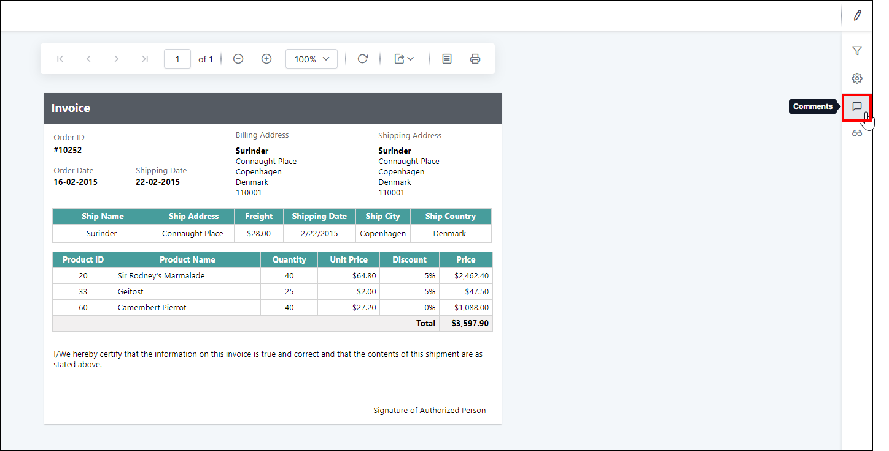

2. Type the comment in the text area and click **Post** to save the comment for the report.
    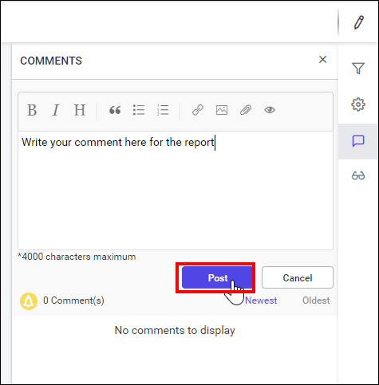

The saved comment appears in the comment list for the report.
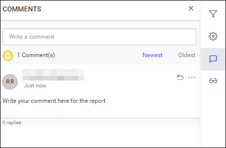

> In addition to text, you can include images in your comments. Copy an image to your clipboard and paste it directly into the text area.

## Reply to a comment

To reply to a comment in Report Server, use the **Reply** icon within the comment.

1. Click the **Reply** icon within the comment.
    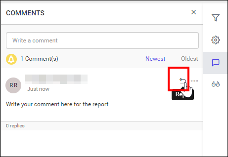

2. Type your response in the text area and click `Reply` to save your reply to the comment in the report.
    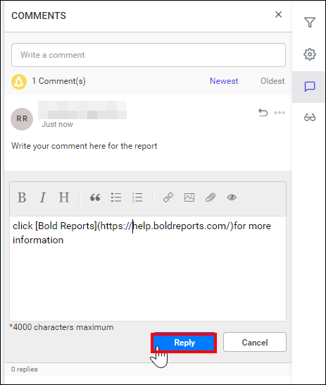

The saved reply appears under the comment.
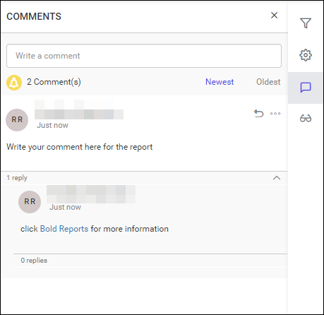

> **Note:** You can also reply to a comment multiple times.

## Edit a comment

To edit a comment or reply in Report Server, use the **Edit** option in the `Actions` menu.

1. Click the `Actions` button to view the additional options for a comment or reply.
2. Select the `Edit` option.
    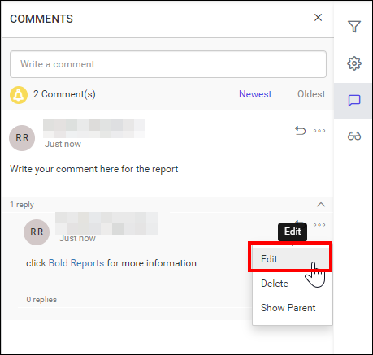

3. Edit the comment and click `Save` to save your changes.
    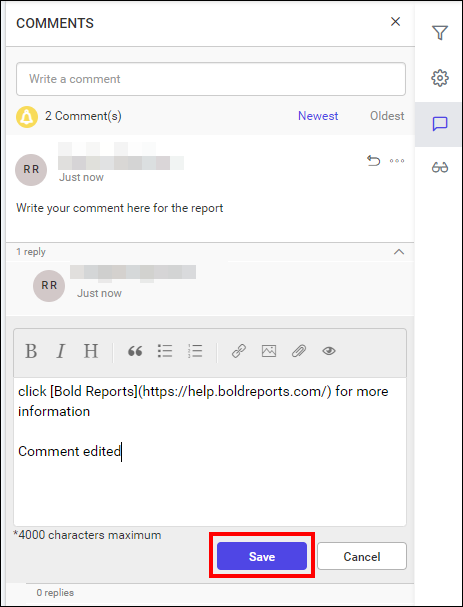

The edited comment appears with your changes.
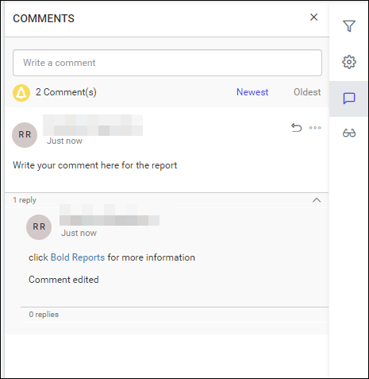

## Delete a comment

To delete a comment or reply in Report Server, use the **Delete** option in the `Actions` menu.

1. Click the `Actions` button to view the additional options for a comment or reply.
2. Select the `Delete` option.
    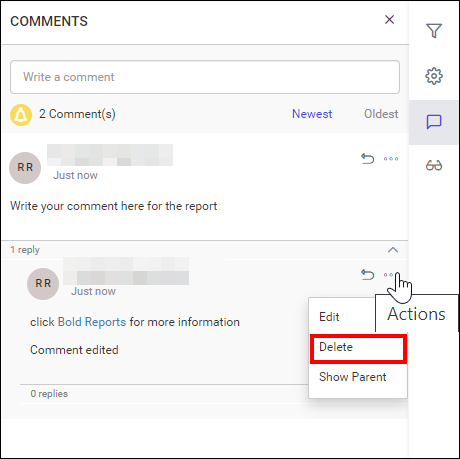

## Show parent comment of a reply

To find the comment that a reply was posted to in Report Server, use the **Show Parent** option.

1. Click the `Actions` button.
2. Select the **Show Parent option**.
    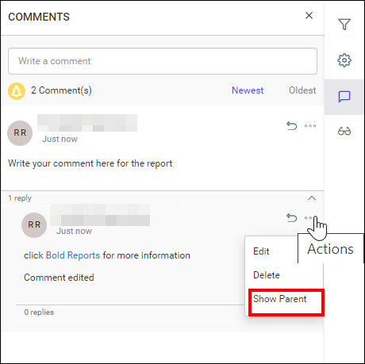

When you click the Show Parent option, the parent comments associated with the reply are highlighted.
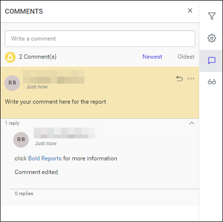

## Mention users in the comment

You can mention users in Report Server comments to notify them about the comment through email.

1. Type `@` followed by the user's name.
2. Select the appropriate user from the list of matching names to mention them in the comment.
    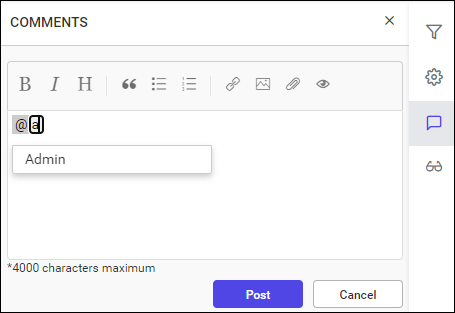

The following screenshots show the mentioned user in the comment.

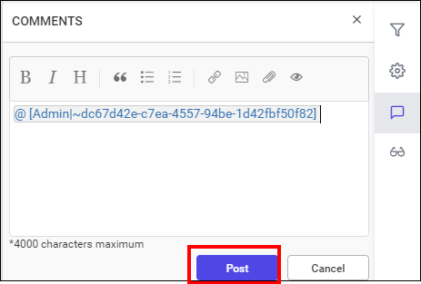

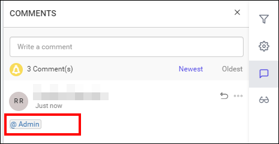

> The options to post a new comment, reply to a comment, edit a comment, delete a comment, and show the parent comment of a reply are available for reports.

### Notification

Report Server notifies users through two distinct methods whenever comments are posted on reports:

1. System notification.
2. Email notification.

Learn more about [Notifications](./../notifications/)

> **Note:** Configuring email settings is not a prerequisite for collaboration. However, if these settings are not configured, users do not receive email notifications.

## Frequently asked questions

### Can I add images to a report comment?

Yes. Copy an image to your clipboard and paste it directly into the comment text area.

### Do I need email settings to use comments?

No. Configuring email settings is not a prerequisite for collaboration, but users do not receive email notifications without them.

## See also

* [Notifications](./../notifications/)
* [Manage categories](./../manage-categories/)
