# Manage report categories in Bold Reports® Report Server

In Bold Reports® On-Premises Edition, you can create, open, update, and delete categories and manage their share permissions. Your access to categories depends on your permissions.

## Where are categories shown?

Report Server displays categories on the left side of the report listing page.
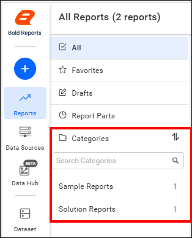

## How do I open a category?

To open an existing category in Report Server, click any category in the left panel to view the reports grouped with it.
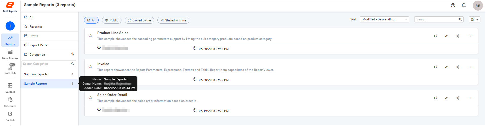

## How do I create a category?

To add a new category in Report Server, you must have the `Create All Categories` permission. You can add a category in several ways:

1. When you publish a designed report to the Report Server, the New Category option is available. For instructions on creating a category through the Publish dialog, see [Create categories from the Publish dialog](./../report-designer/publish-report/#create-categories-from-the-publish-dialog).
2. You can add a new category while copying reports from the context menu on the report listing page.
    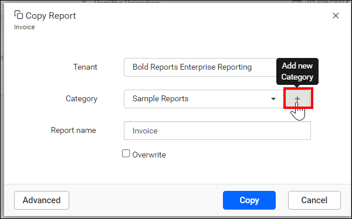
3. Click the `[+]` icon in the toolbar, then select the `Create Category` option.
    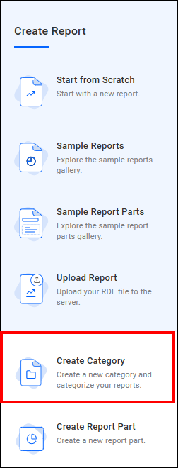
    Provide a name and description (optional) for the category and click **Add**.
    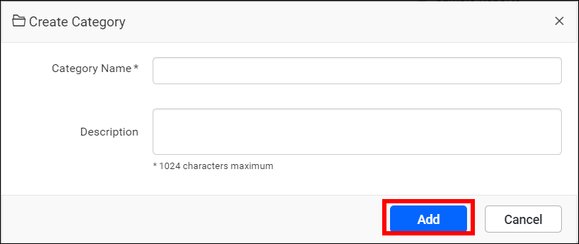
    > The user who created the category is provided with `Read`, `Write`, `Delete` permissions for that specific category.

## How do I share a category?

In the Report Server, you can set permissions for categories to share them with other users.

### Steps to share a category

1. Click **Actions** in the category list context menu and select **Sharing Permissions**.
    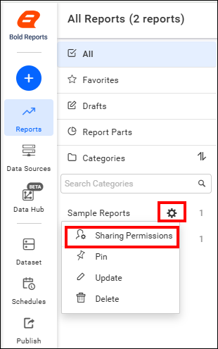
2. Click the `Manage Access` button.
    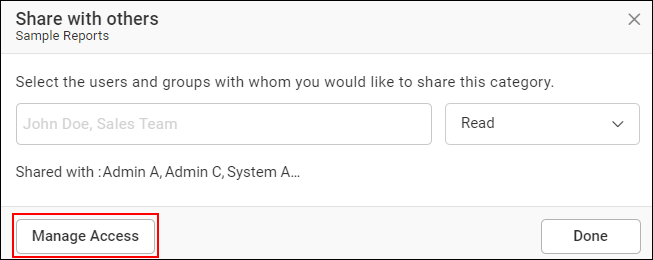
3. Choose the level of permission access, and then select the users or groups you want to share the category with.
    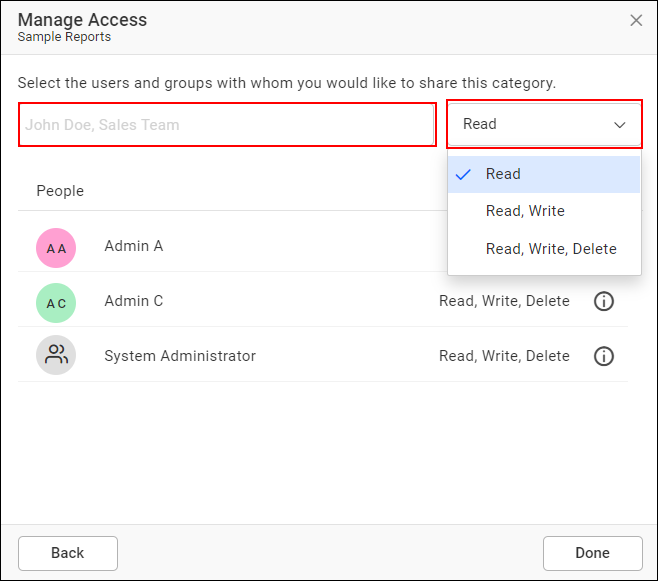
4. Click the **Add** button to finalize the sharing settings.
    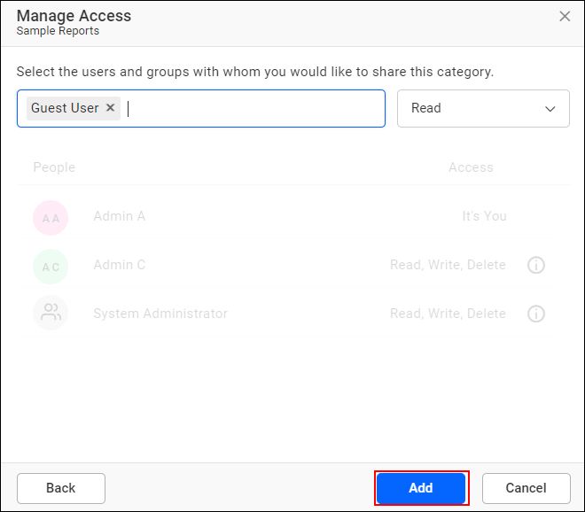
    > Only the user who has permission can share the category with other Report Server users.

### How do I remove category permission?

A Report Server user with the appropriate permissions can remove the shared category permissions using the `Remove option`.
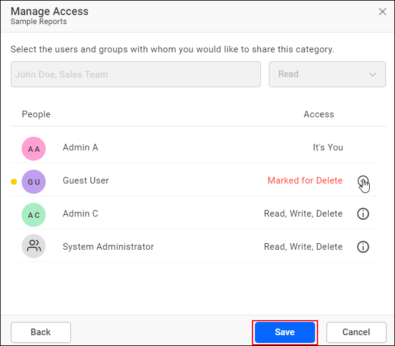

## How do I pin a category?

You can pin a category in Report Server to prioritize it for quick access.

* Locate and click the `Pin` option in the context menu of the category.
    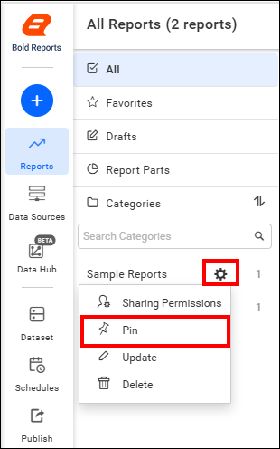

## How do I update a category?

To update the name and description of an existing category in Report Server, follow these steps:

1. Click the settings option available in the category.
2. Select **Update** from the context menu.
    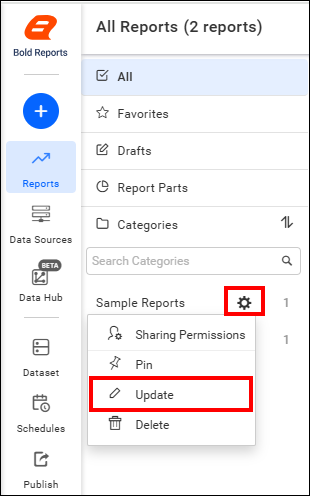
3. Make the necessary changes to the name or description, then click the **Update** button to save your changes.
    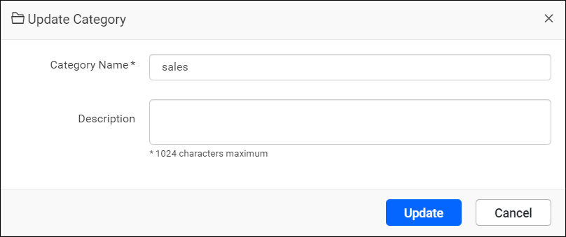

## How do I delete a category?

To delete a category from the Report Server, follow these steps:

1. Click the **settings** icon in the category list.
2. Select the **Delete** option to remove the category.
    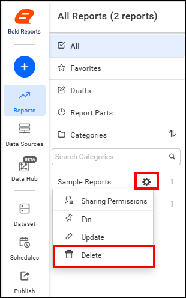
    > A category that contains grouped reports cannot be deleted.

## REST API Reference

The following table lists the available REST APIs related to categories in Bold Reports® On-Premises Edition.

<table>
    <tr>
        <th>
            Action
        </th>
        <th>
            HTTP Method
        </th>
        <th>
            Endpoint
        </th>
        <th>
            Description
        </th>
    </tr>
    <tr>
        <td>
            <a href="https://help.boldreports.com/enterprise-reporting/rest-api-reference/v1.0/server-api-reference/#operation/Items_AddCategory" target="_blank">AddCategory</a>
        </td>
        <td>
            POST
        </td>
        <td>
            /api/site/{tenant-name}/v1.0/categories
        </td>
        <td>
            Adds a new category to the server. Category details must be passed as input.
        </td>
    </tr>
    <tr>
        <td>
            <a href="https://help.boldreports.com/enterprise-reporting/rest-api-reference/v1.0/server-api-reference/#operation/Items_UpdateCategory" target="_blank">UpdateCategory</a>
        </td>
        <td>
            PUT
        </td>
        <td>
            /api/site/{tenant-name}/v1.0/categories
        </td>
        <td>
            Updates the category on the server. Updated category details must be passed as input.
        </td>
    </tr>  
        <tr>
        <td>
            <a href="https://help.boldreports.com/enterprise-reporting/rest-api-reference/v1.0/server-api-reference/#operation/Items_GetItems" target="_blank">GetCategory</a>
        </td>
        <td>
            GET
        </td>
        <td>
            /api/site/{tenant-name}/v1.0/items
        </td>
        <td>
            Returns the list of categories for the current user. ItemType should be Category.
        </td>
    <tr>
        <td>
            <a href="https://help.boldreports.com/enterprise-reporting/rest-api-reference/v1.0/server-api-reference/#operation/Items_IsItemNameExists" target="_blank">IsCategoryNameExists</a>
        </td>
        <td>
            POST
        </td>
        <td>
            /api/site/{tenant-name}/v1.0/items/is-name-exists
        </td>
        <td>
            Returns an item's existence, whether the given category name already exists or not on the server. Category name and ItemType as Category should be passed in the request body.
        </td>
    </tr>
    <tr>
        <td>
            <a href="https://help.boldreports.com/enterprise-reporting/rest-api-reference/v1.0/server-api-reference/#operation/Items_GetItemDetail" target="_blank">GetCategoryDetail</a>
        </td>
        <td>
            GET
        </td>
        <td>
            /api/site/{tenant-name}/v1.0/items/{id}
        </td>
        <td>
            Returns the specified category details from the server. Category item ID should be passed in the path parameter.
        </td>
    </tr>
        <tr>
        <td>
            <a href="https://help.boldreports.com/enterprise-reporting/rest-api-reference/v1.0/server-api-reference/#operation/Items_DeleteItem" target="_blank">DeleteCategory</a>
        </td>
        <td>
            DELETE
        </td>
        <td>
            /api/site/{tenant-name}/v1.0/items/{id}
        </td>
        <td>
            Deletes the specified category from the server. Category item ID should be passed in the path parameter.
        </td>
    </tr>
</table>

## Frequently asked questions

### Which permission do I need to create a category?

You need the `Create All Categories` permission to add a new category in Report Server.

### Can I delete a category that contains reports?

No. A category that contains grouped reports cannot be deleted.

## See also

* [Publish a report](./../report-designer/publish-report/)
* [Collaborate on reports](./../collaboration/)
* [Notifications](./../notifications/)
