# Data sources management in Report Server

You can create and store a data source on the {{site.productNameTM}} Report Server when you have a data source that you use often. A data source that you create on the Report Server is a shared data source that multiple reports can use.

## Why should I use shared data sources?

{{site.productNameTM}} recommends that you use shared data sources as much as possible. Shared data sources are easier to manage and help keep reports and access to data sources more secure. Report Server always places shared data sources on the `Data Sources` page. Users can access them based on their permissions.

## What can I do with data sources in Report Server?

Report Server data source management lets you add, update, share, and delete shared data sources. The following image shows the list of options available for managing data sources.

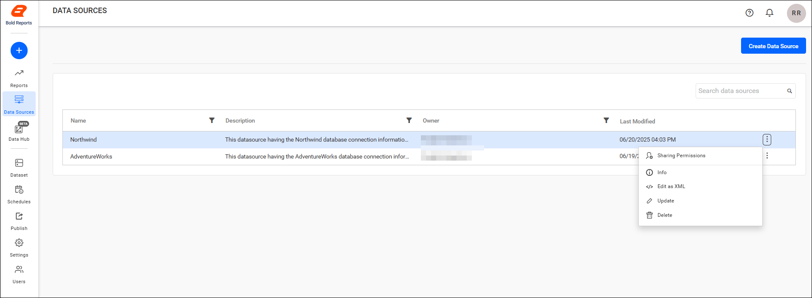

## Add or create data sources

You can add a data source to the Report Server only if you have the `Create All Data Sources` permission.

### Steps to add a data source

1. Click the `Create Data Source` button on the Data Sources listing page.
    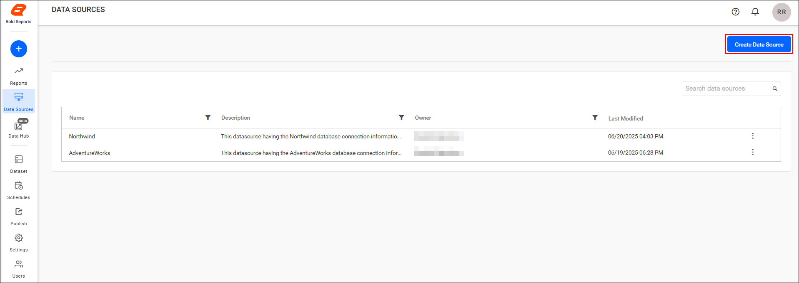

   > While adding a data source, you can also add a new dataset to the Report Server. Use either the `Create New Data source` option or the `Use existing Data source` option.

#### Create New Datasource

The `Create New Datasource` option in Report Server creates a new data source and then a dataset that uses it.

1. Click the `Create New Datasource` option. Report Server shows the enabled connectors, as shown in the following image.
    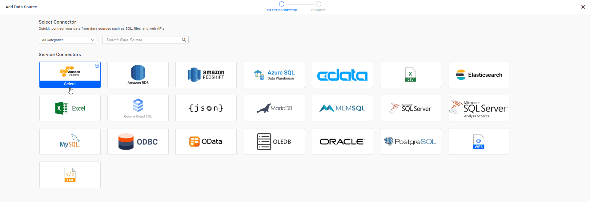

2. Choose the data source, enter the name, description, and other required details of the data source, and then click the **Save and Create DataSet** option.
    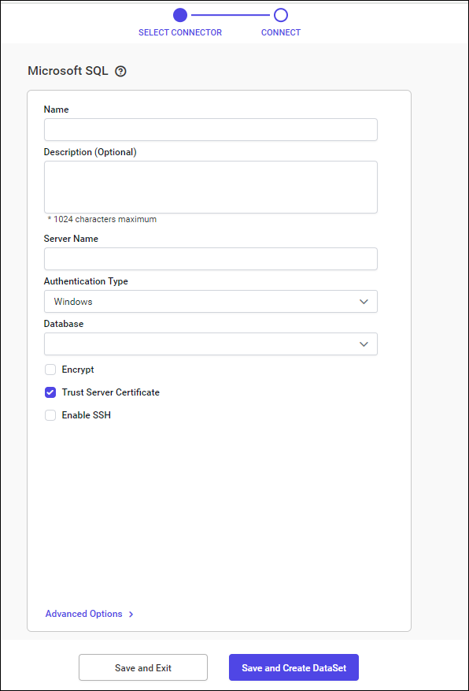

3. Enter the name and description of the dataset and click the `Proceed to Query Designer` option.
    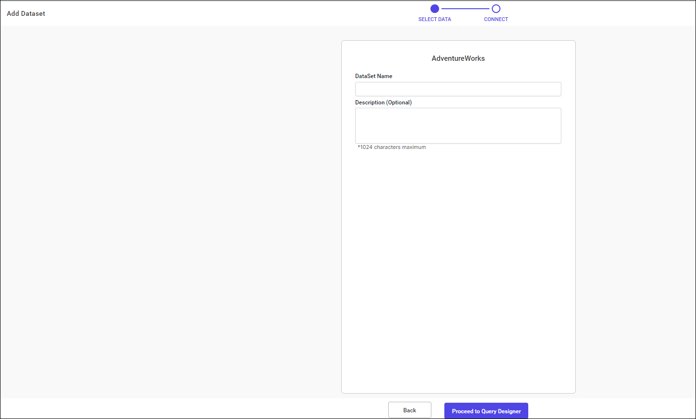.

4. After designing the dataset, click the `save` option.

    >`Read, Write, Delete` permission for the `Specific Data Source` is added for the user who created the data source.

    > **Note**: Security Content
    > 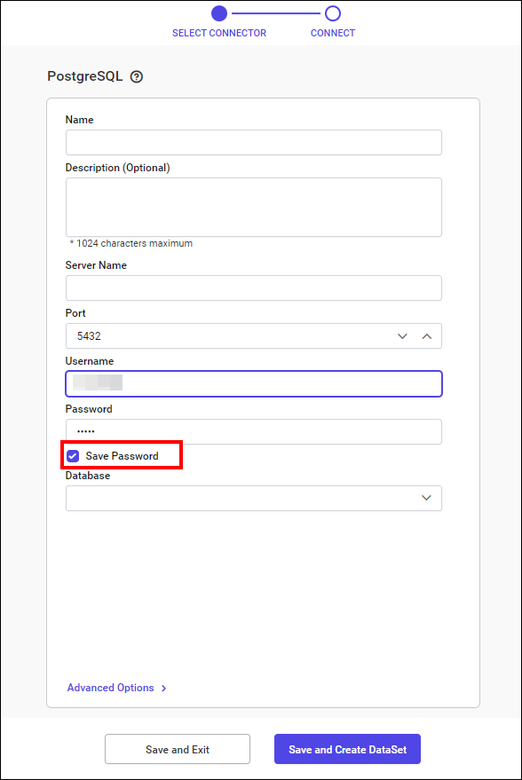
    > * A password is encrypted and saved in the database.
    > * When the `save password` option is not enabled, the credentials are not stored in the database, and the system prompts for the username and password on every occasion.
    > * When the `Save Password` option is enabled, the password is encrypted and the credentials are stored in the database. The system then does not prompt for the username and password on every occasion.

#### Use existing Datasource

The `Use existing Datasource` option in Report Server creates a new dataset from a data source that already exists.

1. Click the `Use existing Datasource` option when creating a dataset. Report Server shows all existing data sources.
   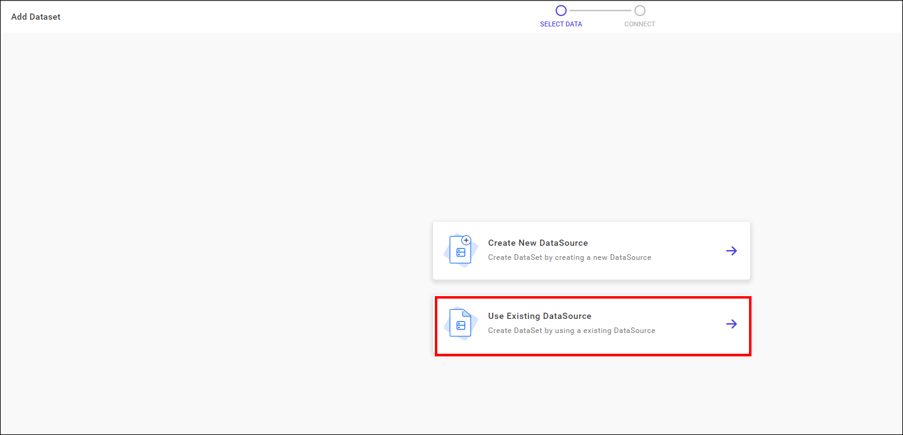

2. Select the existing data source and click the `Connect` button to create a new dataset.
   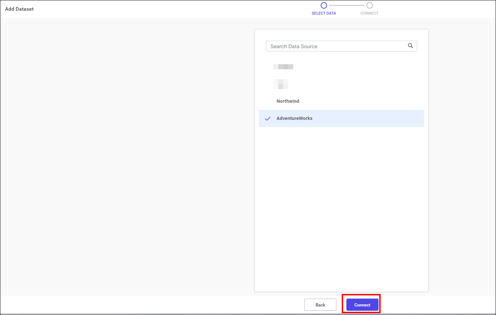

3. Enter the name and description of the dataset and click the `Proceed to Query Designer` option.
   .

4. After designing the dataset, click the `Save` option.
    >`Read, Write, Delete` permissions for the `Specific Data Source` are granted to the user who created the data source.

## How do I share a data source?

You can share data sources with other users in the Report Server by setting sharing permissions.

### Steps to share a data source

1. Click the `Actions` menu button in the Data source grid context menu and select the `Sharing Permissions` option.
   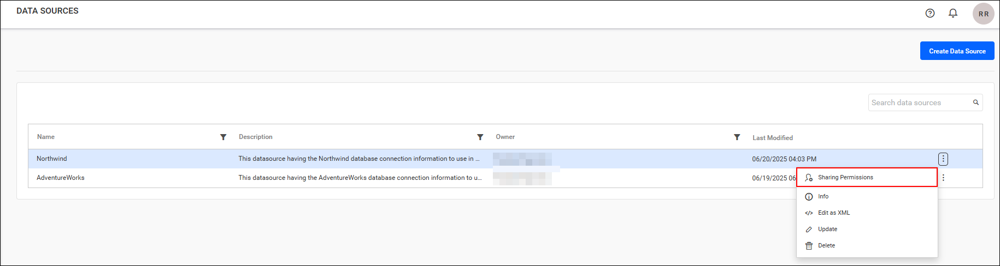

2. Click the `Manage Access` button.
   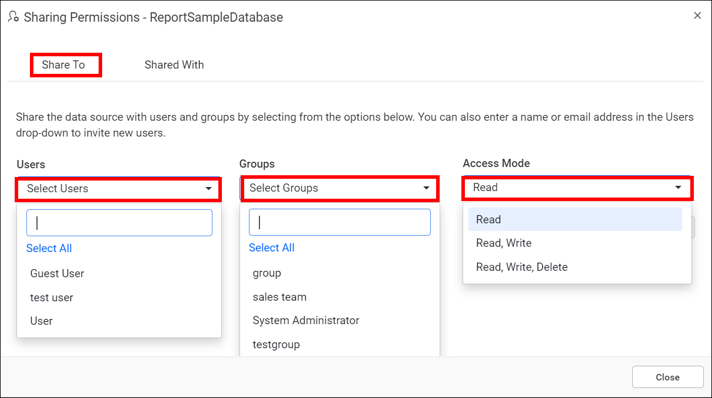

3. Select the permissions to access and the users or groups to share the data source with.
   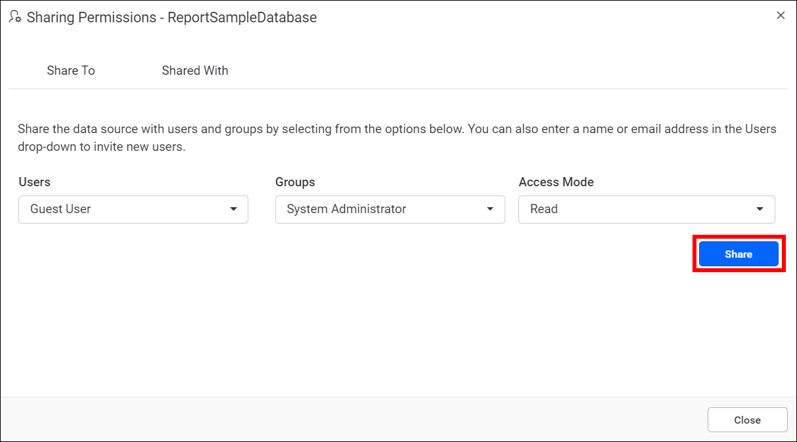

4. After selecting the access and users or groups, click the `Add` button.
   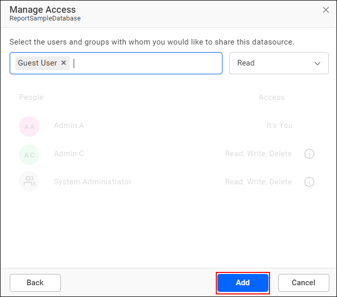
   > **Note:** Only users who have share permission can share the data source with other Report Server users.

### How do I remove data source permission?

A Report Server user with specific permissions can remove the shared permissions using the `Remove` icon in the `Access` column.
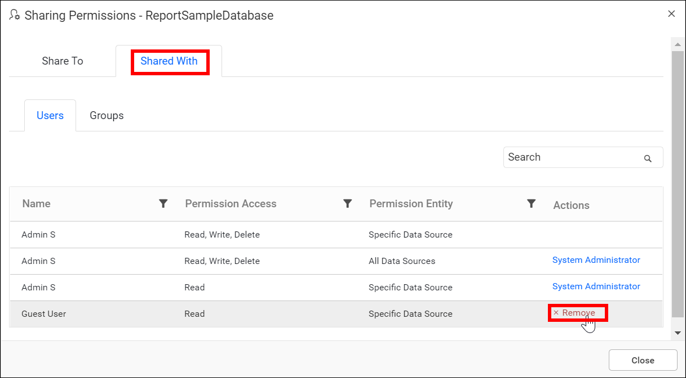

### Info

The `Info` option in Report Server shows the details and linked reports of a data source.

1. Click the Actions menu button in the Data source grid context menu and select `Info`.
    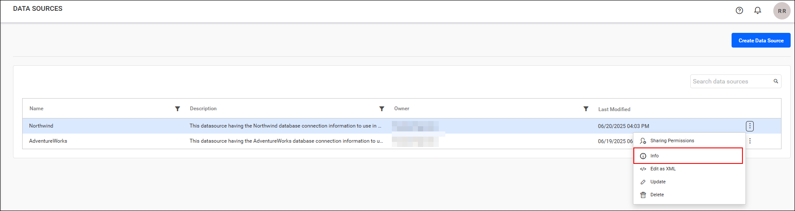

2. Review the Data Source info. It shows the Data source Id, Created by, Created on, Last modified by, Last modified on, and Linked Reports.
    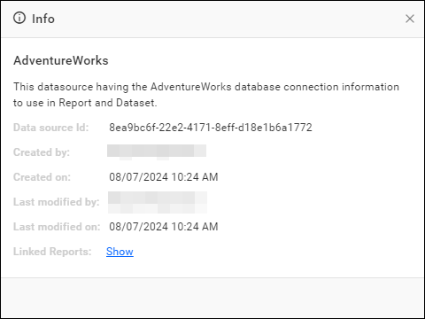

3. Click `Show` to view the linked reports.
    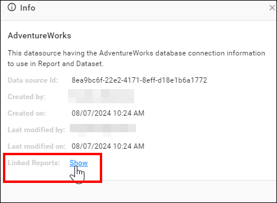
    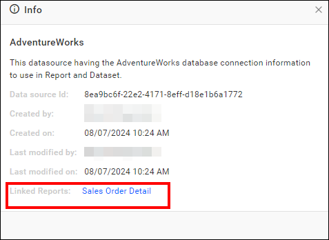

## How do I edit a data source as XML?

The Report Server XML editor provides a user-friendly interface for making modifications to a data source. You can change the data source without downloading it or using a separate text editor.

1. Click the `Actions` menu button in the data source grid context menu and select `Edit As XML` to edit a data source.
    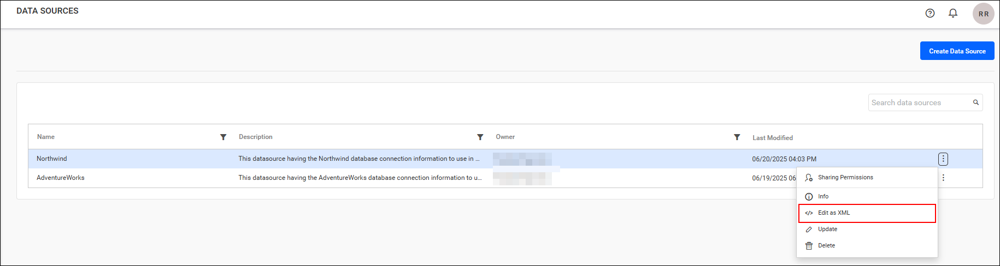

2. Make your modifications in the new tab, where the data source opens as XML. Save the edited data source by publishing it from the XML editor.
    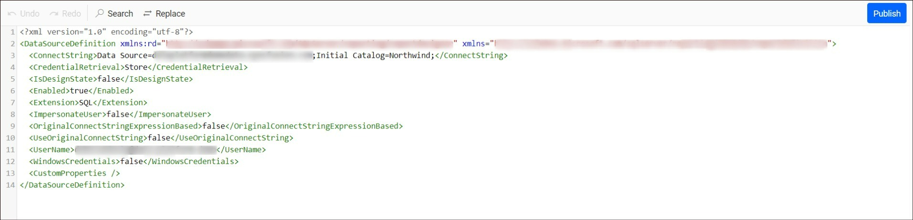

## How do I update a data source?

You can update shared data sources in {{site.productNameTM}} Report Server from the data sources grid.

### Steps to update the data source

1. Click the `Actions` menu button in the data sources grid context menu and select the `Update` option.
   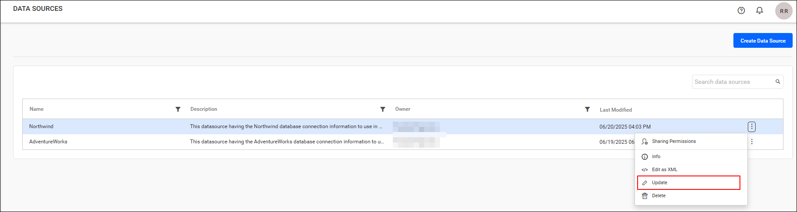

2. Change the name, description, and other required details, and then select the `Update` option in the update data source dialog box.
   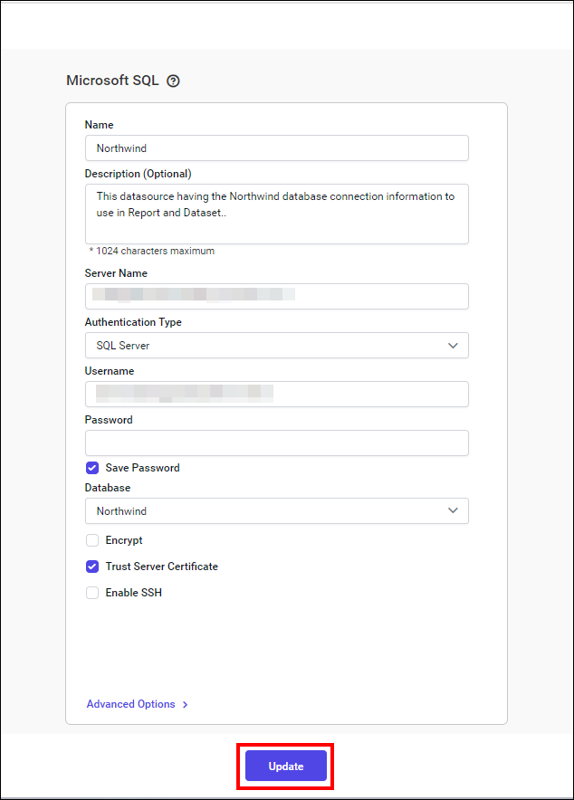
   >**Note:** This option is available in {{site.productNameTM}} On-Premises Edition from version `2.2.28` onwards.

## How do I delete a data source?

You can delete data sources from the Report Server when they are no longer required.

Click the `Actions` menu button in the data sources grid context menu and select `Delete` to delete the data source.
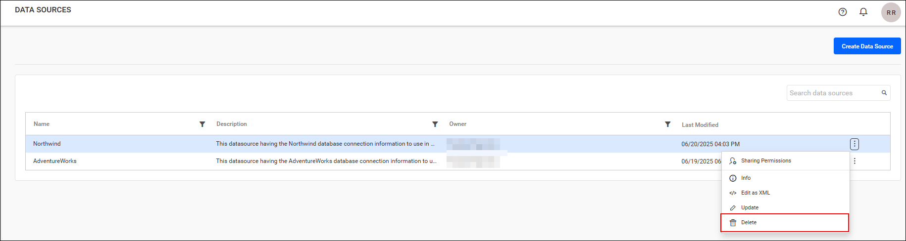

> Data Sources cannot be deleted if a report or dataset uses them.

## REST API Reference

The following table lists the available REST APIs related to data sources in {{site.productNameTM}} On-Premises Edition.

<table>
    <tr>
        <th>
            Action
        </th>
        <th>
            HTTP Method
        </th>
        <th>
            Endpoint
        </th>
        <th>
            Description
        </th>
    </tr>
    <tr>
        <td>
            <a href="https://help.boldreports.com/enterprise-reporting/rest-api-reference/v1.0/server-api-reference/#operation/Items_AddDataSource" target="_blank">AddDataSource</a>
        </td>
        <td>
            POST
        </td>
        <td>
            /api/site/{tenant-name}/v1.0/reports/data-sources
        </td>
        <td>
            Adds a new data source to the server. Datasource details must be passed as input.
        </td>
    </tr>
    <tr>
        <td>
            <a href="https://help.boldreports.com/enterprise-reporting/rest-api-reference/v1.0/server-api-reference/#operation/Items_UpdateDataSource" target="_blank">UpdateDataSource</a>
        </td>
        <td>
            PUT
        </td>
        <td>
            /api/site/{tenant-name}/v1.0/reports/data-sources
        </td>
        <td>
            Updates the data source on the server. Updated data source details must be passed as input.
        </td>
    </tr>  
    <tr>
        <td>
            <a href="https://help.boldreports.com/enterprise-reporting/rest-api-reference/v1.0/server-api-reference/#operation/Items_GetItems" target="_blank">GetDataSources</a>
        </td>
        <td>
            GET
        </td>
        <td>
            /api/site/{tenant-name}/v1.0/items
        </td>
        <td>
            Returns the list of data sources for the current user. ItemType should be Datasource.
        </td>
    </tr>  
    <tr>
        <td>
            <a href="https://help.boldreports.com/enterprise-reporting/rest-api-reference/v1.0/server-api-reference/#operation/Items_GetItemLocation" target="_blank">GetDataSourceLocation</a>
        </td>
        <td>
            GET
        </td>
        <td>
            /api/site/{tenant-name}/v1.0/items/{itemId}/location
        </td>
        <td>
            Returns the item location of the specified data source. A specific data Source ID should be passed as a path parameter.
        </td>
    </tr>
    <tr>
        <td>
            <a href="https://help.boldreports.com/enterprise-reporting/rest-api-reference/v1.0/server-api-reference/#operation/Items_IsItemNameExists" target="_blank">IsDataSourceNameExists</a>
        </td>
        <td>
            POST
        </td>
        <td>
            /api/site/{tenant-name}/v1.0/items/is-name-exists
        </td>
        <td>
            Returns an item's existence, whether the given data source name already exists or not on the server. The data source name and ItemType as data Source should be passed in request body.
        </td>
    </tr>
    <tr>
        <td>
            <a href="https://help.boldreports.com/enterprise-reporting/rest-api-reference/v1.0/server-api-reference/#operation/Items_GetItemDetail" target="_blank">GetDataSourceDetail</a>
        </td>
        <td>
            GET
        </td>
        <td>
            /api/site/{tenant-name}/v1.0/items/{id}
        </td>
        <td>
            Returns the specified datasource details from the server. DataSource item ID should be passed as a path parameter.
        </td>
    </tr>
    <tr>
        <td>
            <a href="https://help.boldreports.com/enterprise-reporting/rest-api-reference/v1.0/server-api-reference/#operation/Items_DeleteItem" target="_blank">DeleteDataSource</a>
        </td>
        <td>
            DELETE
        </td>
        <td>
            /api/site/{tenant-name}/v1.0/items/{id}
        </td>
        <td>
            Deletes the specified data source from the server. DataSource item ID should be passed as a path parameter.
        </td>
    </tr>
</table>

## Frequently asked questions

### Which permission do I need to add a data source?

You need the `Create All Data Sources` permission to add a data source to the Report Server.

### Does Report Server store data source passwords?

When the `Save Password` option is enabled, the password is encrypted and the credentials are stored in the database. When it is not enabled, the credentials are not stored and the system prompts for them on every occasion.

### Can I delete a data source that a report uses?

No. Data sources cannot be deleted if a report or dataset uses them.

## See also

* [Dataset management](./../dataset-management/)
* [Reports](./../reports/)
* [Create a report](./../reports/create-report/)
