# Dataset management in Report Server

You can create and store datasets on the Bold Reports® Report Server so that multiple reports can use them. When you create or upload a dataset to the Report Server, it is a shared dataset and Report Server always places it on the `Dataset` page.

## What is a shared dataset in Report Server?

A shared dataset in Bold Reports® Report Server is a dataset stored on the server that multiple reports can use. A shared dataset must be based on a shared data source. Users can access datasets depending on their permissions.

## What can I do with datasets?

The Report Server includes tools to manage datasets. You can create, edit, update, share permissions for, and delete datasets in Bold Reports® On-Premises Edition. The following image shows the list of options available to manage a dataset.

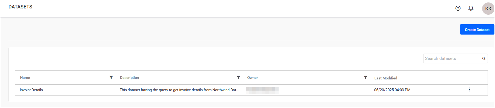

## How do I create a dataset?

You can create a dataset in Report Server only if you have the `Create All Datasets` permission.

### Steps to create a dataset

You can create datasets in the following ways:
1. Add a dataset from the `+` icon.
2. Add a dataset from the dataset listing page.

#### Add dataset from Menu

* Click the `+` button in the left side menu and choose `Create Dataset` to add a dataset.
    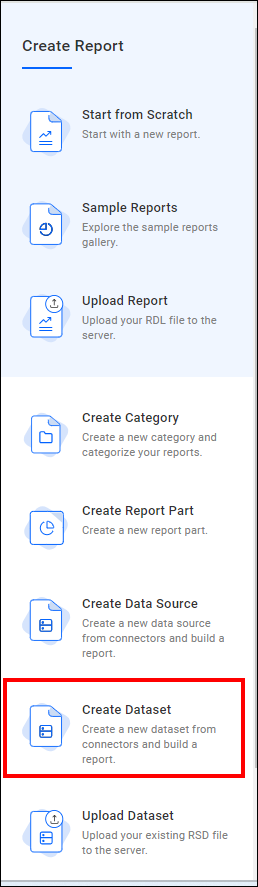

#### Add dataset from Dataset listing page

* Click **Dataset** in the left side panel of the Report Server. If no datasets are listed, click the **Create my first Dataset** button. Otherwise, click the **Create Dataset** button.
   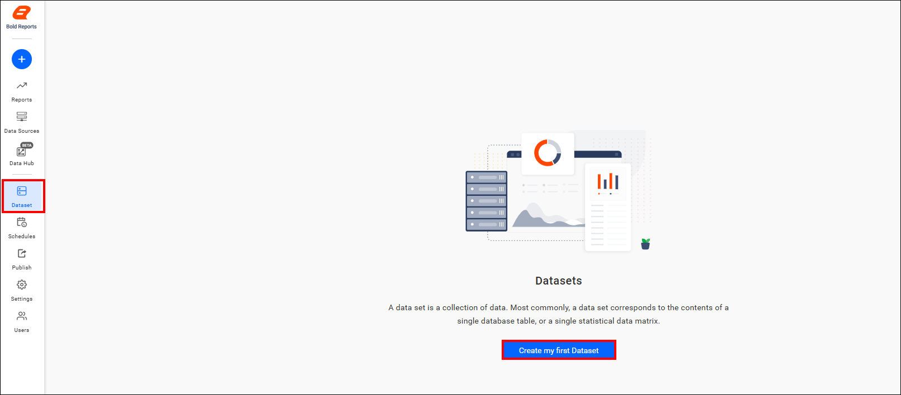

* A dataset requires a data source, which can be a new or an existing data source. For more information, see [Create a new data source](./../data-sources-management/#create-new-datasource).

    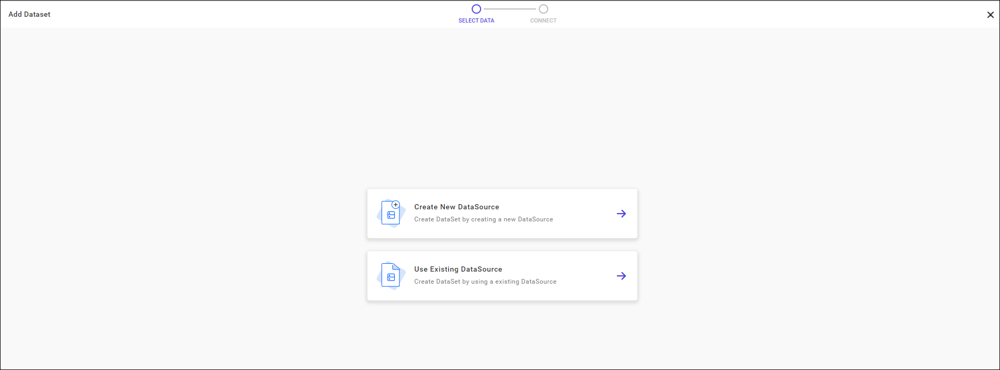

    > `Read Write Delete` permission for that `Specific Dataset` is added for the user who created the dataset.

## Add or upload dataset

You can upload an existing `.rsd` dataset file to Bold Reports® Report Server from the `+` menu.

1. Click the `+` icon in the left side menu and choose `Upload Dataset`.
    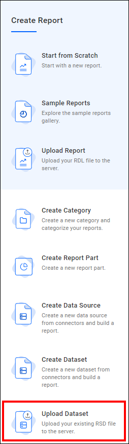

2. Enter the name and description of the dataset.

3. Click `Browse` and select the `.rsd` file to upload.
    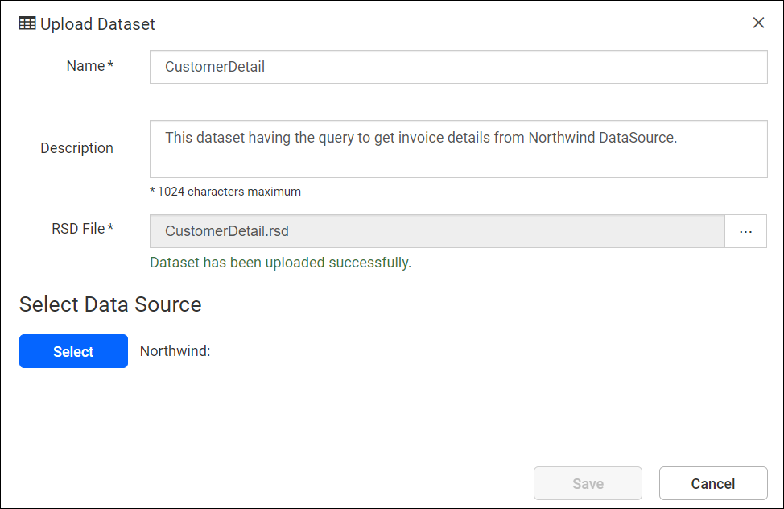

    > If you leave the name field blank, the system auto-populates it with the name of the uploaded `.rsd` file.

4. Select the `Data Source`. In the select data source dialog, either choose a data source from the Report Server or create a new data source.
    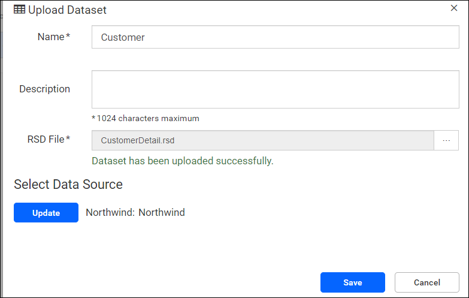

5. Click the `Save` option. The dataset is uploaded to Bold Reports® On-Premise and displayed in the list.
    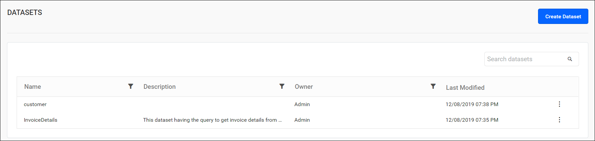

    > `Read, Write, and Delete` permissions for that `Specific Dataset` are granted to the user who created it.

## How do I create a report from a dataset?

To create a new report from a dataset in Report Server, click the `Actions` button in the dataset grid context menu and select `Create Reports`.
    

## How do I create a report part from a dataset?

To create a new report part from a dataset in Report Server, click the `Actions` button in the dataset grid context menu and select `Create Report Part`.
    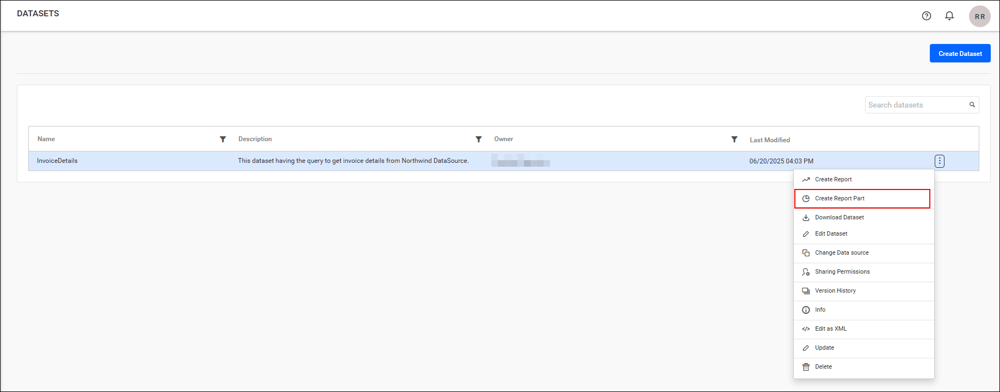

## How do I download a dataset?

To download a dataset from Report Server as a `.rsd file`, click the Actions menu button in the dataset grid's context menu and select `Download Dataset`.
    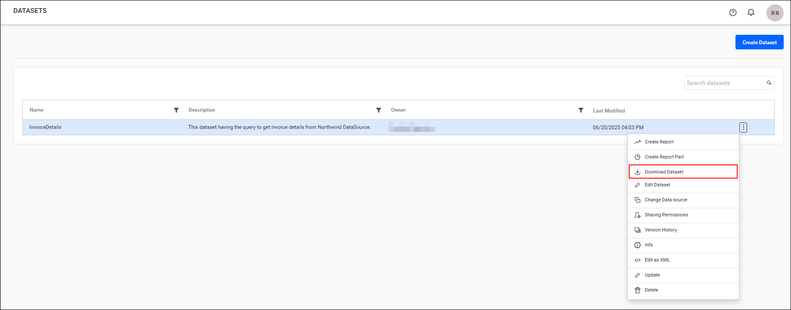

## How do I edit a dataset?

To edit a dataset in Report Server, click the `Actions` menu button in the dataset grid context menu and select `Edit Dataset`.
    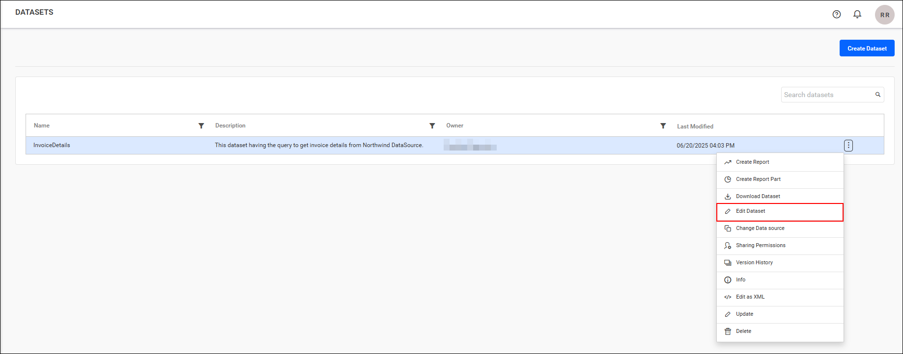

## How do I change the data source of a dataset?

You can change the data source for a dataset that you already created in Report Server.

### Steps to change data source

1. Select the `Change data source` option from the dataset grid context menu.
    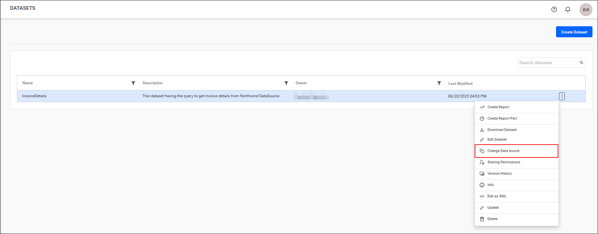

2. Enter the name of the dataset.

3. Enable the **Overwrite** option to overwrite the existing dataset.
    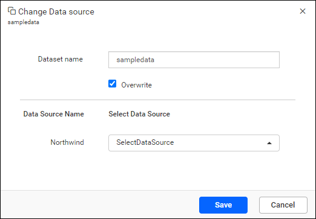

4. Select the new data source from the dropdown menu, then click the `Save` button.
    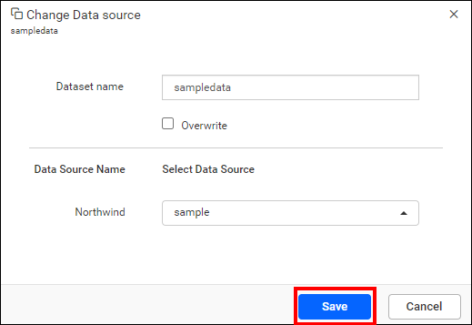

## How do I share a dataset?

You can share a dataset with other users on the Report Server by setting sharing permissions.

### Steps to share a dataset

1. Click the `Actions` menu button in the dataset grid context menu and select the `Sharing Permissions` option.
    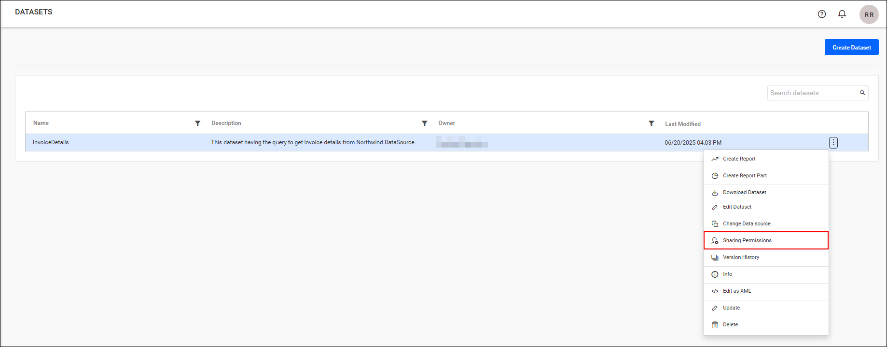

2. Click the `Manage Access` button.
    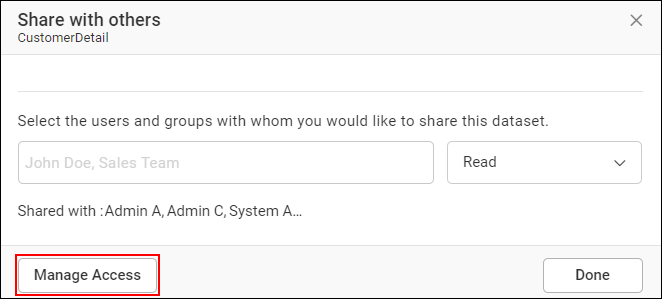

3. Select the permission access and the users or groups to share the dataset with.
4. Click the `Add` button.
    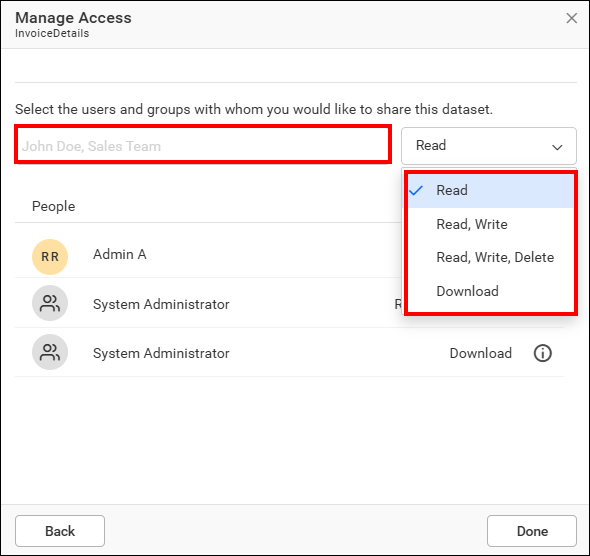
    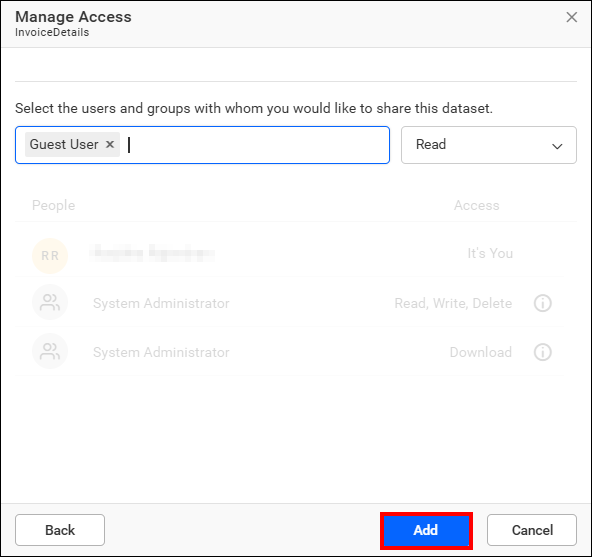
    > Only users who have share permission can share the dataset with other Report Server users.

### How do I remove dataset permission?

A Report Server user with specific permissions can remove the shared dataset permissions by using the `Remove` option in the `Access` column.
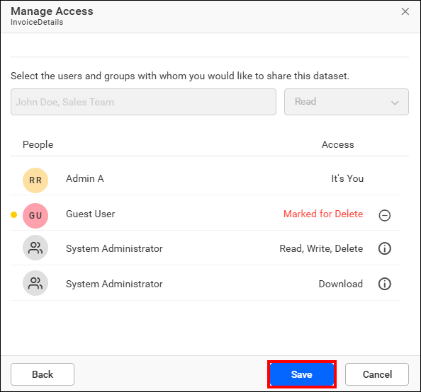

## Version history

The Report Server keeps versions and file logs for each dataset, capturing every change made to the dataset. To access this information, click the grid context menu and select the `Version History` option.
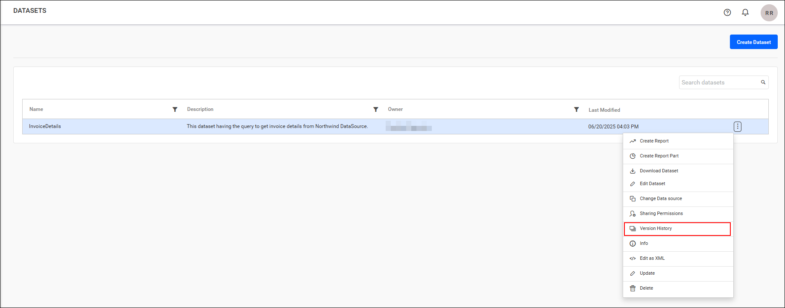

### Versions

Report Server creates a new version for each change in the `.rsd` file, so you can open every version individually.
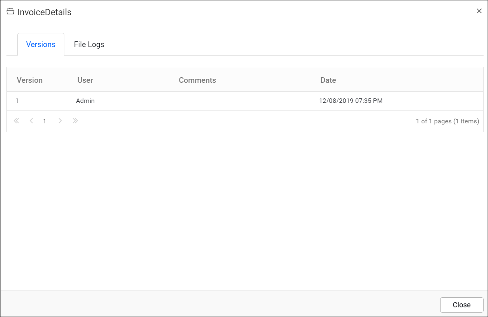

### File logs

Report Server file logs track each change made to the dataset, including alterations in the event, user, and date.
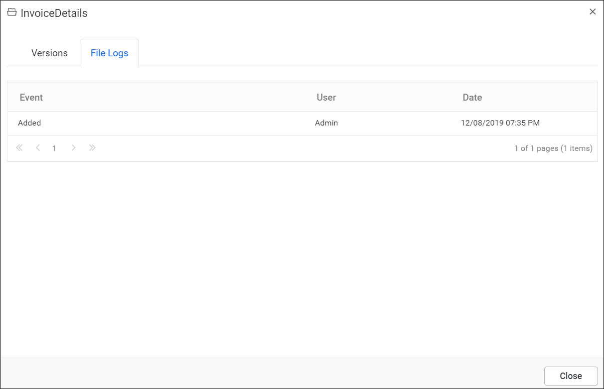

### Info

The `Info` option in Report Server shows the details and linked reports of a dataset.

1. Click the Actions menu button in the Dataset grid context menu and select `Info`.
    

2. Review the Dataset info. It shows the Dataset Id, Created by, Created on, Last modified by, Last modified on, and Linked Reports.
    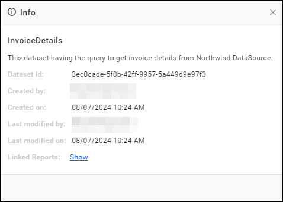

3. Click `Show` to view the linked reports.
    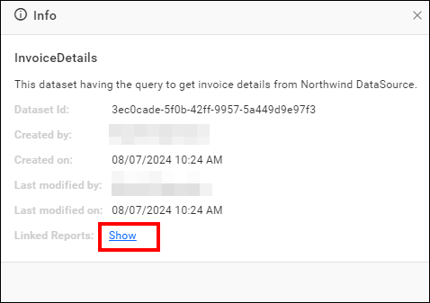
    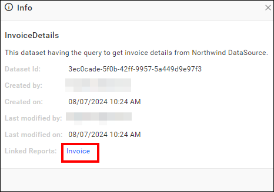

## How do I edit a dataset as XML?

The Report Server XML editor provides a user-friendly interface for making modifications to a dataset. You can change the dataset without downloading it and using a separate text editor.

1. Click the context menu icon in the dataset grid and select `Edit As XML` to edit a dataset.
    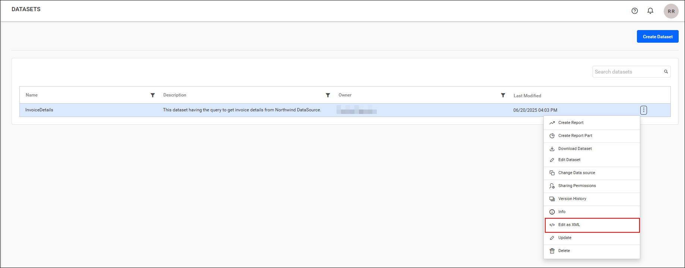

2. Make your modifications in the new tab, where the dataset opens as XML. Save the edited dataset by publishing it from the XML editor.
    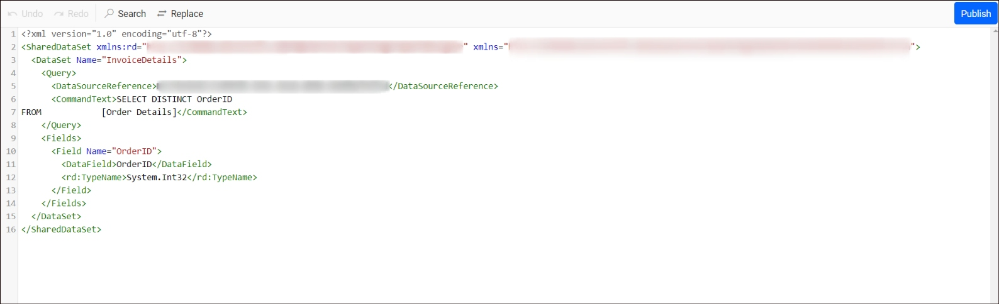

## How do I update a dataset?

You update the details of a dataset in Report Server from the dataset grid context menu.

1. Click the `Actions` menu button in the dataset grid context menu and select `Update Dataset`.
    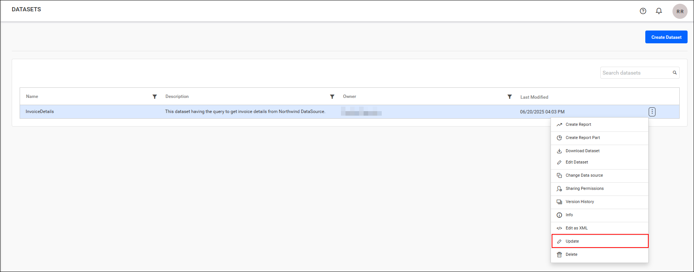

2. Change the name, description, and other required details of the dataset.
3. Click the **Update** option in the update dataset dialog box.

    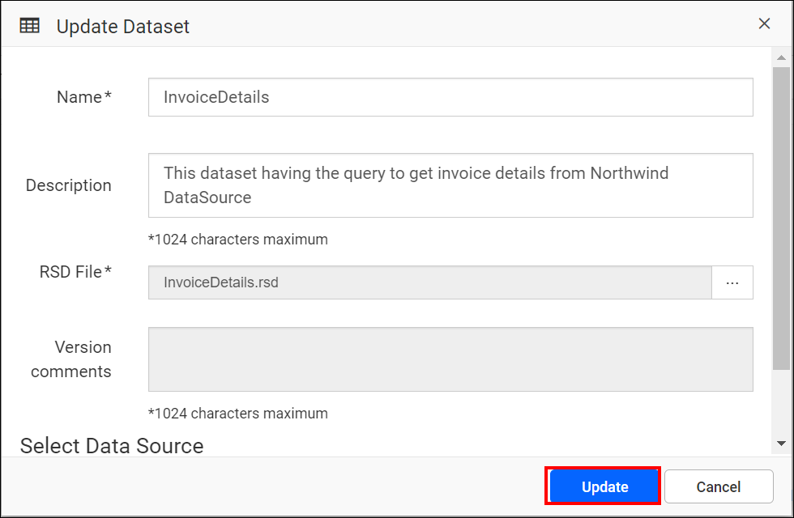

## How do I delete a dataset?

You can delete datasets from the Report Server when they are no longer needed.

To delete a dataset, click the `Actions` menu button in the dataset grid context menu and then select the `Delete` option.

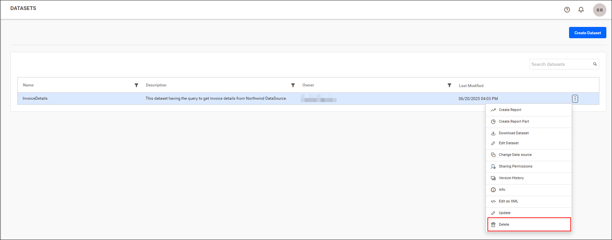

> A dataset cannot be deleted if it is being used by any report.

## REST API Reference

The following table lists the available REST APIs related to datasets in Bold Reports® On-Premises Edition.

<table>
    <tr>
        <th>
            Action
        </th>
        <th>
            HTTP Method
        </th>
        <th>
            Endpoint
        </th>
        <th>
            Description
        </th>
    </tr>
    <tr>
        <td>
            <a href="https://help.boldreports.com/enterprise-reporting/rest-api-reference/v1.0/server-api-reference/#operation/Items_AddDataSet" target="_blank">AddDataset</a>
        </td>
        <td>
            POST
        </td>
        <td>
            /api/site/{tenant-name}/v1.0/reports/datasets
        </td>
        <td>
            Adds a new dataset to the server. Dataset details must be passed as input.
        </td>
    </tr>
    <tr>
        <td>
            <a href="https://help.boldreports.com/enterprise-reporting/rest-api-reference/v1.0/server-api-reference/#operation/Items_UpdateDataSet" target="_blank">UpdateDataset</a>
        </td>
        <td>
            PUT
        </td>
        <td>
            /api/site/{tenant-name}/v1.0/reports/datasets
        </td>
        <td>
            Updates the dataset on the server. Updated dataset details must be passed as input.
        </td>
    </tr>  
        <tr>
        <td>
            <a href="https://help.boldreports.com/enterprise-reporting/rest-api-reference/v1.0/server-api-reference/#operation/Items_GetItems" target="_blank">GetDataSets</a>
        </td>
        <td>
            GET
        </td>
        <td>
            /api/site/{tenant-name}/v1.0/items
        </td>
        <td>
            Returns the list of datasets for the current user. ItemType should be dataset.
        </td>
    </tr>
        <tr>
        <td>
            <a href="https://help.boldreports.com/enterprise-reporting/rest-api-reference/v1.0/server-api-reference/#operation/Items_GetItemLocation" target="_blank">GetDataSetLocation</a>
        </td>
        <td>
            GET
        </td>
        <td>
           /api/site/{tenant-name}/v1.0/items/{itemId}/location
        </td>
        <td>
            Returns the item location of the specified dataset. A specific DataSet ID should be passed as a path parameter.
        </td>
    </tr>
    <tr>
        <td>
            <a href="https://help.boldreports.com/enterprise-reporting/rest-api-reference/v1.0/server-api-reference/#operation/Items_IsItemNameExists" target="_blank">IsDataSetNameExists</a>
        </td>
        <td>
            POST
        </td>
        <td>
            /api/site/{tenant-name}/v1.0/items/is-name-exists
        </td>
        <td>
            Returns an item's existence, whether the given dataset name already exists or not on the server. Dataset name and ItemType as DataSet should be passed in the request body.
        </td>
    </tr>
    <tr>
        <td>
            <a href="https://help.boldreports.com/enterprise-reporting/rest-api-reference/v1.0/server-api-reference/#operation/Items_GetItemDetail" target="_blank">GetDataSetDetail</a>
        </td>
        <td>
            GET
        </td>
        <td>
            /api/site/{tenant-name}/v1.0/items/{id}
        </td>
        <td>
            Returns the specified dataset details from the server. The dataset item ID should be passed as a path parameter.
        </td>
    </tr>
        <tr>
        <td>
            <a href="https://help.boldreports.com/enterprise-reporting/rest-api-reference/v1.0/server-api-reference/#operation/Items_DeleteItem" target="_blank">DeleteDataSet</a>
        </td>
        <td>
            DELETE
        </td>
        <td>
            /api/site/{tenant-name}/v1.0/items/{id}
        </td>
        <td>
            Deletes the specified dataset from the server. DataSet item ID should be passed as a path parameter.
        </td>
    </tr>
</table>

## Frequently asked questions

### Which permission do I need to create a dataset?

You need the `Create All Datasets` permission to create a dataset in the Report Server.

### What file type does Report Server use for datasets?

Report Server uploads and downloads datasets as `.rsd` files.

### Can I delete a dataset that a report uses?

No. A dataset cannot be deleted if it is being used by any report.

## See also

* [Data sources management](./../data-sources-management/)
* [Report part](./../report-part/)
* [Create a report](./../reports/create-report/)
