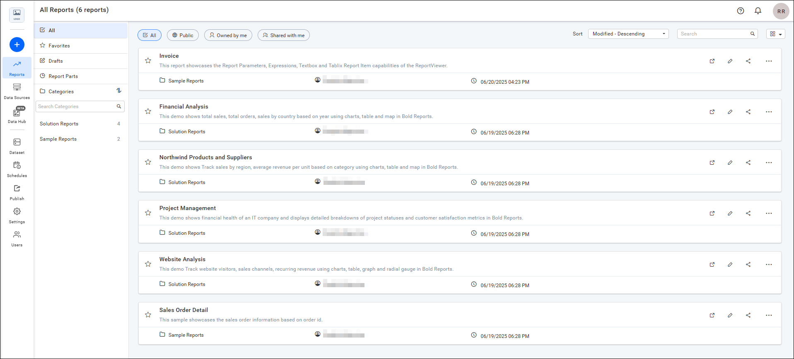
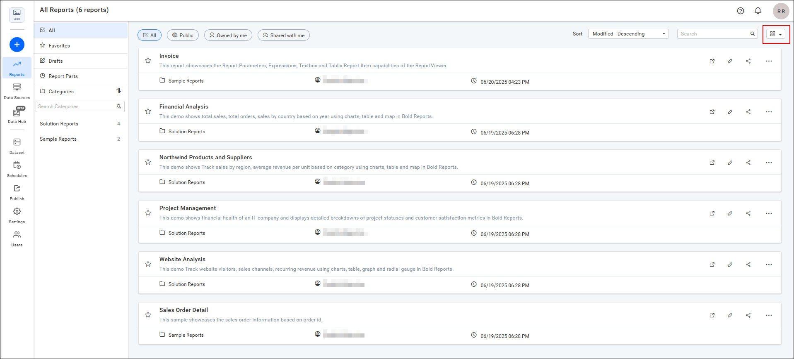
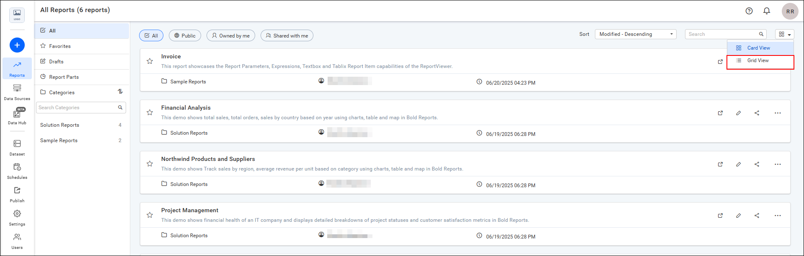
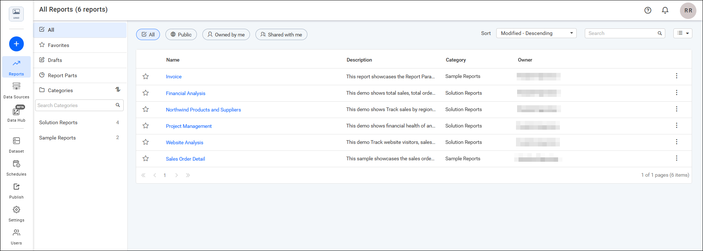

# Change the report layout in {{site.productNameTM}} Report Server

In the {{site.productNameTM}} Report Server, you can switch the report listing page from the default card view to a grid view.

## How do I switch the report listing to grid view?

You switch the Report Server report listing page to grid view from the layout menu.

1. Review the standard card view. The following image shows the default card view on the Report Server.

    

2. Navigate to the top-right corner of the page to change the layout of the report listing page to the grid view.

    

3. Select `Grid View` from the dropdown menu.

    

The report listing page then shows the reports in grid view.

## See also

* [Manage reports](./../reports/)
* [Report parts](./../report-part/)
* [Manage datasets](./../dataset-management/)
