# Create report parts in {{site.productNameTM}} Report Server

You can create `Report Parts` directly from the {{site.productNameTM}} Report Server and manage published Report Parts with the available options.

## How do I create and manage a report part?

You create a report part in Report Server from the `+` menu, design it in the Web Report Designer, and then publish it.

1. Click the `+` icon in the left menu and then select `Create Report Part`.
    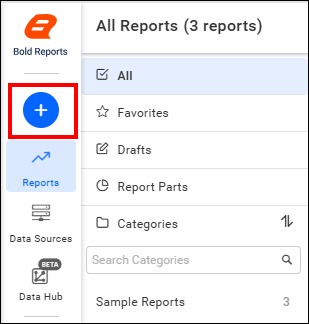
    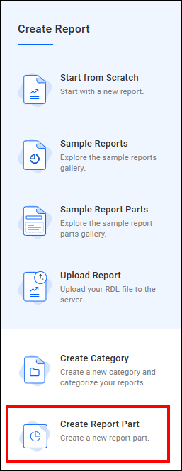

2. Enter the report part name and then click the `Add and Design` button.
    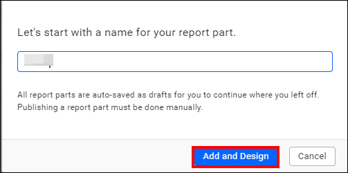

3. Design and customize report items such as tables, charts, maps, indicators, and other elements in the Web Report Designer page that opens.

4. After you complete the design of your report elements, click the `Publish` option.
    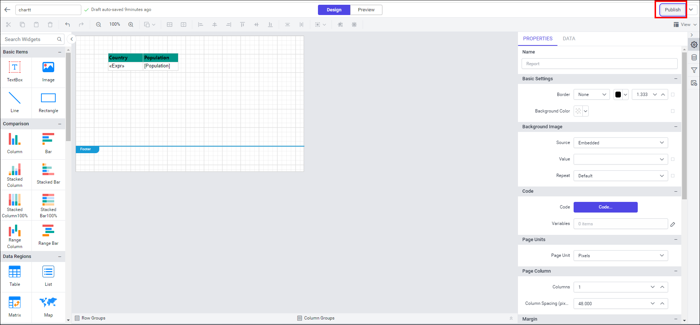
    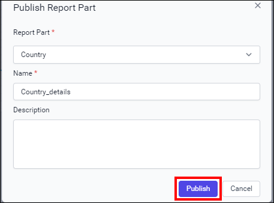

5. View published report parts under the `Report Parts` section.
    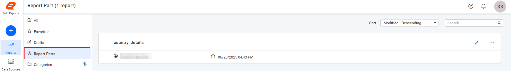

6. Choose the `Edit` icon to edit the report part.
    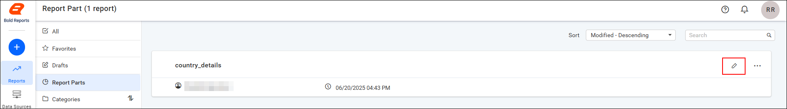

7. To view the Report Part Info, click `Info` in the menu.
    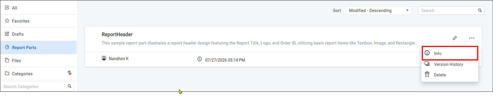

    Report Part Info provides information about the Report Part id, Report Part Type, Created by, Created on, Last modified by, Last modified on, and Linked Reports.

    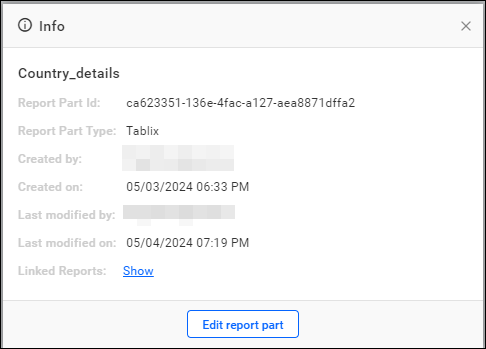

8. To view the version history, click `Version History` in the menu.
    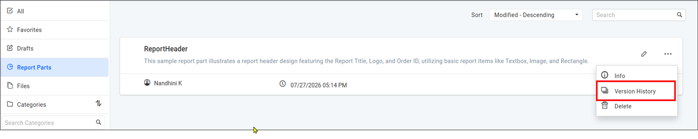

    The Version History dialog displays all available versions of the selected report part along with the version details.
    The latest version includes only the `Edit` option, while previous versions provide both `Edit` and `Restore` options.

    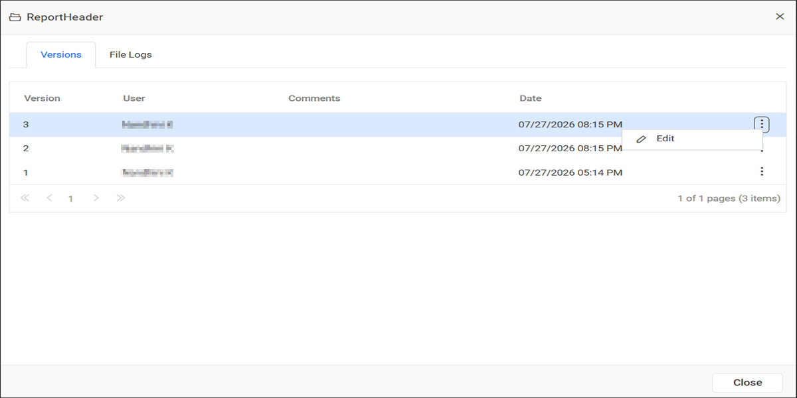

    To restore a previous version, click `Restore` from the corresponding version menu.

    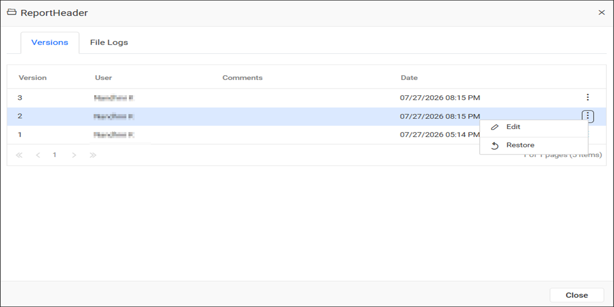

    The File Logs tab displays the history of changes made to the report part. The Report Server records details such as the event, user, and date for each modification.

    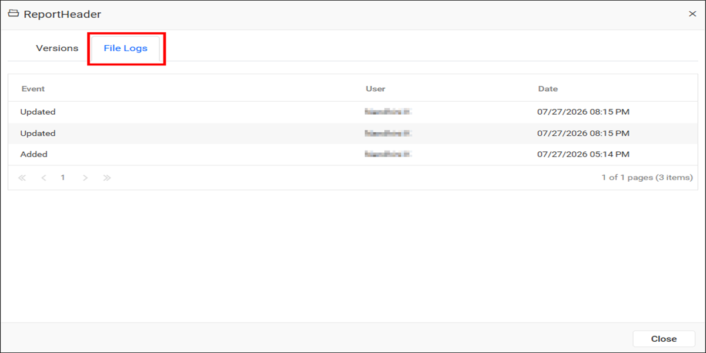

9. Choose the delete option to delete the report part.
    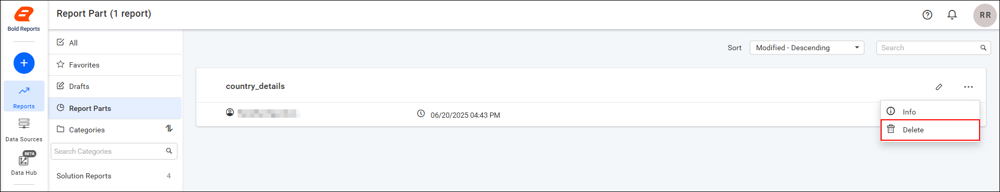

   > **Note:** To learn more, see [Report Parts in the Web Report Designer](../../report-designer/report-parts/).

## Where are draft report parts saved?

Report Server keeps unpublished report parts under the `Report Parts` category in the `Drafts` section.

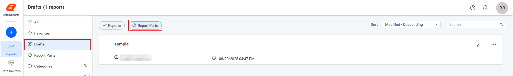

## Frequently asked questions

### Can I restore an earlier version of a report part?

Yes. Previous versions provide both `Edit` and `Restore` options, and you click `Restore` from the corresponding version menu.

### What does Report Part Info show?

Report Part Info shows the Report Part id, Report Part Type, Created by, Created on, Last modified by, Last modified on, and Linked Reports.

## See also

* [Report Parts in the Web Report Designer](../../report-designer/report-parts/)
* [Manage datasets](./../dataset-management/)
* [Manage reports](./../reports/)
