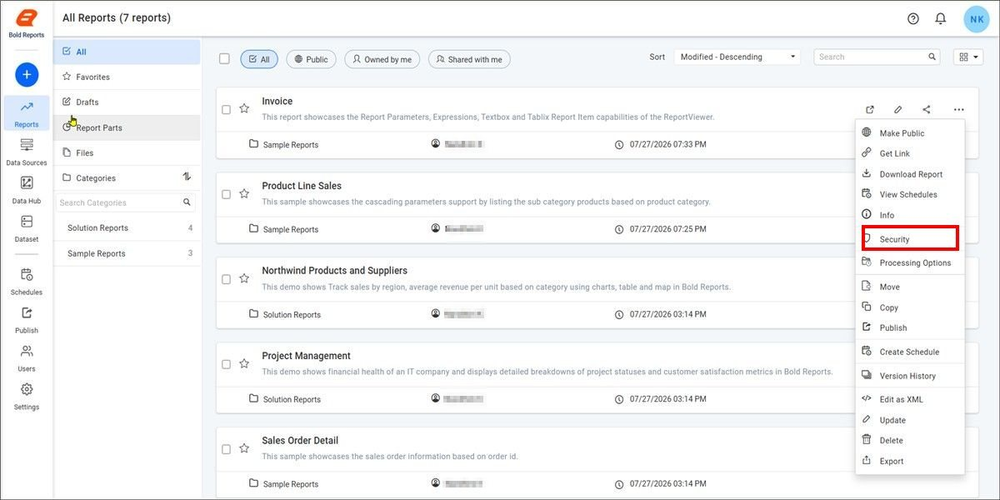
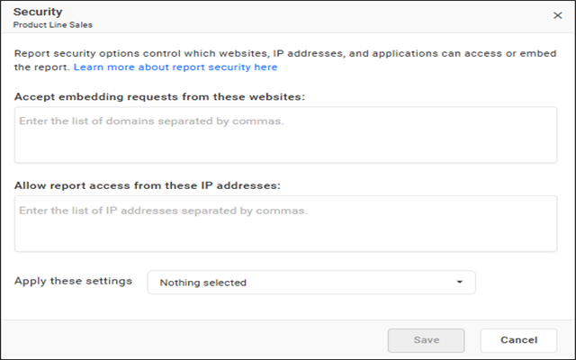
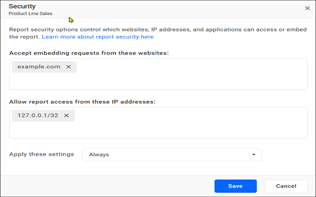
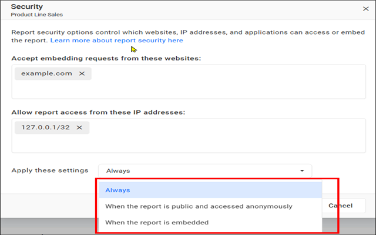
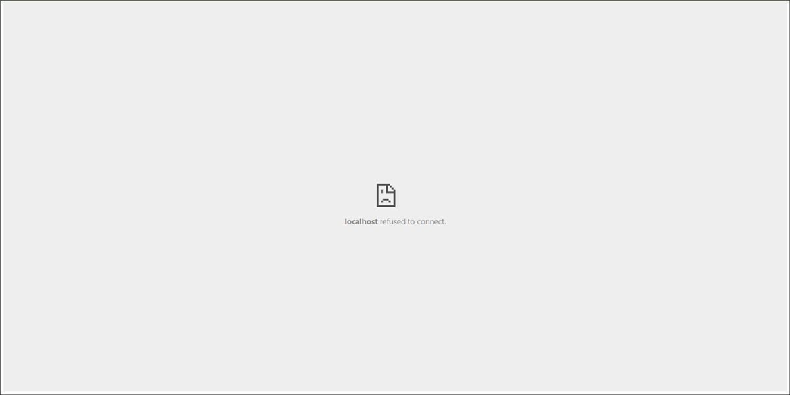
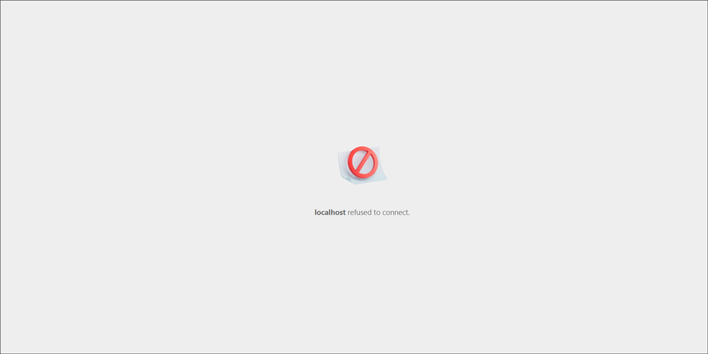
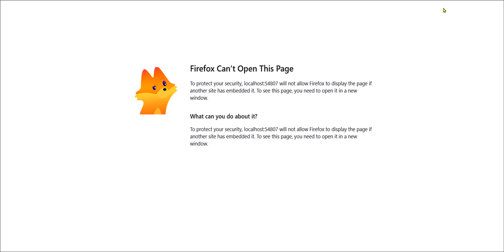
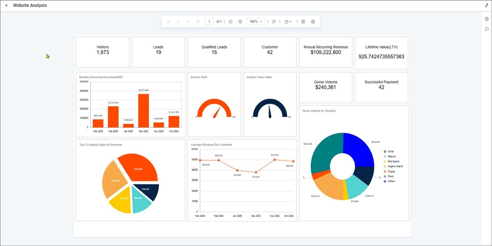
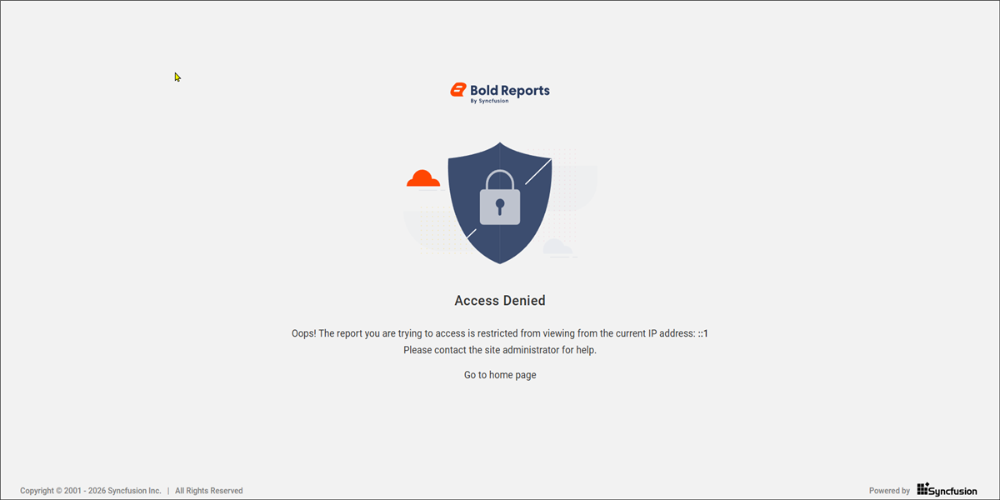

# Advanced Report Security

In Bold Reports®, report security options control which websites, IP addresses, and applications can access or embed the report. These settings ensure that reports are accessible only to authorized users.

You can restrict report access based on IP address and allow the report to be embedded in a specific domain.

## How do I update report security settings?

You update Bold Reports® report security settings from the `Security` option in the Reports context menu.

1. Click the Reports context menu and select `Security` to update security settings.

    

2. Review the security settings dialog. You specify the domains allowed for report embedding and the IP addresses or IP ranges allowed to access the report.

    

3. Specify the IP addresses or ranges you want to allow for report access, and specify the domains you want to allow the reports to be embedded in.

    

## When are these settings applied?

Bold Reports® can apply the report security restrictions in three ways.

   

### Always

The `Always` option applies the restriction to Private, Public, and Embed reports.

For example, specify the IP address that needs to be allowed in the `Allow report access from these IP addresses` field and choose `always` from the dropdown.

In this case, users can view the report based on the specified IP address in the `Allow report access from these IP addresses` field.

* The report can be viewed from the allowed IP addresses.
* An Access Denied message is shown for requests from an IP address not mentioned in the `Allow report access from these IP addresses`.

For embedded scenarios, specify the domains in the `Accept embedding requests from these websites` field.

* The Embedded reports are accessible from allowed domains.
* Access is blocked for other domains.

### When the report is public and accessed anonymously

The `When the report is public and accessed anonymously` option applies the restriction only to public reports accessed anonymously (without login).

For example, specify the IP address that needs to be allowed in the `Allow report access from these IP addresses` field and choose `When the report is public and accessed anonymously` from the dropdown.

In this case, users can view the public report anonymously based on the specified IP address in the `Allow report access from these IP addresses`. Private reports and public reports viewed with login are not affected.

* The public report accessed anonymously can be viewed from the allowed IP addresses.
* An Access Denied message is shown for requests from an IP address not mentioned in the `Allow report access from these IP addresses`.

### When the report is embedded

The `When the report is embedded` option applies the restriction only to embedded reports.

For example, specify the domain in the `Accept embedding requests from these websites` field where the report should be embedded and choose `When the report is embedded` from the dropdown.

In this case, the report can be embedded in the specified domains in the `Accept embedding requests from these websites`.

* The reports embedded in the allowed domain can be viewed.
* The browser blocks the viewing of embedded reports for domains not mentioned in the `Accept embedding requests from these websites`.

> **Note:** Ensure that you use a valid HTTPS URL. The following are examples of valid URLs for embedded reports: `example.com`, `data.com`, `127.0.0.1`, `121.1.0.11`.

## What happens when access is blocked?

Bold Reports® displays a blocked message if the report is embedded from domains other than those specified.

The blocked message may vary depending on the browser used.

* Google Chrome
    
* Microsoft Edge
    
* Firefox
    

When the report is viewed from the allowed IP address, the report renders successfully.

   

When the report is viewed from the restricted IP address, an access denied message appears.

   

## Frequently asked questions

### Which URLs are valid for embedded reports?

Use a valid HTTPS URL. Examples of valid URLs are `example.com`, `data.com`, `127.0.0.1`, and `121.1.0.11`.

### Does the anonymous public option affect private reports?

No. The `When the report is public and accessed anonymously` option applies only to public reports accessed without login.

## See also

* [Public report](./../public-report/)
* [Share report](./../share-report/)
* [Report info](https://help.boldreports.com/enterprise-reporting/designer-guide/manage-content/reports/report-info/)
