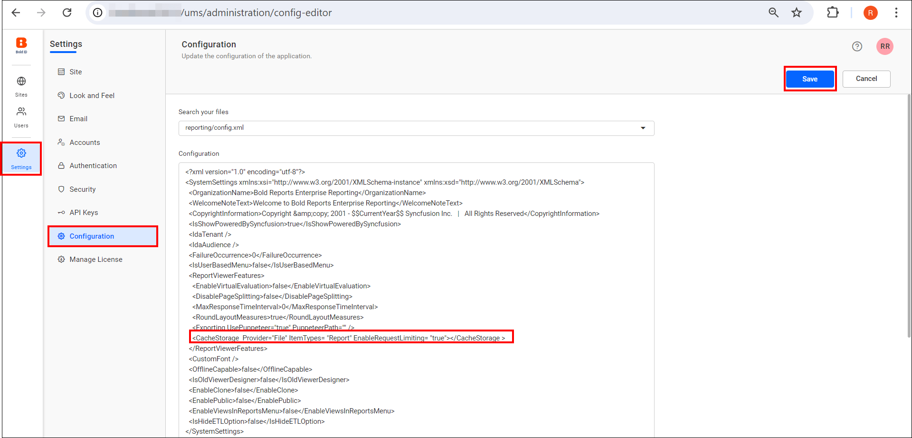
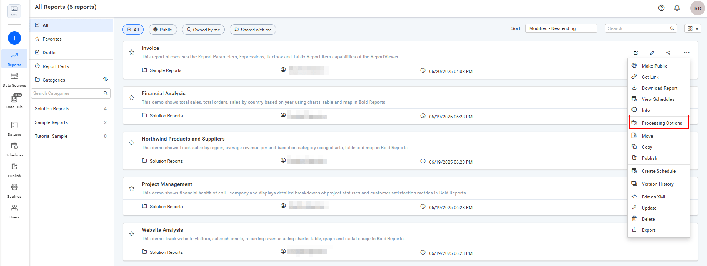
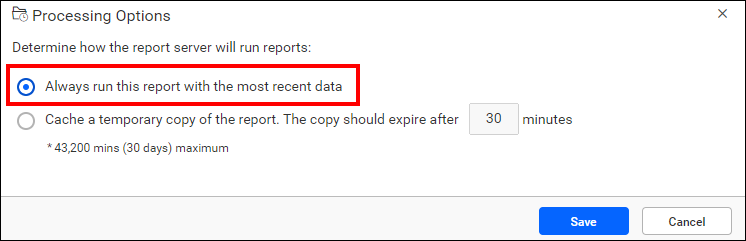
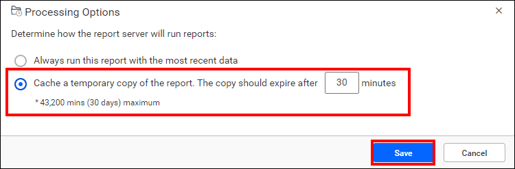

# Cache reports in {{site.productNameTM}} Report Server

The Caching Report Option in the {{site.productNameTM}} Report Server returns a cached copy of a processed report when a user opens it.

## How do I enable report caching?

You enable Report Server caching by adding a `CacheStorage` node to the reporting configuration file.

* Go to the UMS Settings page -> Configuration -> reporting/config.xml, add the following node inside the `<ReportViewerFeatures>` as shown in the screenshot, and save the changes. The processing option works only if this node is present.

   ```sh
   <CacheStorage  Provider="File" ItemTypes= "Report" EnableRequestLimiting= "true"></CacheStorage >
   ```

   

## Why should I cache a report?

{{site.productNameTM}} Report Server can cache a copy of a processed report and return that copy when a user opens the report.

* Caching can shorten the time required to retrieve a report if the report is large or accessed frequently.
* To process the report, click the Actions button in the Reports grid context menu and select Processing Options.
   

## Which processing options are available?

Report Server offers two options in the Report Processing Options.
* Always run this report with the most recent data.
* Cache a temporary copy of the report.

## Always run this report with the most recent data

The `Always run this report with the most recent data` option in Report Server keeps the report data up to date when the user selects the report. If a cached copy of the report is available, Report Server returns it to the user. Otherwise, Report Server retrieves the data and renders the report at the time of selection.

   

To enhance efficiency, Report Server can temporarily cache a report and its associated data when a user generates it. This cache is cleared if the user closes the report tab or opens the same report in a new tab.

**Functionality**:
* Treats each user's view uniquely, even if the report parameters are the same.
* Maintains strict data privacy and security.
* Cached data is not shared between users, preventing accidental data exposure.
* Ensures personalized and efficient report delivery.

  **Example Scenario**:
* User 1: run the report in 9:00 AM with parameter value - Bikes → Cached as Cache Item1.
* User 2: run the report in 9:05 AM with parameter value - Clothes → Cached as Cache Item2.
* User 3: run the report in 9:10 AM with parameter value - Bikes → Cached as Cache Item3.

### Cache a temporary copy of the report

The `Cache a temporary copy of the report` option in Report Server caches a report and its data when a user generates it, and shares that cached version with other users who request the same report. Only the initial request triggers report processing, while later users access the cached version. For instance, if 10 users open the report, only the first request processes the report, and the remaining nine users view the cached copy.

Report Server automatically clears cached reports based on intervals you define. You can set these intervals in minutes or schedule a specific date and time to clear the cache.

   

  **Functionality**:
* When a report is run for the first time with specific parameters, the output is stored in the cache.
* If another user requests the same report with identical parameters within the cache's time limit, the stored cache report is served.
* This approach reduces data processing and loading times for subsequent identical requests.

  **Example Scenario**:
* User 1: run the report in 9:00 AM with parameter value - Bikes → Cached as Cache Item1.
* User 2: run the report in 9:05 AM with parameter value - Clothes → Cached as Cache Item2.
* User 3: run the report in 9:10 AM with parameter value - Bikes → Retrieved from Cache Item1 (No new cache created).

## What is the difference between common cache and instance cache?

Report Server common cache shares cached data among users, while instance cache keeps each user's cached data separate.

### Key Differences

1. **Data Sharing:**
   * Common Cache: Shares cached data among users with identical parameters.
   * Instance Cache: Does not share cached data between users, even with identical parameters.

2. **Security:**
   * Common Cache: Suitable for reports without user-specific data filters.
   * Instance Cache: Ensures data privacy for reports with user-specific filters or row-level security.

3. **Efficiency:**
   * Common Cache: More efficient for frequently requested reports with common parameters.
   * Instance Cache: Balances personalization and efficiency for user-specific reports.

## What are the limits of a shared cache?

Report Server cannot share a report cache in the following cases.

> **Note:**
> * A report cache cannot be shared if it includes user-specific data and user based expression, row level security, prompts for credentials, or relies on Windows Authentication.
> * Drill down and drill through reports aren't supported in shared cache.

## Frequently asked questions

### When is the cache cleared for the most recent data option?

The cache is cleared if the user closes the report tab or opens the same report in a new tab.

### Are drill down reports supported in a shared cache?

No. Drill down and drill through reports aren't supported in shared cache.

## See also

* [View a report](./../view-report/)
* [Edit a report](./../edit-report/)
* [Advanced report security](./../advanced-report-security/)
