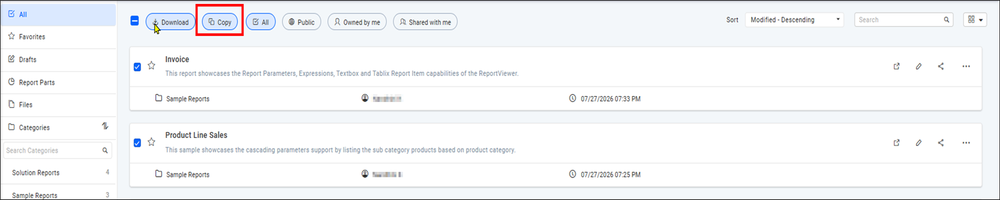
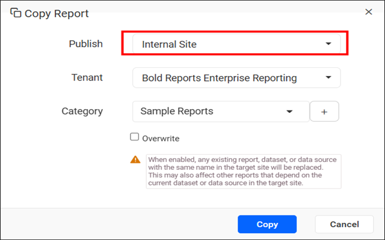
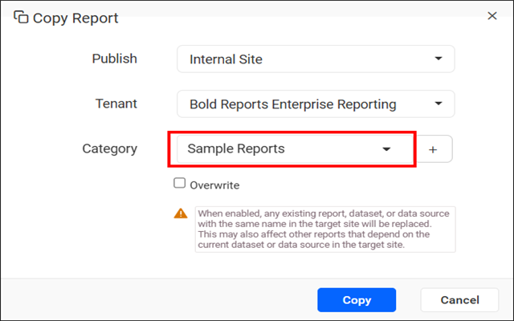
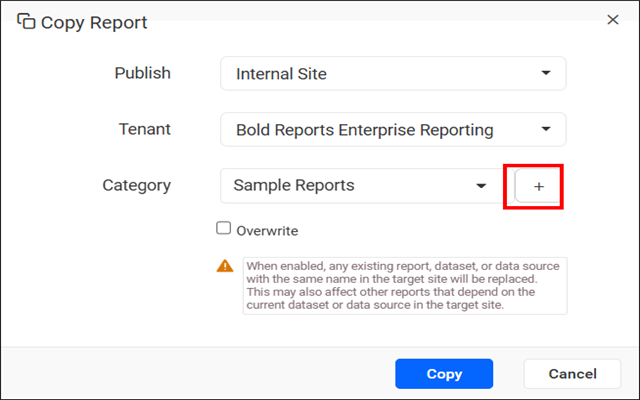
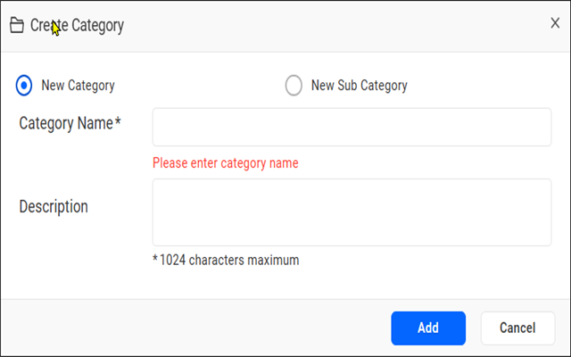
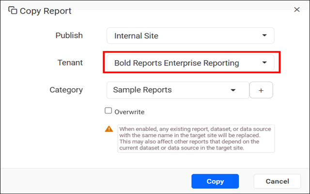

# Copy Multiple Reports using Multi-Select Option from {{site.productNameTM}} Report Server

You can copy multiple reports at once in {{site.productNameTM}} On-Premises Edition by selecting them with the multi-select checkboxes.

## How do I copy multiple reports at once?

You copy several reports at once in {{site.productNameTM}} Report Server by selecting them and using the `Copy` option in the toolbar.

1. Select the reports you want to copy by using the multi-select checkboxes.
    > **Note:** Select multiple reports using the checkboxes displayed next to each report. After you select the required reports, the `Copy` option becomes available in the toolbar, so you can copy the selected reports simultaneously.

2. Click the `Copy` button located near the `All` option to copy the selected reports.
    

3. Select the site type where the report should be copied by choosing either `Internal Site` or `External Site`.
    

4. Select the target category to copy the report from one category to another.
    

    To create a new category while copying a report, click the `+` button next to the **Category** field.
    
    

    > **Note:** When multiple tenants are selected, the **Category** list and the option to create a new category are not displayed. In this case, enter the category name manually. If the specified category already exists in the selected tenants, the reports are copied to that category. If the category does not exist, a new category is created automatically in the selected tenants.

    > **Note:** When the `Overwrite` option is enabled, any existing report, dataset, or data source with the same name in the target site is replaced. This may affect other reports that depend on the existing dataset or data source in the target site.

5. Copy the report to one or more tenants by selecting the required tenants from the `Tenant` list.
    

    > **Note:** When multiple reports are selected, the `Report Name` field and the `Advanced` option are not available. These options are applicable only when copying a single report.

    > This option is available on {{site.productNameTM}} On-Premises Edition from version `14.1.12` onwards.

## Frequently asked questions

### Which version supports copying multiple reports?

Copying multiple reports is available on {{site.productNameTM}} On-Premises Edition from version `14.1.12` onwards.

### Can I rename reports when I copy several at once?

No. When multiple reports are selected, the `Report Name` field and the `Advanced` option are not available.

## See also

* [Move, copy, and clone reports](./../move-copy-and-clone-reports/)
* [Download multiple reports](./../download-multiple-reports/)
* [Manage categories](./../../../manage-categories/)
