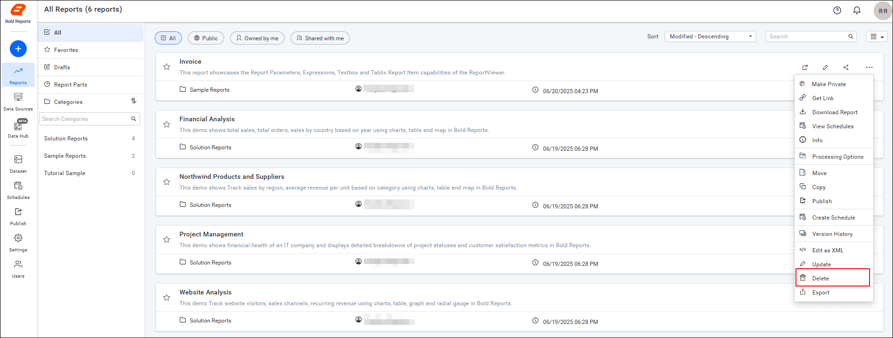
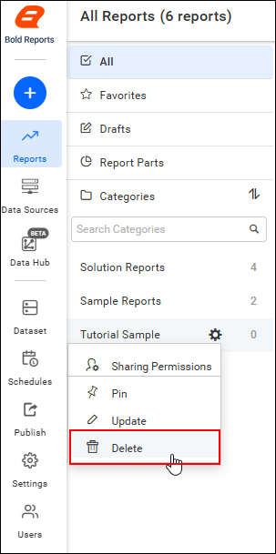

# Delete reports from Bold Reports® Report Server

You can delete reports individually or delete multiple reports from Bold Reports® On-Premises Edition. You can also delete reports from the Report Server when they are no longer required.

## How do I delete a report?

To delete a report from Report Server, click the **Delete** option in the report's context menu.

> Reports cannot be deleted when they are scheduled by a user.

## Delete All Sample Reports

You can delete all Bold Reports® sample reports at once by removing their category.

Click the **Delete** option in the context menu to delete all sample reports as well as the sample category.

> **Note:** If the sample category contains any modified sample reports, scheduled reports, or newly added reports, those reports are skipped, and the category is not deleted.

## REST API Reference

The following table lists the available REST APIs related to deleting reports in Bold Reports® On-Premises Edition.

<table>
   <tr>
      <th>
         Action
      </th>
      <th>
         HTTP Method
      </th>
      <th>
         Endpoint
      </th>
      <th>
         Description
      </th>
   </tr>
   <tr>
      <td>
         <a href="https://help.boldreports.com/enterprise-reporting/rest-api-reference/v1.0/server-api-reference/#operation/Items_DeleteItem" target="_blank">DeleteReport</a>
      </td>
      <td>
         DELETE
      </td>
      <td>
          /api/site/{tenant-name}/v1.0/items/{id}
      </td>
      <td>
         Deletes the specified report from the server. Report item ID should be passed in path parameter.
      </td>
   </tr>
</table>

## Frequently asked questions

### Can I delete a scheduled report?

No. Reports cannot be deleted when they are scheduled by a user.

### Why was the sample category not deleted?

If the sample category contains any modified sample reports, scheduled reports, or newly added reports, those reports are skipped and the category is not deleted.

## See also

* [Download a report](./../download-report/)
* [Version history of a report](./../version-history-of-report/)
* [Move, copy, and clone reports](./../move-copy-and-clone-reports/)
