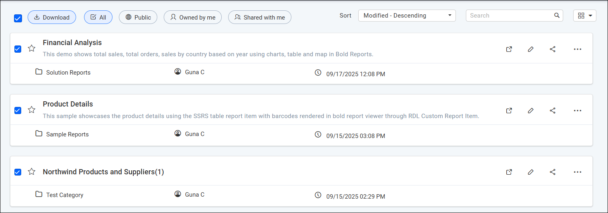

# Download Multiple reports using Multi-Select Option from Bold Reports® Report Server

You can download multiple reports at once in Bold Reports® On-Premises Edition with the multi-select feature.

## How do I download several reports at once?

You download several reports at once in Bold Reports® Report Server by selecting them and clicking `Download`.

1. Select the reports you want to download by checking the multi-select options.
    > **Note:** The multi-select options are checkboxes next to each report and near the `All` option at the top of the report list, so you can select multiple reports.

2. Click the `Download` button, located near `All`, to start downloading the selected reports.
    

    > This option is available on Bold Reports® On-Premises Edition from version `11.1.10` onwards.

## Frequently asked questions

### Which version supports downloading multiple reports?

Downloading multiple reports is available on Bold Reports® On-Premises Edition from version `11.1.10` onwards.

## See also

* [Download a report](./../download-report/)
* [Copy multiple reports](./../copy-multiple-reports/)
* [Upload reports](./../upload-reports/)
