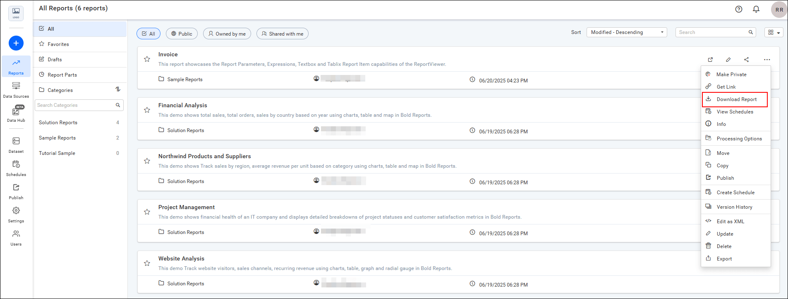

# Download a report from {{site.productNameTM}} Report Server

You can download reports from the {{site.productNameTM}} On-Premises Edition Report Server as RDL files.

## How do I download a report?

To download a report from Report Server in `.rdl` format, click the **Download Report** option in the report's context menu.

> This option is available on {{site.productNameTM}} On-Premises Edition from version `2.2.28` onwards.

## Frequently asked questions

### Which file format does Download Report use?

The **Download Report** option downloads the report in `.rdl` format.

## See also

* [Download multiple reports](https://help.boldreports.com/enterprise-reporting/designer-guide/manage-content/reports/download-multiple-reports/)
* [Upload reports](./../upload-reports/)
* [Share reports with users](./../share-report/)
