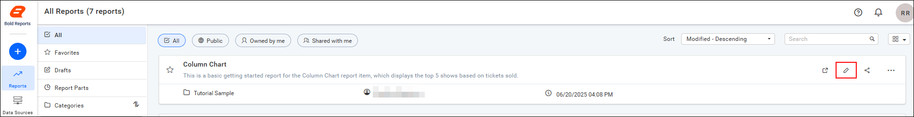
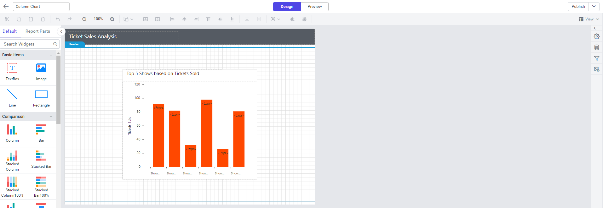
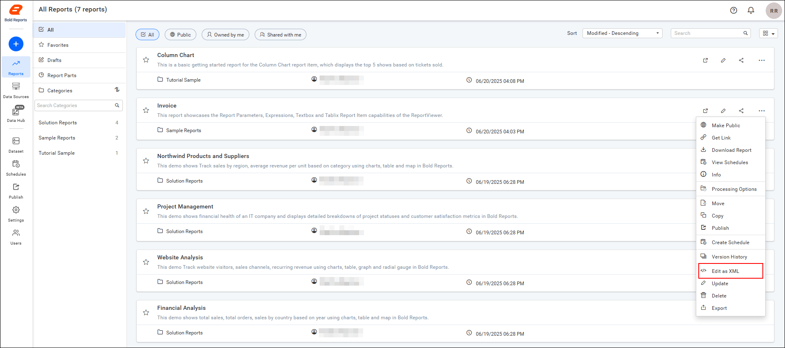
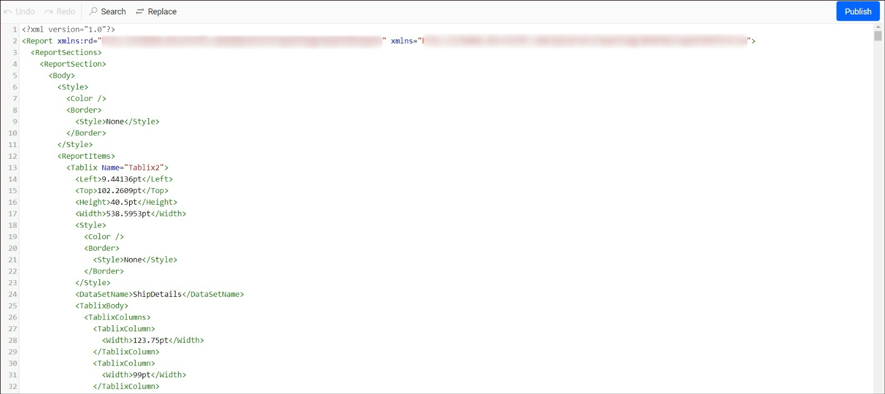

# Edit reports in Bold Reports® Report Server

**Editing a report** opens an existing report from the Bold Reports® Report Server directly in Web Report Designer, or, for direct source-level changes, in an XML editor. You can update its layout, data, or report items without starting over. A report launched for editing keeps its existing data sources, datasets, and permissions.

You can edit a report in two ways: launch it into Web Report Designer for visual editing, or open its underlying XML for direct changes.

## What is report editing?

Report editing modifies a report that's already stored on the Report Server, rather than a local copy you'd need to re-upload. Bold Reports® supports two approaches: launching the report into the full Web Report Designer for drag-and-drop layout and data changes, or opening the report's underlying XML directly for targeted edits without downloading the file or using a separate text editor. Both approaches save changes back to the Report Server when published.

### What can I do with report editing?

With Bold Reports® report editing, you can:

* Open any report you have permission to edit directly from the report listing page.
* Modify layout, data bindings, parameters, and report items using the full Web Report Designer.
* Make direct changes to a report's XML definition without downloading it.
* Publish edits back to the Report Server so other users see the updated report.

## Who should use this guide?

This guide is intended for:

* Report authors updating reports they or others have published.
* Administrators managing or troubleshooting edit permissions.
* Developers comfortable editing RDL XML directly for targeted fixes.

## What do I need first?

Before you edit a report in Bold Reports® Report Server, make sure you have:

* Permission from your administrator to edit the report.
* Familiarity with Web Report Designer for visual edits, or with RDL XML structure for direct XML edits.

No additional server-side setup is required beyond having edit permission.

## Steps to edit a report

You edit a Report Server report either in Web Report Designer or as XML.

### Edit in Web Report Designer

You open a Report Server report in Web Report Designer from the `Edit` icon on the report listing page.

1. Click the `Edit` icon on the report listing page to open the report in Web Report Designer.
    

2. Make your changes in the designer, where the selected report opens.
    

    > **Note:** Editing an existing report requires permission from your administrator.

### Edit an existing report as XML

The Report Server XML editor provides a straightforward way to modify a report's underlying definition directly on the server, without downloading it or using a separate text editor.

1. Select the `Edit As XML` option from the report's context menu.
    

2. Make your modifications in the new tab, where the report opens as XML. Publish from the XML editor to save your edits.
    

## What are the key features?

Bold Reports® report editing offers the following key features:

* **Launch straight into Web Report Designer**: Open a report from the listing page directly into the full visual designer, without a separate export or import step.
* **Direct XML editing**: Make targeted changes to a report's underlying definition on the server, without downloading the file or using an external editor.
* **Permission-based access**: Editing requires permission granted by an administrator, keeping changes to published reports controlled.
* **Changes saved back to the server**: Whether you edit visually or as XML, publishing writes your changes back to the same report on the Report Server.

## What are common use cases?

Bold Reports® report editing supports the following common use cases:

* **Updating report layout or data after publishing**: Adjust a report's design, data bindings, or parameters after it's already live on the server.
* **Making a quick fix via XML**: Correct a text value, expression, or property directly in the report's XML without opening the full designer.
* **Correcting a report without redesigning it**: Fix an issue in an existing report instead of recreating it from scratch.
* **Reviewing and adjusting reports created by another user**: Open a colleague's published report to make updates, provided you have edit permission.

## What are the limits?

Report editing in Bold Reports® Report Server has the following considerations and limitations:

* Editing a report requires permission granted by an administrator; without it, the `Edit` option isn't available.
* Direct XML edits bypass the visual designer's validation, so review changes carefully before publishing.
* Changes made in the XML editor take effect only after publishing from that editor.

## Frequently asked questions

### Do I need special permission to edit a report?

Yes. Editing an existing report requires permission from your administrator.

### What's the difference between editing in Web Report Designer and editing as XML?

Web Report Designer gives you the full visual, drag-and-drop editing experience. The XML editor lets you make direct changes to the report's underlying definition without opening the designer.

### Can I edit a report without downloading it?

Yes. Both editing methods work directly on the report stored on the Report Server, so you don't need to download the file first.

### How do I save changes made in the XML editor?

Publish the report from the XML editor to save your changes back to the Report Server.

## How do I get help?

If the `Edit` option isn't available for a report, or you run into issues publishing changes, contact your administrator to confirm your permissions. You can also see the following related articles for adjacent report-management tasks.

## Related articles

* [Create Report](../create-report/) if you need to design a new report from scratch instead of editing an existing one.
* [Update Report](../update-report/) to change a report's category, description, or file without opening the designer.
* [Upload Reports](../upload-reports/) to add an already-designed RDL file to the server for editing later.
* [View report](../view-report/) to check how your edits render before sharing the report with others.
