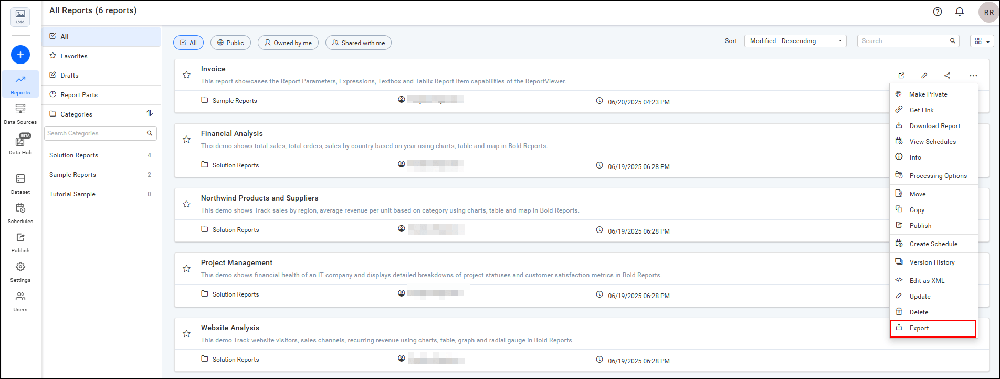
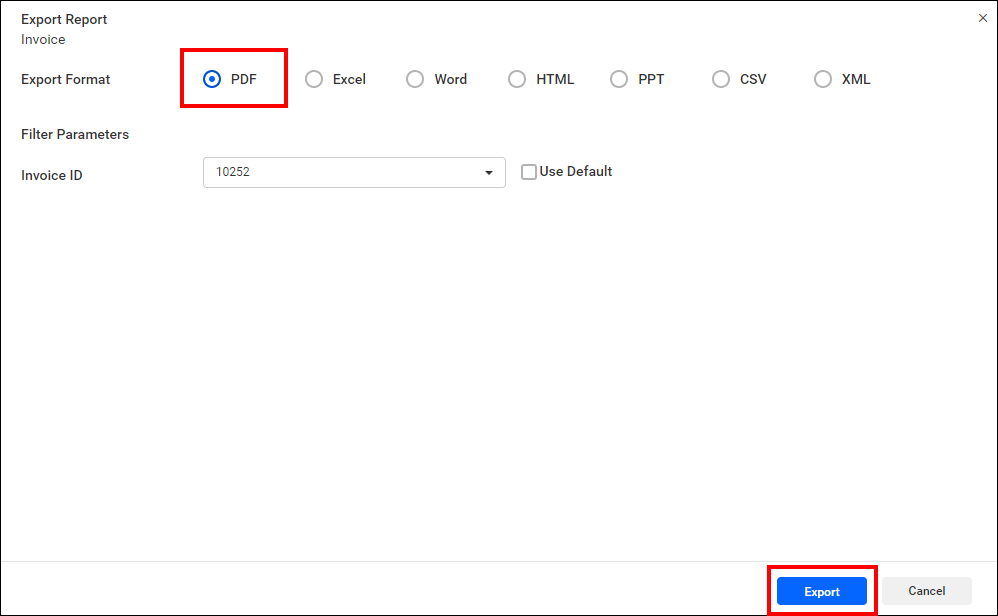
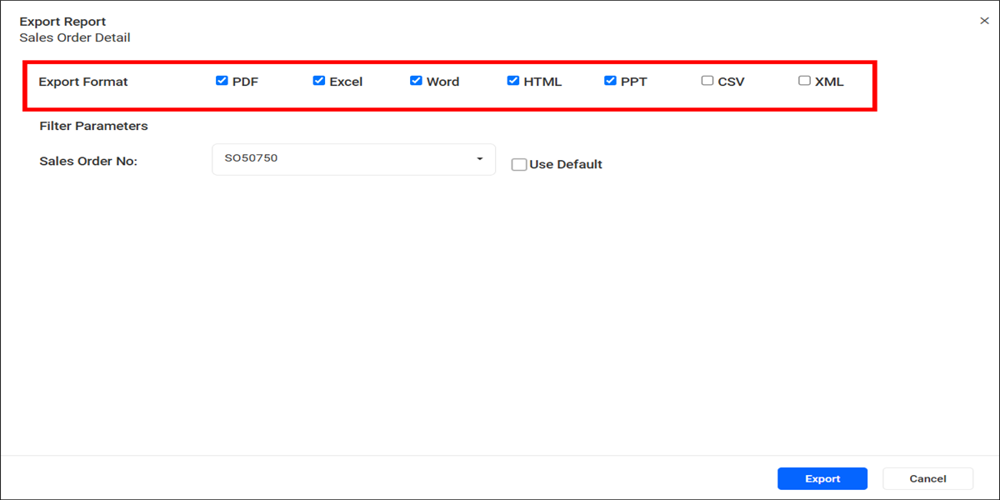

# Export reports from {{site.productNameTM}} Report Server

You can export reports from {{site.productNameTM}} On-Premises Edition in one or more formats.

## How do I export a report?

To export a report from Report Server, click the `Export` option in the report's context menu.

## Select Format and Filter for Report

After you select the report format in Report Server, set the filter parameters and export the report.

## Can I export to several formats at once?

Yes. Report Server lets you select multiple export formats at the same time. Each selected format is exported separately and opened in a new browser tab.

> **Note:** Each selected export format opens in a separate browser tab or window. If your browser blocks pop-ups, a notification may appear asking you to allow pop-ups from the {{site.productNameTM}} application. Allow pop-ups to ensure all exported reports are opened successfully.

## Frequently asked questions

### Why did only some of my exported formats open?

Each selected export format opens in a separate browser tab or window. If your browser blocks pop-ups, allow pop-ups from the {{site.productNameTM}} application so that all exported reports open.

## See also

* [View a report](./../view-report/)
* [Download a report](./../download-report/)
* [Manage report views](./../manage-report-views/)
