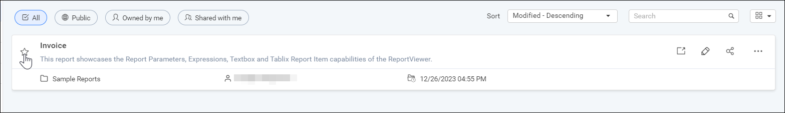
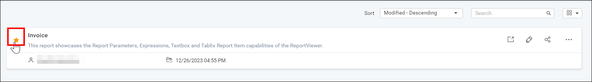
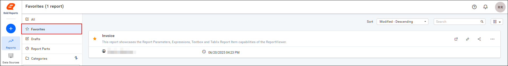

# Mark favorite reports in {{site.productNameTM}} Report Server

In {{site.productNameTM}} On-Premises Edition, you can mark a report as a favorite, remove it from favorites, and view the list of favorite reports.

## How do I mark a report as a favorite?

To mark a report as a favorite in Report Server, click the star icon near the report name. The star icon fills with color to show that the report is added as a favorite.

Favorite reports appear in the `Favorite Reports` category, so you do not need to search through categories or use keywords in the reports list.

## How do I remove a report from favorites?

To remove a report from favorites in Report Server, click the star icon near the report name. The star icon's color empties to show that the report is removed from favorites.

## Where can I see my favorite reports?

Report Server shows reports marked as favorites under the `Favorite Reports` category.

## See also

* [View a report](./../view-report/)
* [Manage report views](./../manage-report-views/)
* [Report info](https://help.boldreports.com/enterprise-reporting/designer-guide/manage-content/reports/report-info/)
