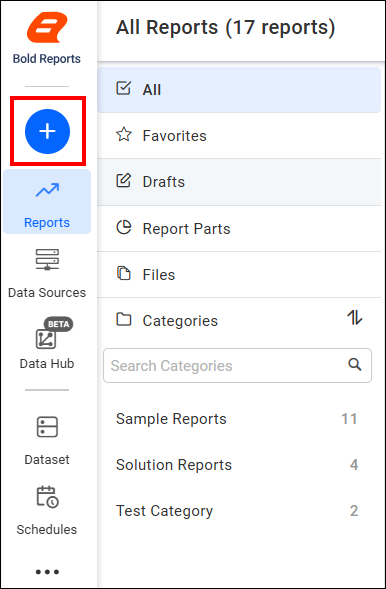
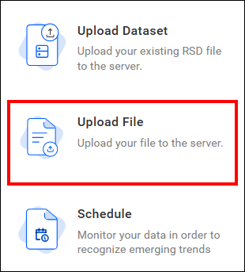
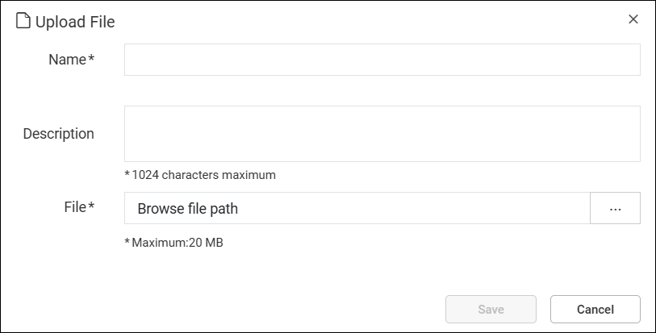
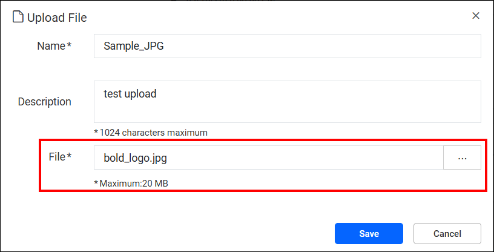

# Upload files to {{site.productNameTM}} Report Server

You can upload files to the {{site.productNameTM}} On-Premises Report Server so users and administrators can manage various file types.

## Which file formats can I upload?

{{site.productNameTM}} Report Server supports the following file formats for upload: `.jpg`, `.jpeg`, `.png`, `.html`, `.pdf`, `.json` and `.pfx`.

## Steps to upload a file

You upload a file to Report Server from the `Upload File` option in the `[+]` menu.

1. Click the `[+]` icon in the left side panel and select the `Upload File` option from the menu.
    
    

2. In the upload dialog, provide a Name and optional Description for the file.
    

    > If you leave the name field blank, the system auto-populates it with the name of the uploaded file.

3. Click the `Browse` button to choose a file from your device.
    

    >Supported file formats include `.jpg`, `.jpeg`, `.png`, `.html`, `.pdf`, `.json` and `.pfx`.

4. Click the `Save` button to add the selected file to the Report Server.

## Frequently asked questions

### What happens if I leave the file name blank?

The system auto-populates the name field with the name of the uploaded file.

## See also

* [Upload reports](./../upload-reports/)
* [Download a report](./../download-report/)
