# Multi-tabbed reports in Bold Reports<sup>®</sup> Report Server

The multi-tabbed report feature lets you display two or more reports on the same page in Bold Reports<sup>®</sup> On-Premises Edition.

## How do I enable multi-tabbed reports?

You enable multi-tabbed reports in Bold Reports<sup>®</sup> Report Server through the reporting configuration file.

* To enable the Multi-tab support, navigate to `UMS -> Settings -> Configuration -> reporting/config.xml`, set the `<EnableMultiTabbedReports>` node to `true`, and then save the changes.

    ```sh
    `<EnableMultiTabbedReports>true</EnableMultiTabbedReports>`
    ```

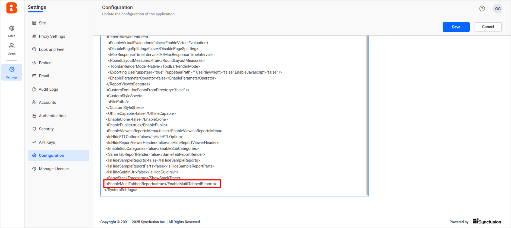

## What can I do with multi-tabbed reports?

You can create, edit, render, and delete multi-tabbed reports in Bold Reports<sup>®</sup>.

* The reports listing page displays the multi-tabbed reports that you can access, depending on your permissions.
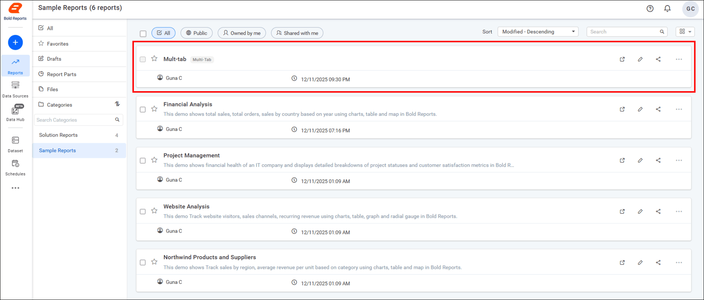

## Who can create a multi-tabbed report?

To create a multi-tabbed report in Report Server, you must have access to reports. An admin user can use any report to create a multi-tabbed report, while other users can only use their own reports or shared reports with write permission.

## Steps to create a multi-tabbed Report

You create a multi-tabbed report in Report Server from the `[+]` menu and then add two or more reports to it.

1. Click the `[+]` icon on the left side of the menu area and select the multi-tabbed report option.
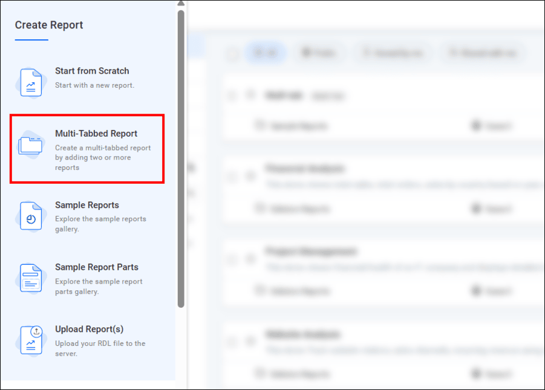

2. Fill out the form with the name of the multi-tab report and select the category from the Select Category drop-down menu.
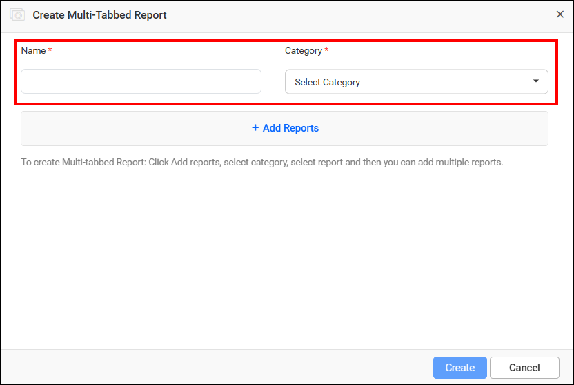

    >NOTE: The plus icon next to the `Select Category` drop-down appears only if the user has permission to create categories.

3. Click `Add Reports` in the Create Multi-Tabbed Reports dialog box.
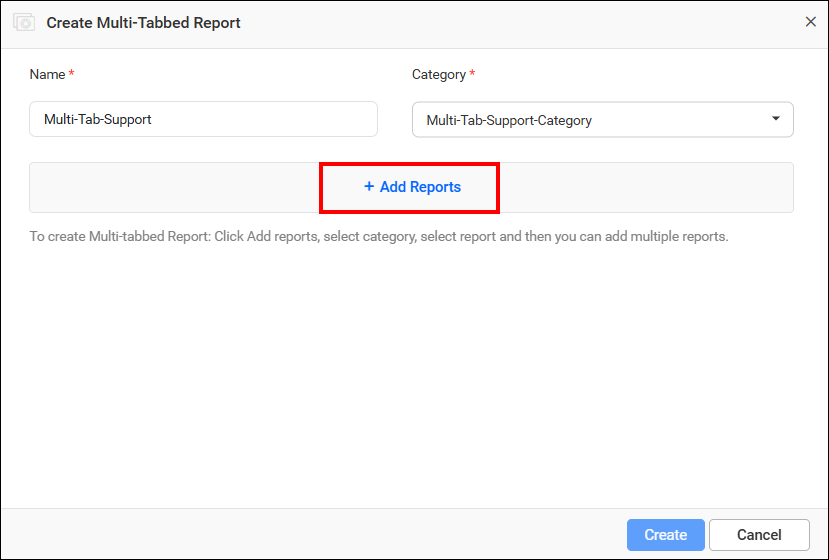

4. Select the category from the `Select Category` drop-down menu. The reports in that category are displayed in the `Select Reports` drop-down menu.

5. Select the reports from the Select report drop-down menu. The `Add` button becomes enabled.
6. Click the `Add` button.
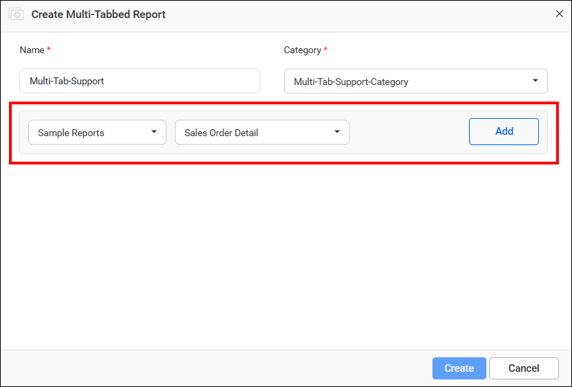

7. Add a minimum of two or more reports to create the multi-tabbed report. The added reports are displayed in the multi-tabbed report.
8. To edit the tab name of a report, click the edit icon.
9. Edit the tab name and click the check icon to apply the edited tab name. Use the cancel icon to reset the tab name.
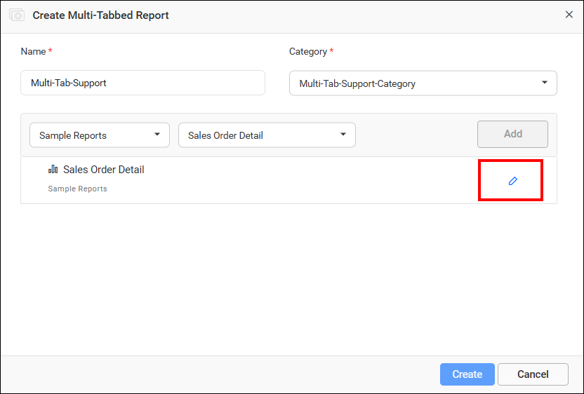
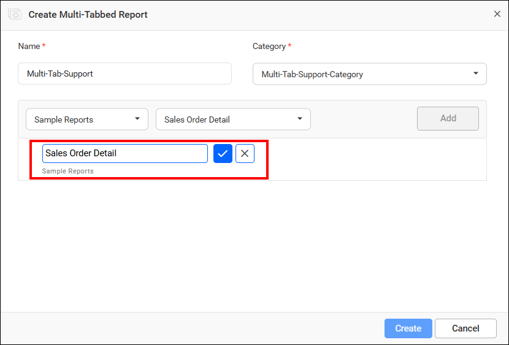

10. After adding reports to the multi-tabbed report, click `Create`.
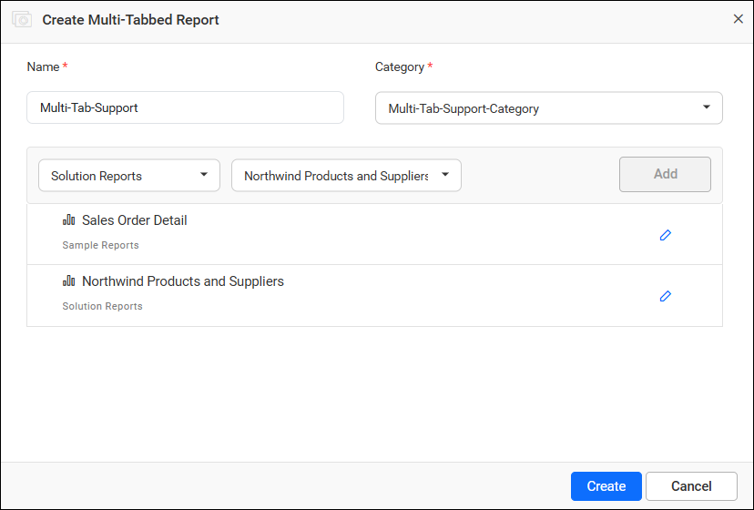

## How do I open a multi-tabbed report?

You identify a multi-tabbed report in Report Server by the `multi-tab` badge icon on the report listing page.
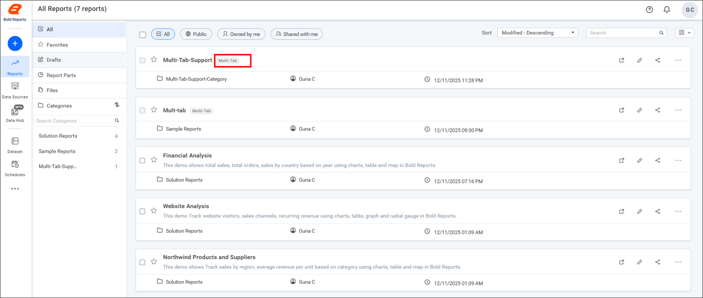

* Click the multi-tabbed report in the list to open it.

* Switch between tabs to view the other reports.
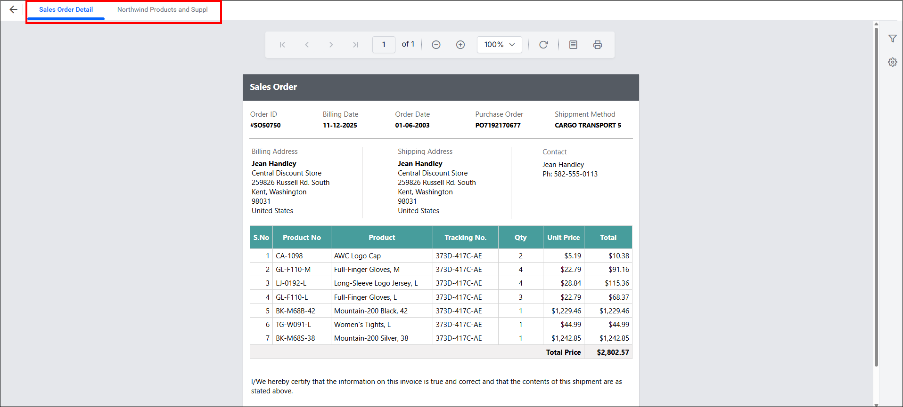

## What are the limits of multi-tabbed reports?

Multi-tabbed reports in Report Server hide some viewer options.

> NOTE: The limitations of Multi-Tabbed Reports are that the edit, share, favorite, and get link options in the viewer are hidden, and users cannot share the report views with others.

## Frequently asked questions

### How many reports does a multi-tabbed report need?

Add a minimum of two or more reports to create the multi-tabbed report.

### Can non-admin users use any report in a multi-tabbed report?

No. Other users can only use their own reports or shared reports with write permission, while an admin user can use any report.

## See also

* [View a report](./../view-report/)
* [Manage report views](./../manage-report-views/)
* [Create a report](./../create-report/)
