# Manage report views in Bold Reports® Report Server

Report Views are saved parameter information for a report that you can apply to the viewer while viewing the report in Bold Reports® Report Server. Only the user who created a view can share, update, and delete it.

You can open, add, update, share, and delete Report Views in Bold Reports® On-Premises Edition.

> **Note:** Starting from v6.x, the **Views** option is hidden by default from the Report Server context menu. For more information, see [Breaking changes in the context menu](#breaking-changes-in-the-context-menu).

## Report Views in Old Viewer

The Report Server old viewer lets you add, open, share, copy links to, and delete Report Views from the `Saved Views` panel.

### Add the Report Views

1. Click the parameter icon at the top and select `Save` to add a report view.

    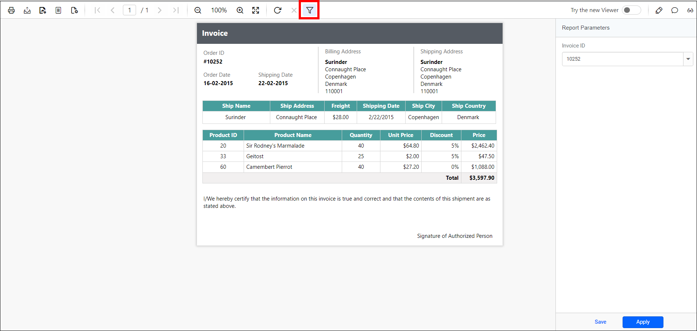

    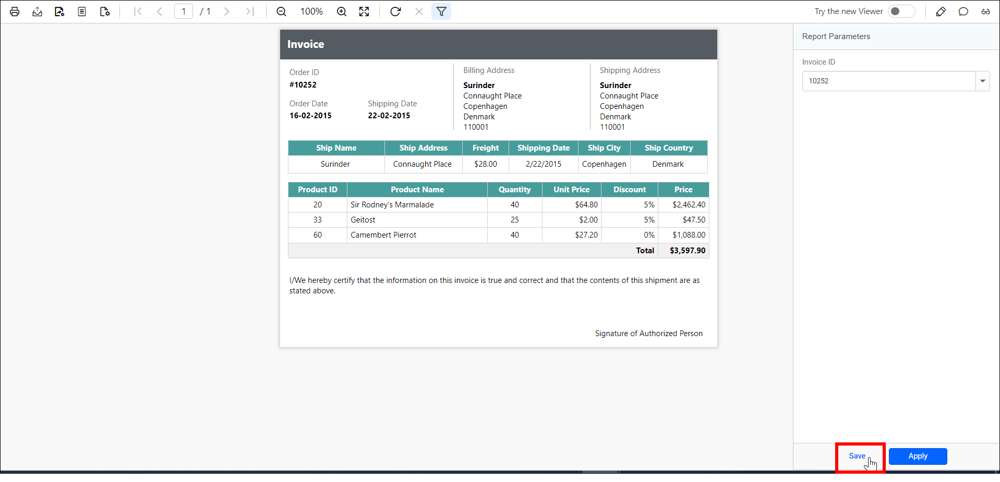

    Enter a name for the new view and click `Save` as shown in the following figure.

    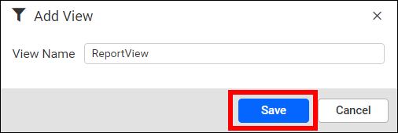

    After the view is saved, you can save the same view again with a new name by clicking `Save As`.
    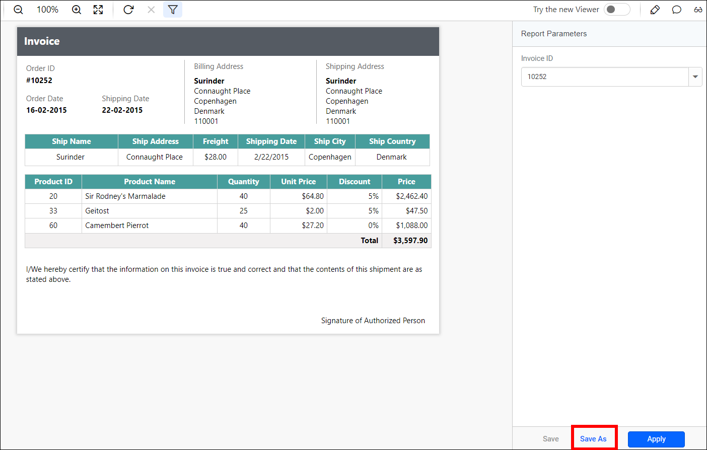

   > A view icon is available for reports that contain parameters.

2. Check the `Saved Views` panel. The view is added, and saved Report Views are displayed there.
   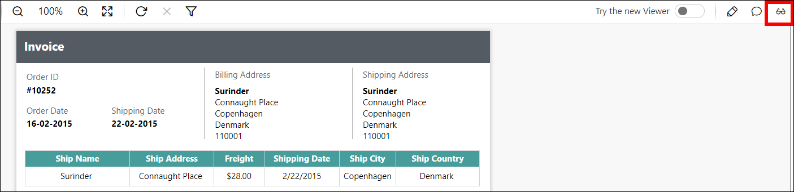

   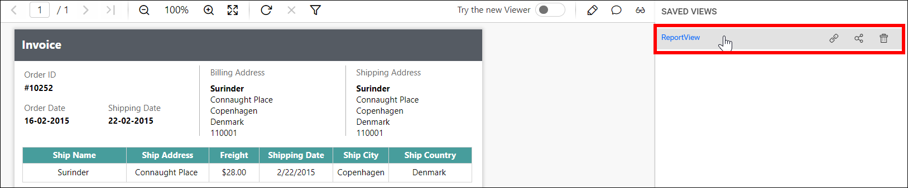

### Open the Report Views

1. Open the context menu of the report. Saved Report Views of each report are listed in the context menu of the respective report.

    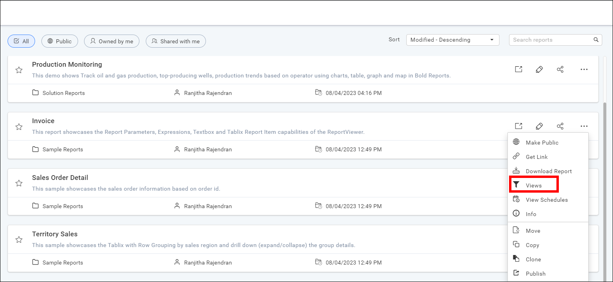

    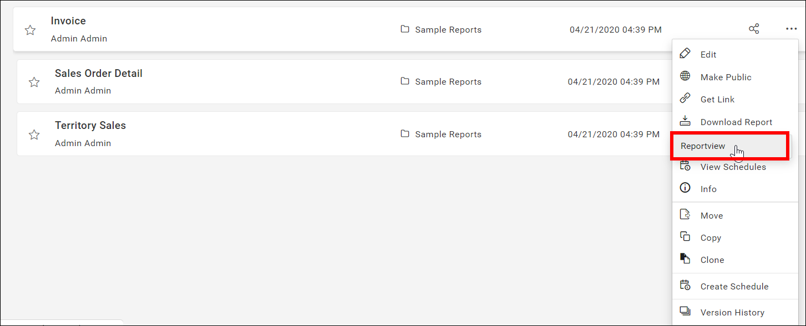

2. Click the report view.

3. View the saved view, which opens in the viewer.
    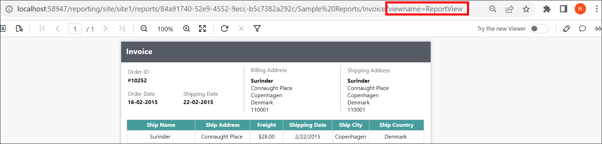

    > The URL includes the name of the saved view.

### Share the Report Views

You can share saved Report Views with other users and groups in the Bold Reports® Report Server. You can also share them with anonymous users.

1. To share the report views, click the `share` icon of the respective report view in the `Saved Views` panel.
   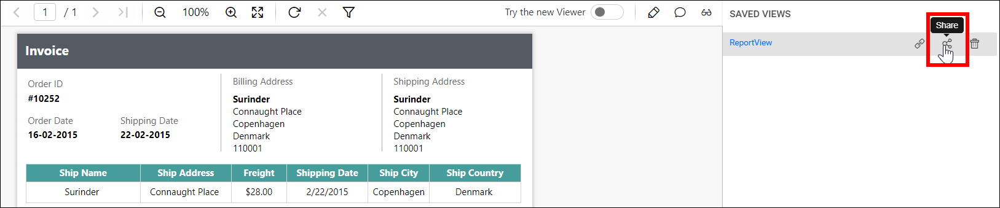

2. Click the `Manage Access` button.
   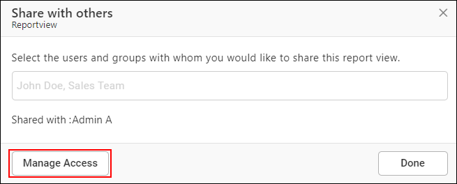

3. Select the users or groups to share the report view with.
   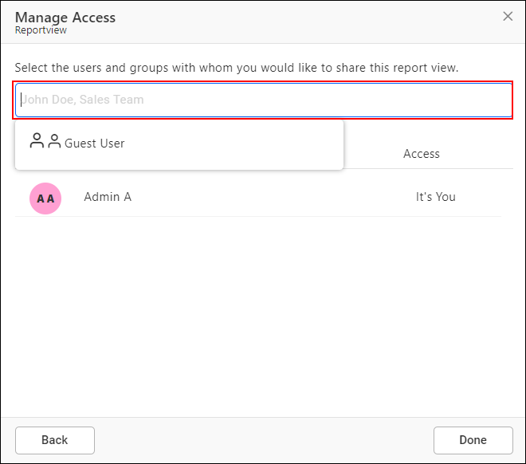

4. After selecting the users or groups, click the `Add` button.
   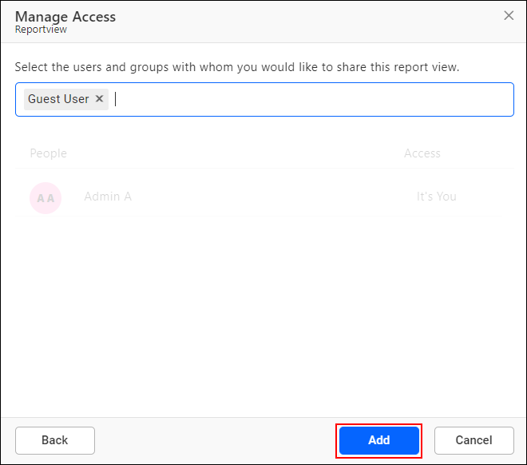

### Copy the Report Views link

To copy the Report Views link in Report Server, click the `copy` icon of the respective report view in the `Saved Views` panel.

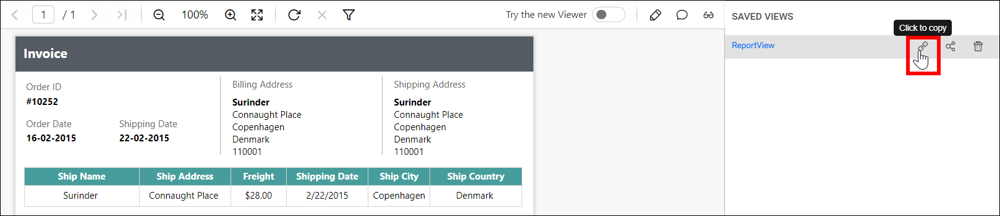

### Delete the Report Views

To delete Report Views in Report Server, click the `Delete` icon of the respective report view in the `Saved Views` panel.

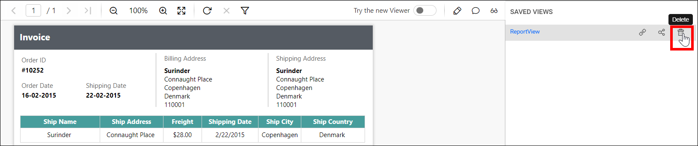

## Report Views in new viewer

Bold Reports® Report Server supports managing views in the `new Viewer` from version 5.2.26.

### Add the Report Views

1. Click the parameter icon in the right corner and select `Save` to add a report view.

    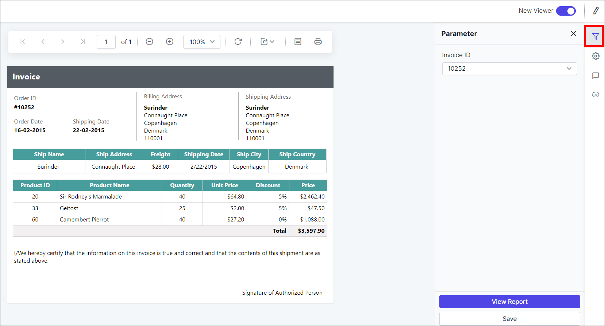

    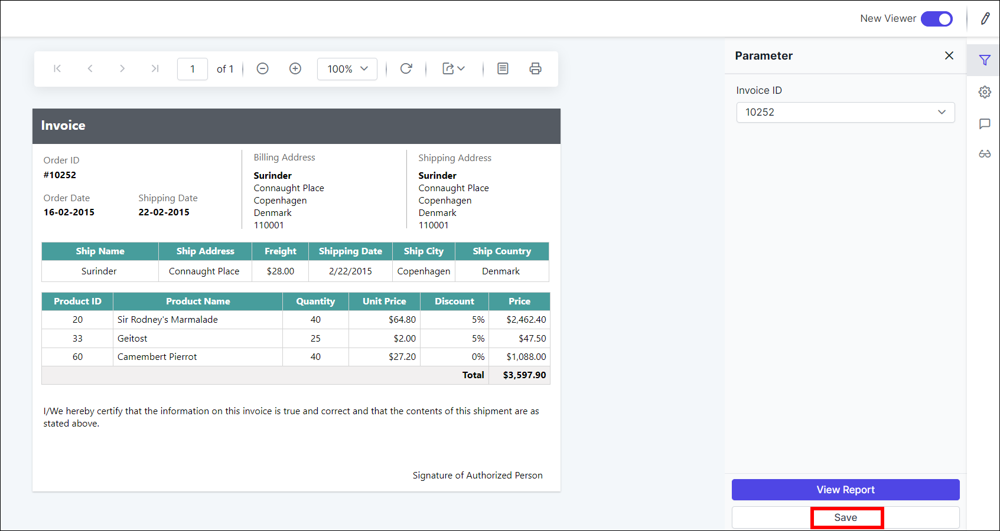

    Enter a name for the new view and click `Save` as shown in the following figure.

    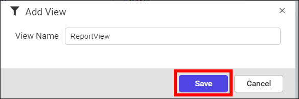

    After the view is saved, you can save the same view again with a new name by clicking `Save As`.
    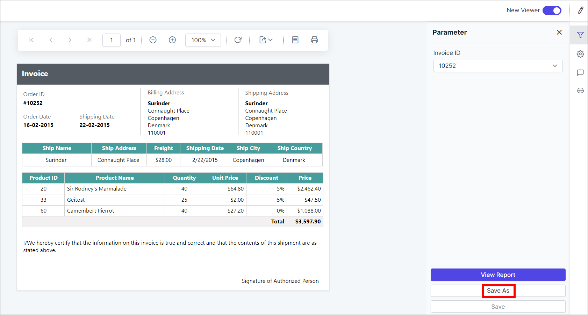

   > A view icon is available for reports that contain parameters.

2. Check the `Saved Views` panel. The view is added, and saved Report Views are displayed there.
   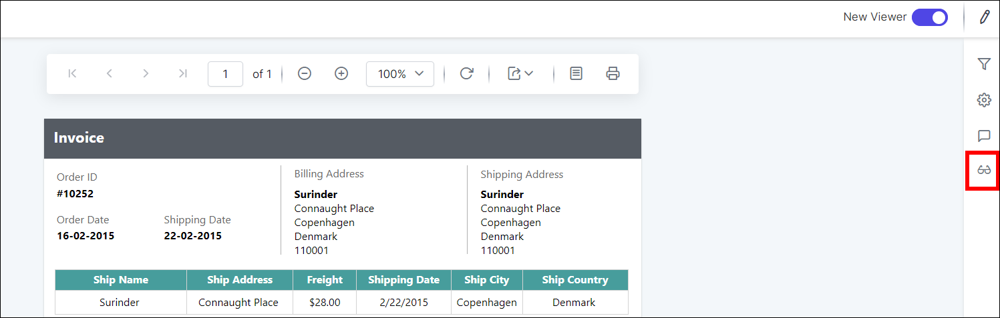

   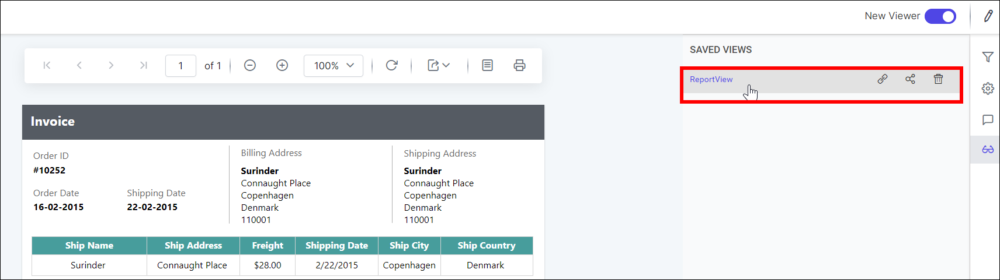

### Open the Report Views

1. Open the context menu of the report. Saved Report Views of each report are listed in the context menu of the respective report.

    

    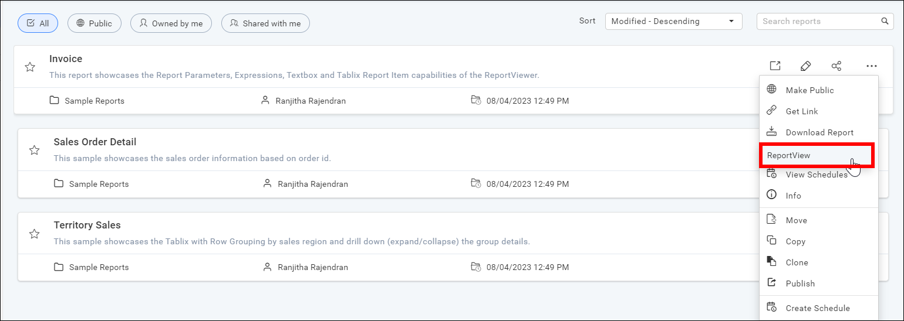

2. Click the report view.

3. View the saved view, which opens in the viewer.
    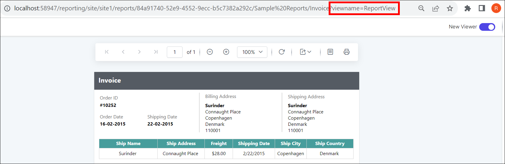

    > The URL includes the name of the saved view.

### Share the Report Views

You can share saved Report Views with other users and groups in the Bold Reports® Report Server. You can also share them with anonymous users.

1. To share the report views, click the `share` icon of the respective report view in the `Saved Views` panel.
   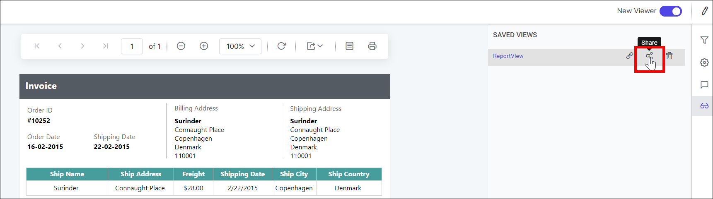

2. Click the `Manage Access` button.
   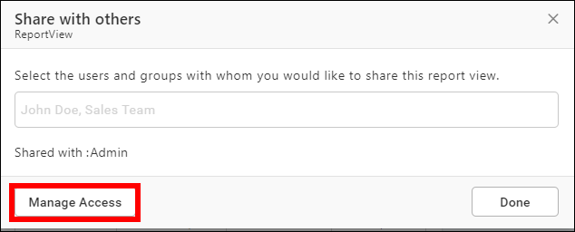

3. Select the users or groups to share the report view with.
   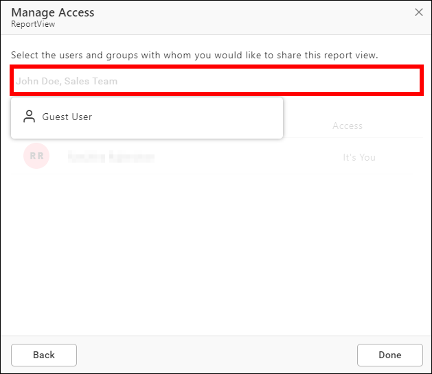

4. After selecting the users or groups, click the `Add` button.
   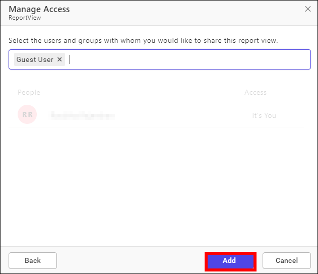

### Copy the Report Views link

To copy the Report Views link in the new viewer, click the `copy` icon of the respective report view in the `Saved Views` panel.

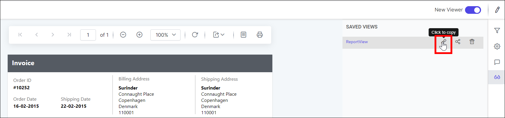

### Delete the Report Views

To delete Report Views in the new viewer, click the `Delete` icon of the respective report view in the `Saved Views` panel.

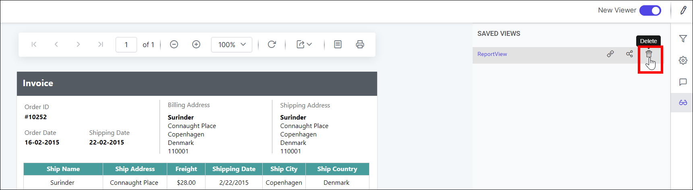

## Breaking changes in the context menu

Bold Reports® Report Server hides the **Views** option in the report listing context menu by default from v6.x.

* Starting from v6.x, the **Views** option is **visible** only on the **Report Preview page**. In the **Report Listing page context menu**, the Views option is set to **hidden** by default.
   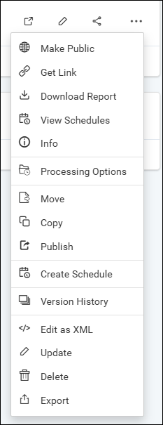

* If you still need the option in the context menu, navigate to `Settings -> Configuration -> reporting/config.xml`, set the `<EnableViewsInReportsMenu>` node to `true`, and then save the changes. `<EnableViewsInReportsMenu>true</EnableViewsInReportsMenu>`
   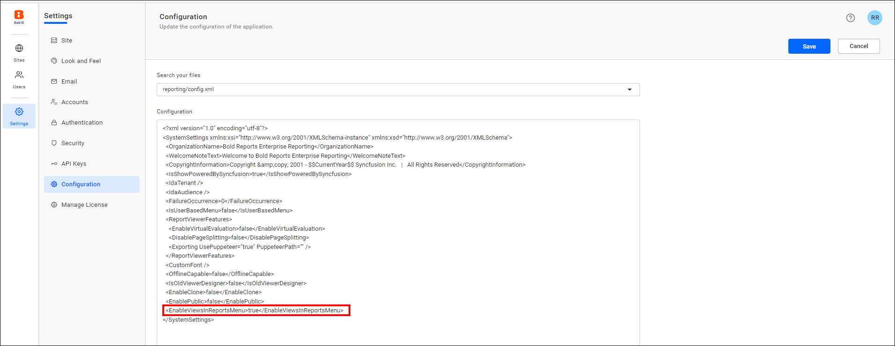

* The view option then appears in the context menu.
   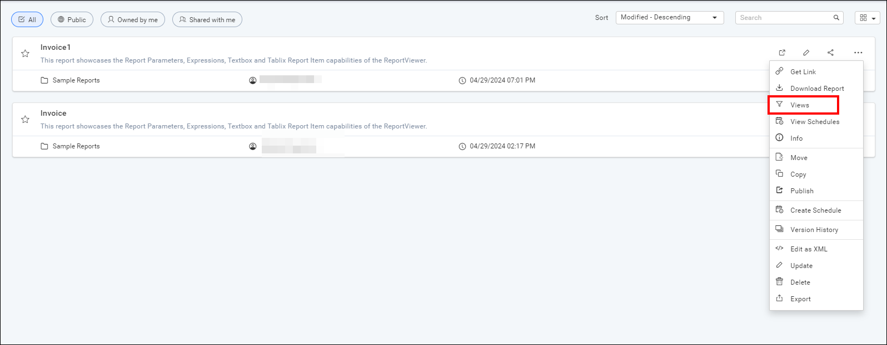

## Frequently asked questions

### Who can share, update, or delete a report view?

Only the user who created the report view can share, update, and delete it.

### Can I share a report view with anonymous users?

Yes. Saved Report Views can be shared with other users and groups, and also with anonymous users.

## See also

* [View a report](./../view-report/)
* [Manage multi-tabbed reports](./../manage-multi-tab-reports/)
* [Share a report](./../share-report/)
