# Move, copy and clone reports in Bold Reports® Report Server

In Bold Reports® On-Premises Edition, you can move, copy, and clone reports from one category to another.

> **Note:** Starting v6.1, Bold Reports® plans to deprecate the feature of `cloning reports`. For more information, see [Breaking changes from v6.x](#breaking-changes-from-v6x).

## How do I move a report?

You move a report to another category in Report Server with the `Move` option in the context menu.

1. Click the `Move` option in the context menu.
    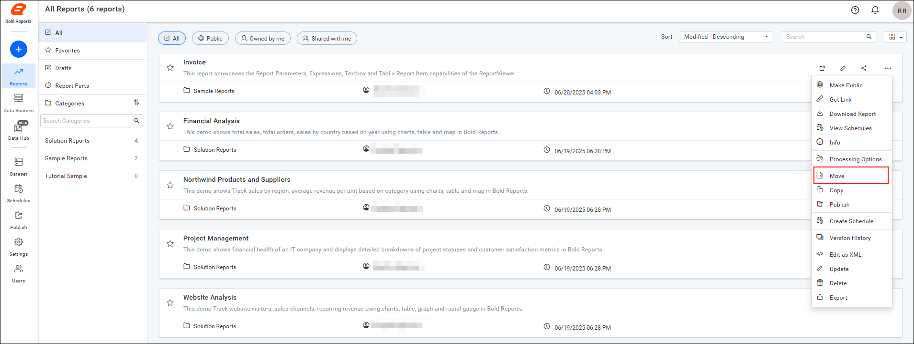

2. Select the target category to move the report from one category to another.
    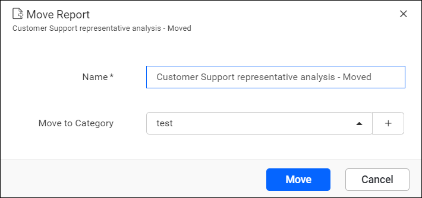

## How do I copy a report?

You copy a report to another category, site, or tenant in Report Server with the `Copy` option in the context menu.

1. Click the `Copy` option in the context menu.
    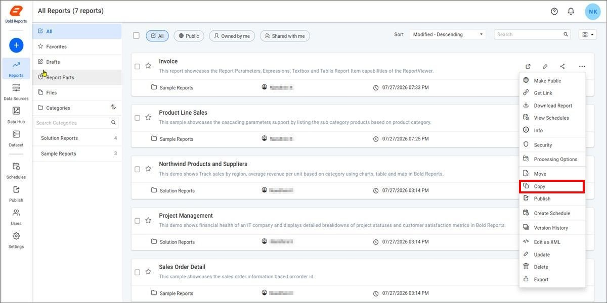

2. Select the site type where the report should be copied by choosing either `Internal Site` or `External Site`.
    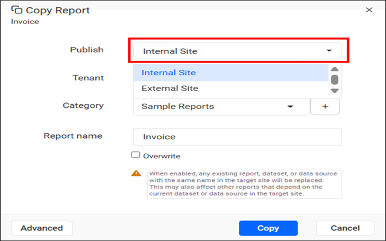

3. Select the target category to copy the report from one category to another.
    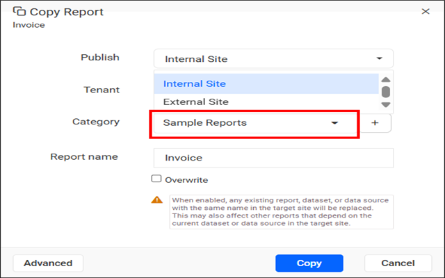

    To create a new category while copying a report, click the `+` button next to the **Category** field.
    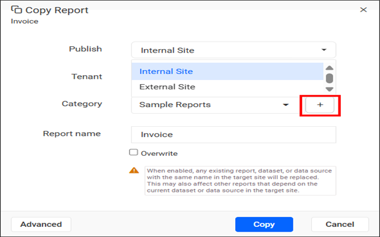
    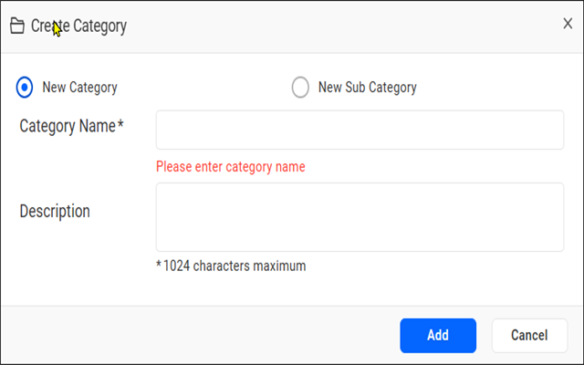

    > **Note:** When multiple tenants are selected, the **Category** list and the option to create a new category are not displayed. In this case, enter the category name manually. If the specified category already exists in the selected tenants, the reports are copied to that category. If the category does not exist, a new category is created automatically in the selected tenants.

    > **Note:** When the `Overwrite` option is enabled, any existing report, dataset, or data source with the same name in the target site is replaced. This may affect other reports that depend on the existing dataset or data source in the target site.

4. Copy the report to one or more tenants by selecting the required tenants from the `Tenant` list.
    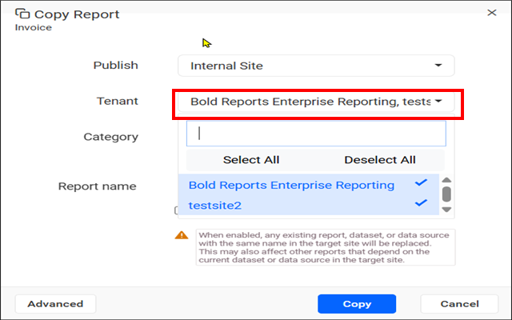

5. If the report is designed using a shared dataset or datasource, you can change the dataset or datasource and save the copy with the `Advanced option`.
    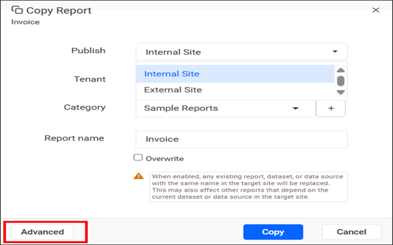
    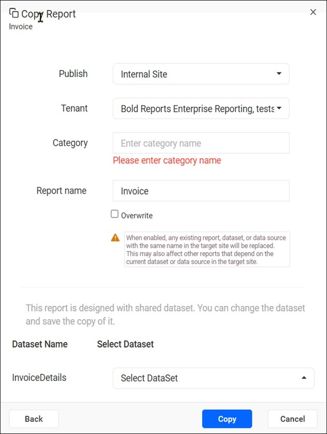

## Breaking changes from v6.x

Bold Reports® Report Server plans to deprecate `Cloning reports` and hides the `Clone` option by default.

* `Cloning reports` is planned for deprecation.

* Initially, the `Clone` option is removed in the Report Server.
    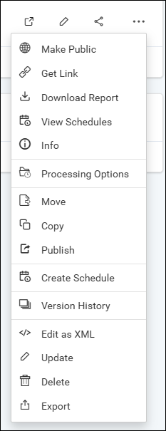
    > The existing cloned reports remain available in the sites.

* If you still need to clone the reports, enable the clone option by setting the `<EnableClone>` node to **true** in `Settings -> Configuration -> reporting/config.xml`. `<EnableClone>true</EnableClone>`.
    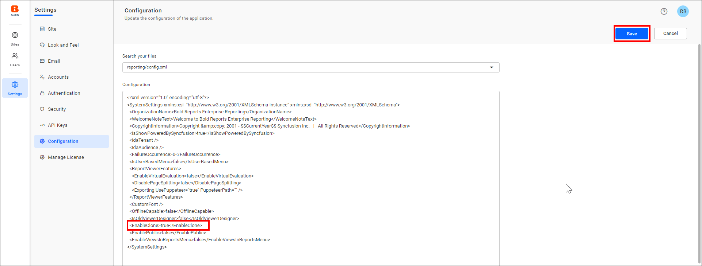

* After you enable the node, the clone option appears and you can clone the reports.
    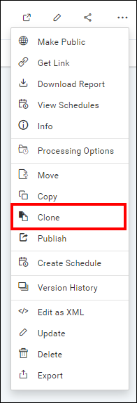

## Frequently asked questions

### What happens to reports I already cloned?

The existing cloned reports remain available in the sites.

### What does the Overwrite option replace when I copy a report?

When the `Overwrite` option is enabled, any existing report, dataset, or data source with the same name in the target site is replaced.

## See also

* [Copy multiple reports](./../copy-multiple-reports/)
* [Manage categories](./../../../manage-categories/)
* [Delete a report](./../delete-report/)
