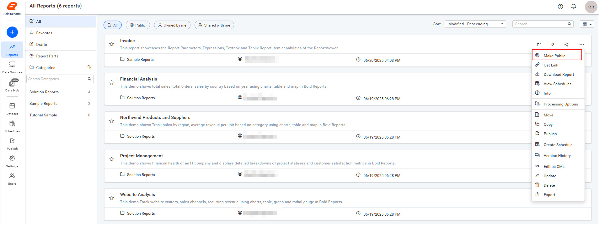
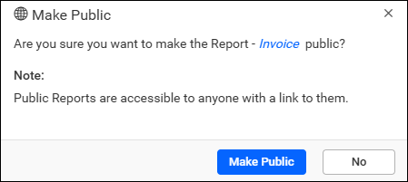
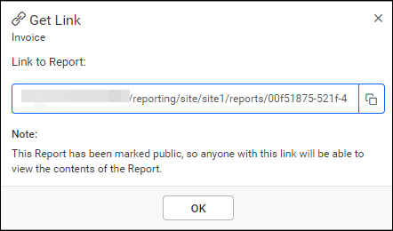
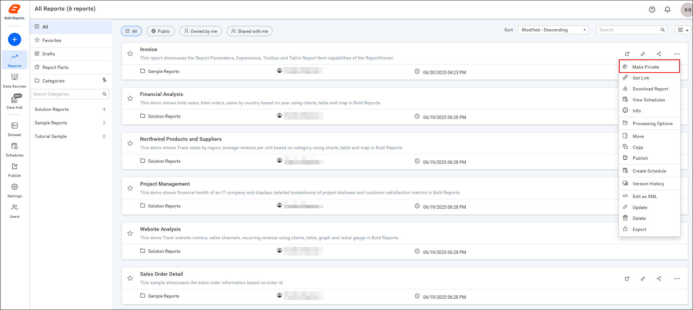
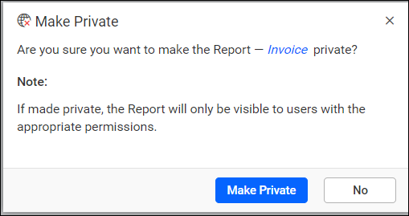
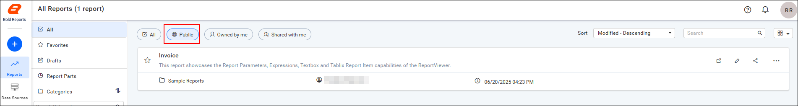

# Make reports public or private in Bold Reports® Report Server

In the Bold Reports® Report Server, you can make a report public so anonymous users with the link can view it, or keep it private.

## What is the difference between public and private reports?

Bold Reports® public reports are accessible to anonymous users who have the report link.

Private reports are accessible to registered users on the Report Server who have appropriate permissions.

## Make public

The Report Server `Make Public` option is available only to the owner of the report.

Follow these steps to make a report accessible to anonymous users:

1. Click the context menu of the report and choose the `Make Public` option.

    

2. Click `Make Public` in the confirmation dialog box.

    

3. Copy the report link from the dialog box that appears after the report is made public, and share the link with users.

    

## Make Private

The Report Server `Make Private` option is available only to the owner of the report.

Follow these steps to make a report accessible only to users in the Report Server who have appropriate permissions:

1. Click the context menu of the report and choose the `Make Private` option.

    

2. Click `Make Private` in the confirmation dialog box.

    

After the report is made private, a dialog box with a confirmation message is displayed.

## Where are public reports listed?

Report Server lists public reports under the public section, as shown in the following image.

 

## Frequently asked questions

### Who can make a report public?

Only the owner of the report can use the `Make Public` option.

### Who can view a public report?

Anonymous users who have the report link can view a public report.

## See also

* [Advanced report security](./../advanced-report-security/)
* [Share a report](./../share-report/)
* [View a report](./../view-report/)
