# Publish Reports in the {{site.productNameTM}} application

You can publish a report from the master site of the {{site.productNameTM}} Report Server to internal sites on the same server or to external sites.

## How do I start publishing a report?

To publish a report to other sites from the {{site.productNameTM}} Report Server, follow these steps:

1. Click **Publish** in the context menu to publish the corresponding report.
   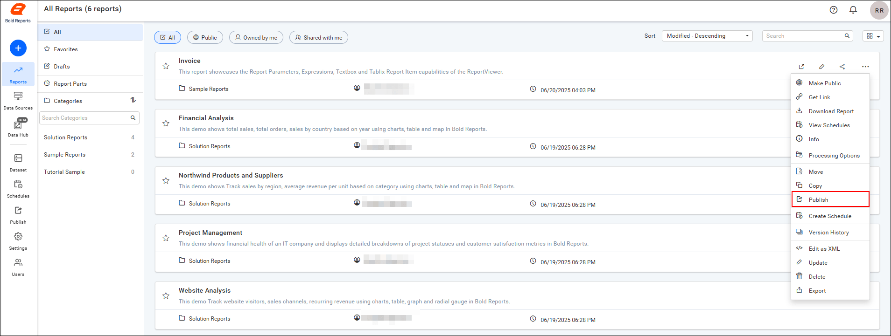

2. For the master site, a dialog appears with the options Internal Site and External Site. Select either `Internal Site` or `External Site` in the publish dialog, then proceed to Next.
   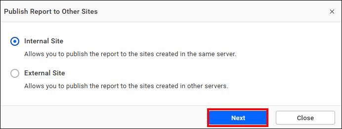

> **Note:** 
>The Publish option is available only for the master site. For non-master sites, the publish option is not shown in the context menu. 
> The master site is the first site created during startup in {{site.productNameTM}}, and all other sites are considered non-master sites.

## Internal Site

You can publish reports to the sites created on the same {{site.productNameTM}} server.

1. Choose the sites from the drop-down menu where you want to publish the report.
   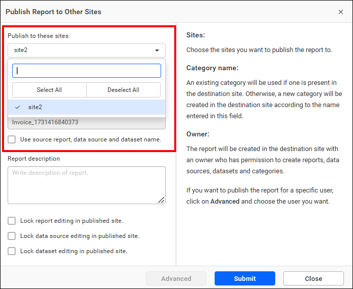

2. Specify the category name in which you want the report to be published on other sites.
   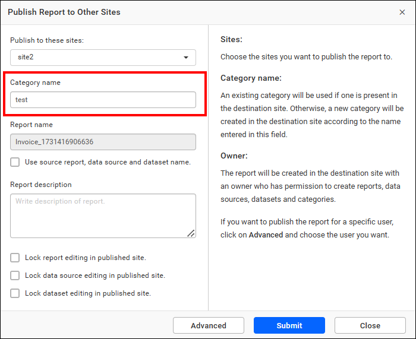

3. To publish the report, data source, and dataset with the same names on the destination site, select the checkbox `Use source report, data source, and dataset name`.
   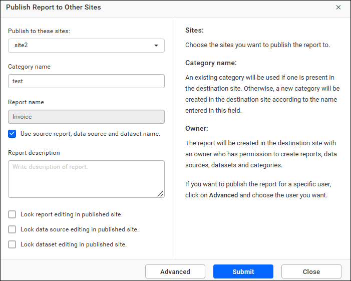
   If you prefer not to use the same name as the source site, uncheck the checkbox. A timestamp is then appended to the report name. The data source name and dataset name used in the report also have the timestamp added on the destination site.
   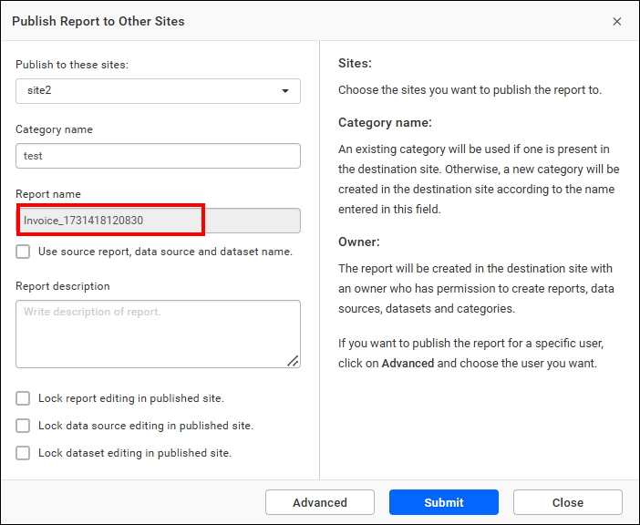

4. If needed, provide a description for the reports.
   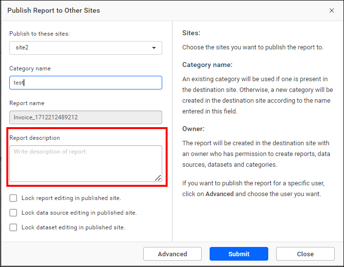

5. Select the **Lock report editing in published site** checkbox if you want to prevent editing of the published report on published sites.
   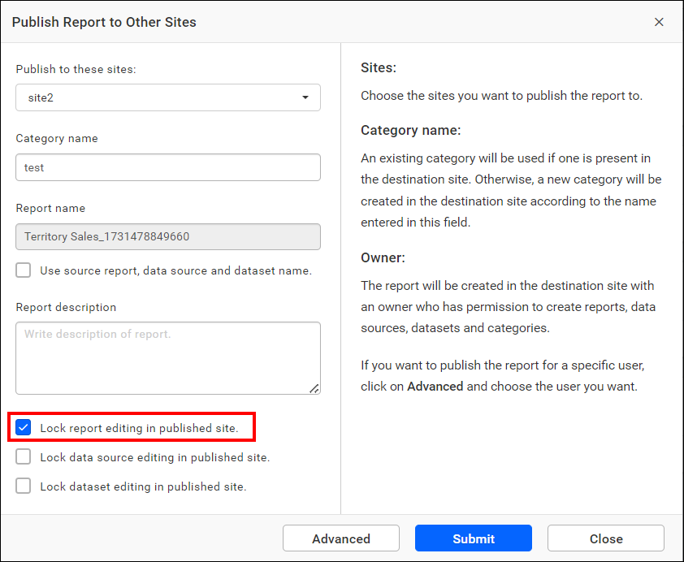

6. Select the **Lock data source editing in published site** checkbox if you want to prevent editing of the published data source on published sites.
   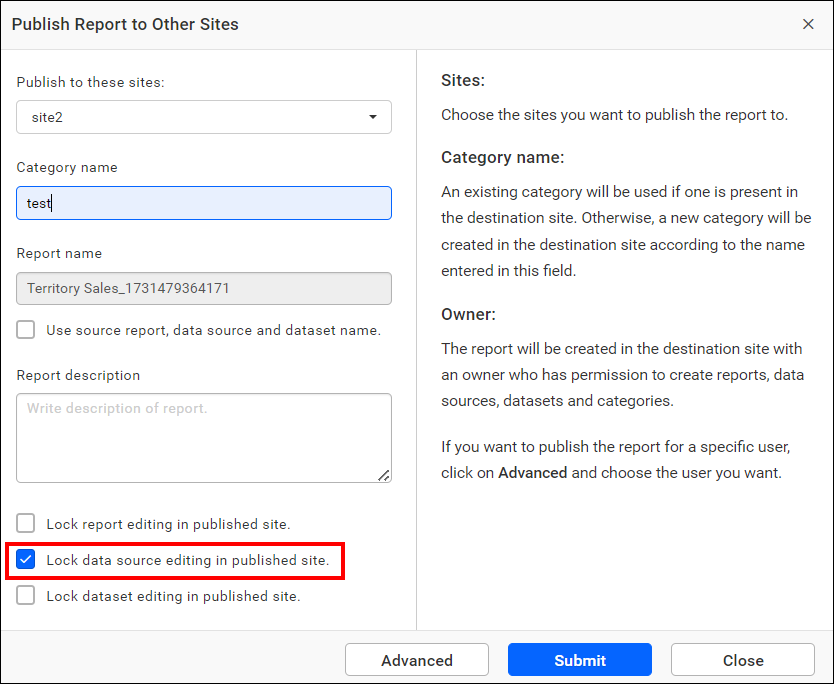

7. Select the **Lock dataset editing in published site** checkbox if you want to prevent editing of the published dataset on published sites.
   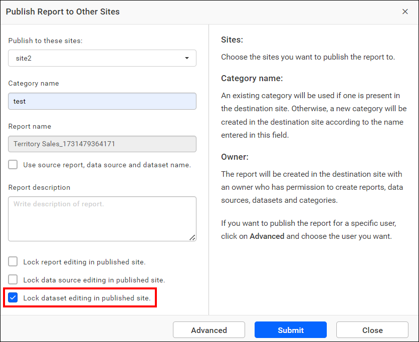

8. Use the Advanced option to select an owner (with permissions to create reports, data sources, datasets, and categories) for the reports on the published site. If you don’t select an owner, a random user with the required permissions is assigned.
   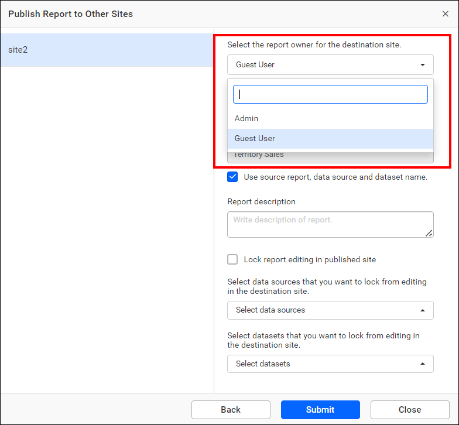

9. To publish in a different category, enter the desired category name in the text field.
   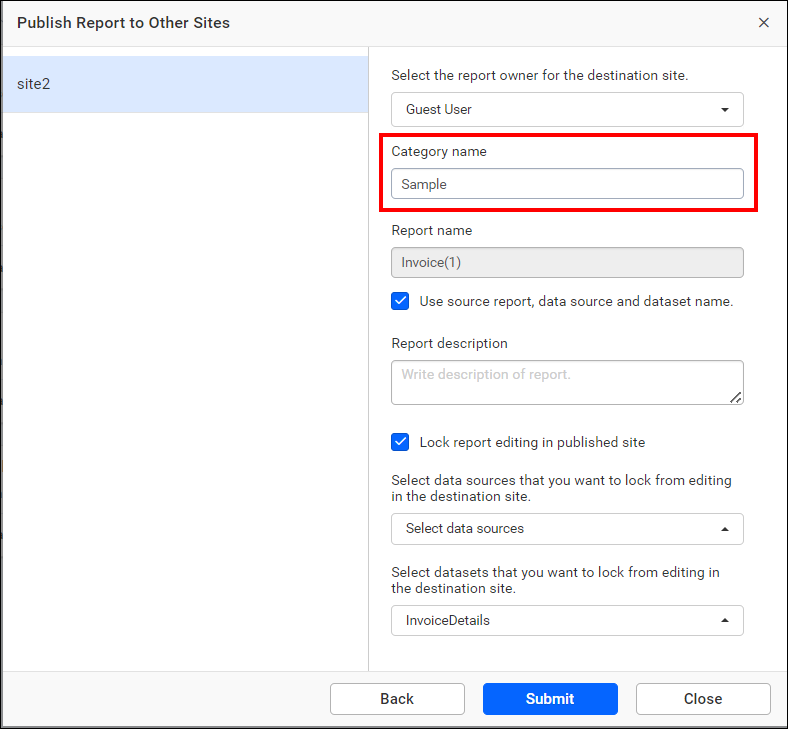

10. Configure each field individually in the Advanced window, if needed.
      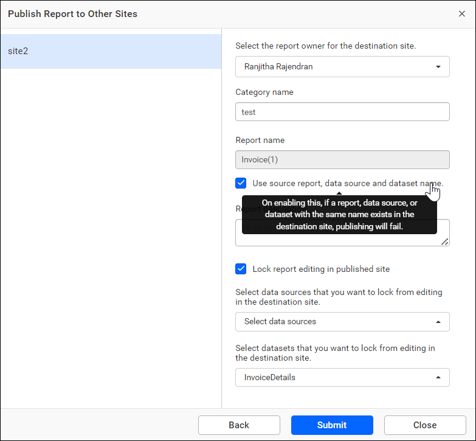

11. Submit the form. The publishing process begins, and you can monitor its status on the Published Resources page.
      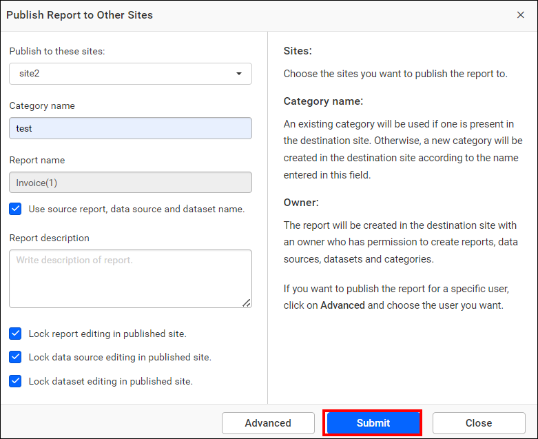

## External Site

Use the Report Server external site publish option to publish reports to sites hosted on other {{site.productNameTM}} servers.

1. Click `+` to add an external site.
   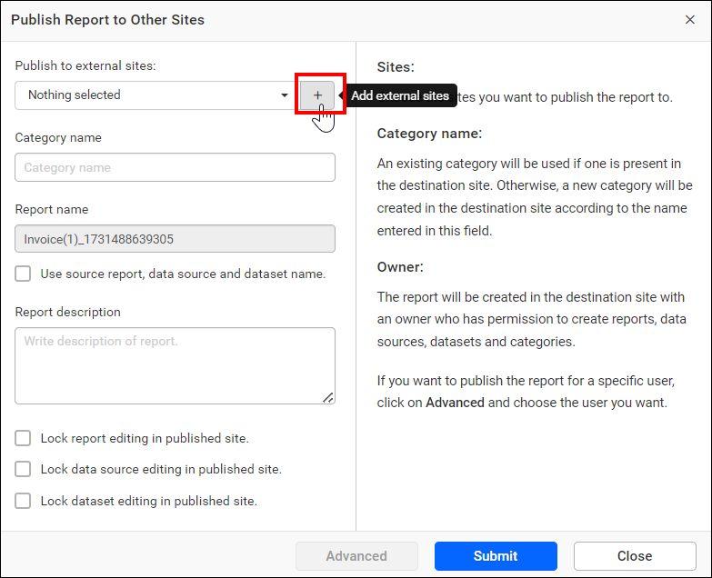

2. Fill in the following details, as shown in the following image:
   * **Name:** Enter the name you want for the external site.
   * **Client ID:** Enter the Client ID of the site.
   * **Client Secret:** Enter the Client Secret of the site.
   * **Site URL:** Enter the URL of the site.

   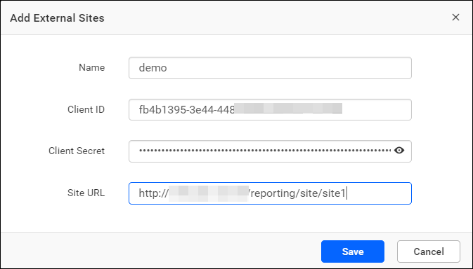

3. After the external site is added, choose it from the drop-down menu and follow the same steps used for the internal site to publish the report.

## How do I track published reports?

You view the status of published reports on the Report Server Published Resources page. The published resources are listed in the grid and grouped by Reports by default.
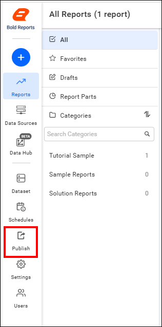
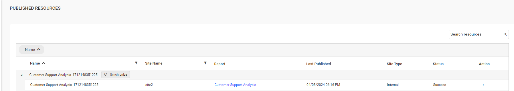

## How do I synchronize published reports?

When you change the original reports, you synchronize those changes with the published site using the Report Server `Synchronize Published Resource` option.
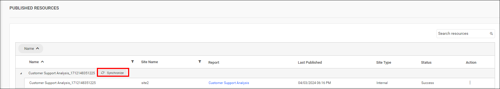
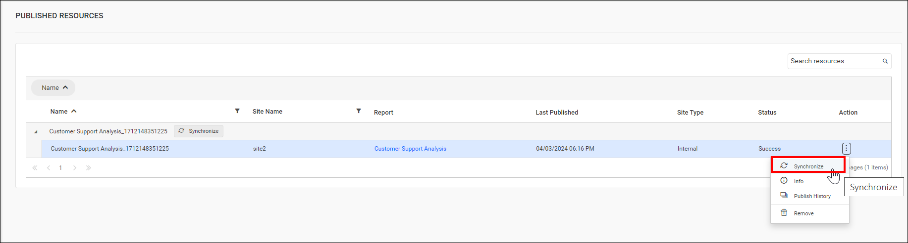

## How do I view publishing information?

You view the publishing information of a report in the Report Server Info dialog box. Click `Actions` in the grid context menu and select `Info`.

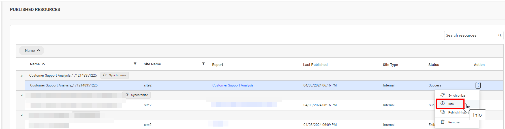
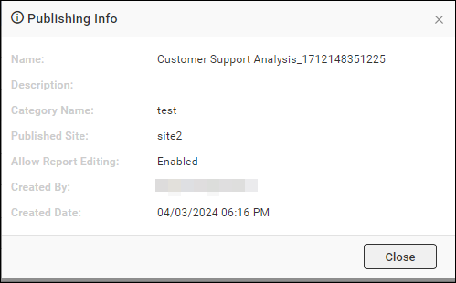

## Publish history

You can see the publish history of a report in Report Server. Click `Actions` in the grid context menu and select `Publish History`.
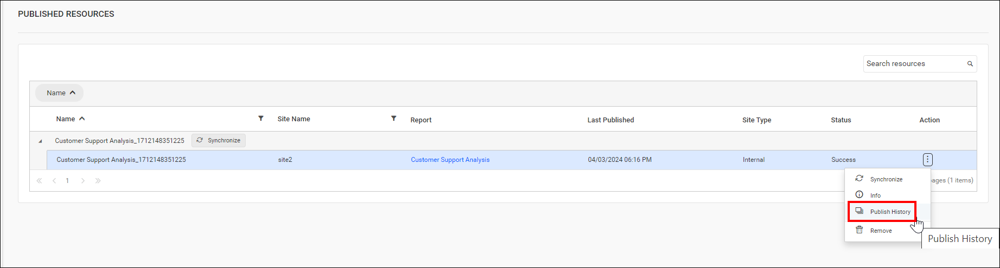
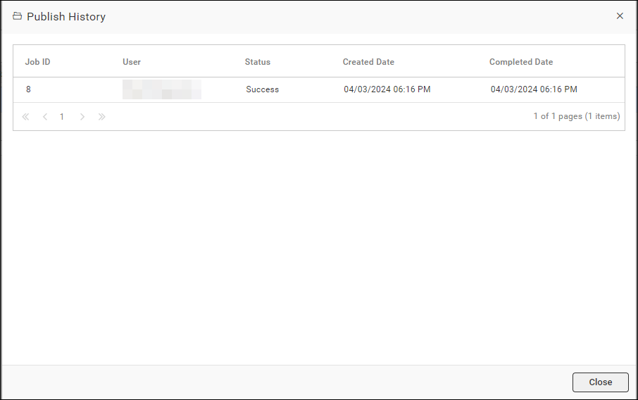

## How do I remove a published report?

You can remove published reports from {{site.productNameTM}} when they are no longer required.

Click `Actions` in the grid context menu and select `Remove` to remove the published report from the list.
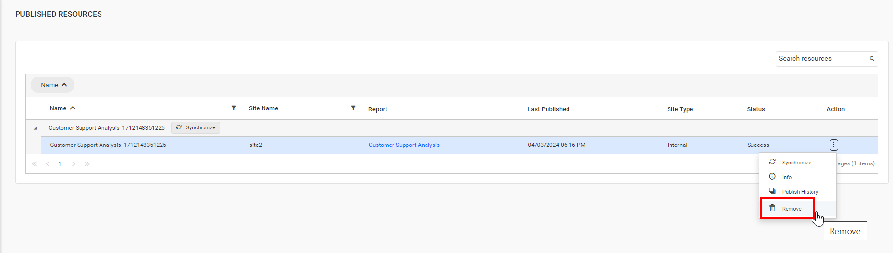

## Frequently asked questions

### Why is the Publish option missing from the context menu?

The Publish option is available only for the master site. The master site is the first site created during startup, and all other sites are non-master sites.

### What happens if I do not select an owner for published reports?

If you don’t select an owner, a random user with the required permissions is assigned.

## See also

* [Move, copy, and clone reports](./../move-copy-and-clone-reports/)
* [Copy multiple reports](./../copy-multiple-reports/)
* [Share a report](./../share-report/)
