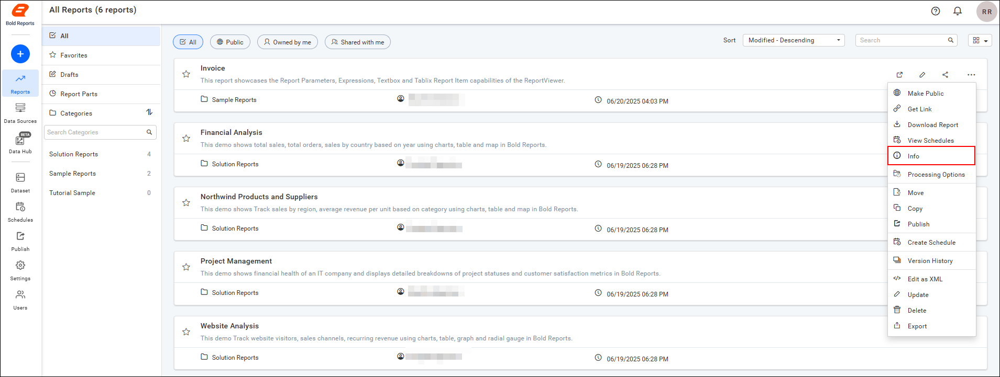
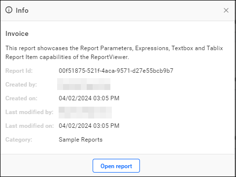

# View report info in Bold Reports® Report Server

You can view report information, such as the creator and category, in Bold Reports® On-Premises Edition.

## How do I view report info?

To view report info in Report Server, click `Info` in the report's context menu.

* Click `Info` from the context menu to view the Report Info.
    

## Report Info Elements

The following report info elements are available in Bold Reports® On-Premises Edition. The **Report Info** action provides information about the Report ID, Report Creator Name, Report Created Date, Report Modifier Name, Report Modified Date, and Report Category.

## See also

* [Version history of a report](./../version-history-of-report/)
* [Edit reports](./../edit-report/)
* [Update reports](./../update-report/)
