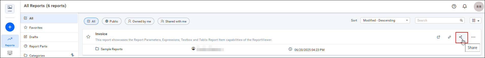
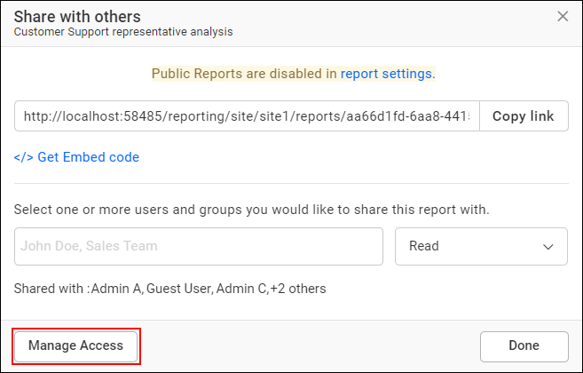
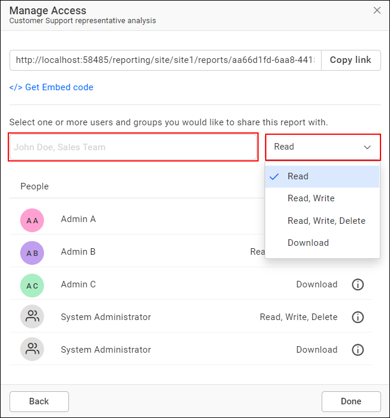
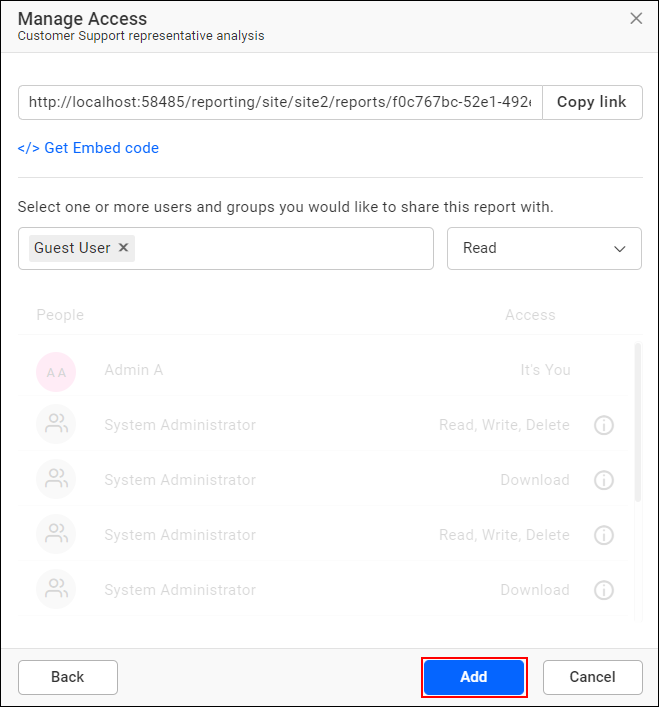
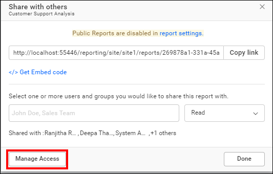
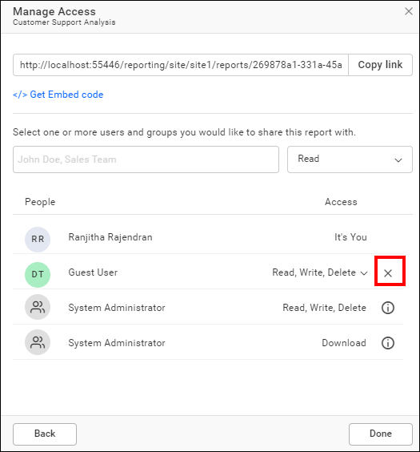
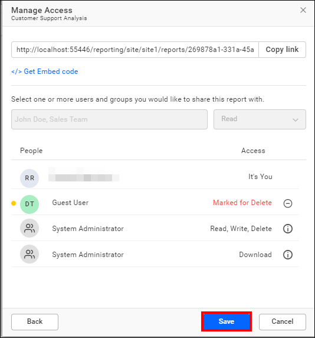
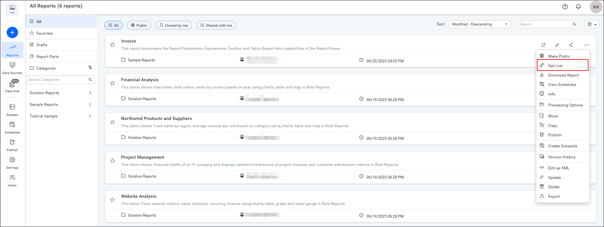
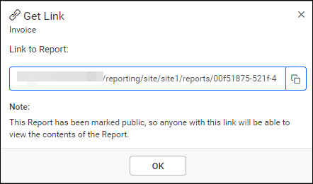
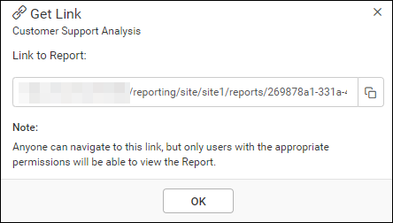

# Share a report with users in the Report Server

You share reports with users and groups in {{site.productNameTM}} On-Premises Edition by granting them access permissions through **Manage Access**. You can also share a report link, and the report's public or private setting decides who can open it.

## How do I share a report in Report Server?

You share a report in {{site.productNameTM}} Report Server from the report listing page by adding access permissions for users or groups.

1. Click the `Share` icon on the report listing page.
   

2. Click the `Manage Access` button.
   

3. Select the access permissions and the users or groups to share the report with.
   

4. Click the `Add` button.
   
   > **NOTE:** Only the user who created the report, administrators, and users with share permissions can share the report with other Report Server users.

## How do I remove a shared report permission?

You remove a shared report permission in Report Server with the `Remove` icon in the `Actions` column of each permission. Only a user with the specific permissions can remove them.

1. Click the `Manage Access` button.
   

2. Click the remove icon to revoke access from the user or group.
   

3. Click `Save`.
   

## How do I share a report link with users?

You can share a report link with users in {{site.productNameTM}} On-Premises Edition. The report's visibility decides who can open the link:

* If the report is public, anyone with the link can access its contents.

* If the report is private, only users with the appropriate permissions can view its contents, even if others have the link.

### Get Link

The `Get Link` option in Report Server is available for all reports. Follow these steps to get the link for a report:

1. Click the context menu of the report and select the `Get Link` option.
    

2. Copy the link for the report from the `Get Link` dialog box. The dialog looks different for public and private reports.

    **For Public Reports**:

    

    **For Private Reports**:

    

## Frequently asked questions

### Who can share a report in Report Server?

In {{site.productNameTM}} Report Server, only the user who created the report, administrators, and users with share permissions can share it with other users.

### Can anyone with a report link open the report?

Only if the report is public. A private report opens only for users with the appropriate permissions, even if others have the link.

## See also

* [Public report](../public-report/)
* [Advanced report security](../advanced-report-security/)
* [View a report](../view-report/)
