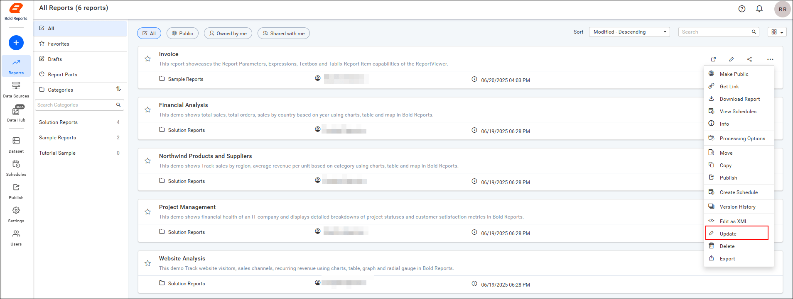
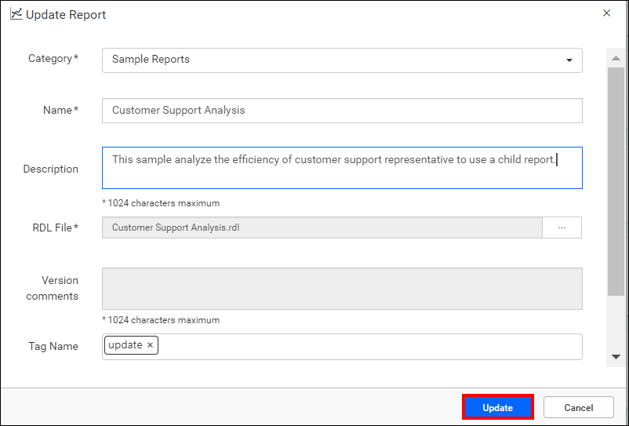

# Update reports on the Report Server

You can update reports in {{site.productNameTM}} On-Premises Edition from the context menu or with the REST API. An update lets you change a report's category, name, description, tags, or report file (`.rdl`).

## How do I update a report in Report Server?

You update a report in {{site.productNameTM}} Report Server with the **Update Report** dialog box. In the dialog, you can move a report to a different category and modify its name, description, and report file (`.rdl`).

1. Click the **Update** option in the report's context menu.
    

2. Change the Category, Name, Description, Report file (.rdl), or Tag name as needed. If you modify the report file (`.rdl`), you can add version comments for reference.

3. Click `Update` in the dialog box.
    

## REST API Reference

The following table lists the API for updating reports in {{site.productNameTM}} On-Premises Edition.

<table>
  <tr>
    <th>
      Action
    </th>
    <th>
      HTTP Method
    </th>
    <th>
      Endpoint
    </th>
    <th>
      Description
    </th>
    </tr>
    <tr>
      <td>
        <a href="https://help.boldreports.com/enterprise-reporting/rest-api-reference/v1.0/server-api-reference/#operation/Items_UpdateReport" target="_blank">UpdateReport</a>
      </td>
      <td>
        PUT
      </td>
      <td>
        /api/site/{tenant-name}/v1.0/reports
      </td>
      <td>
        To update the report on the server, the report details must be passed as input.
    </td>
  </tr>
</table>

## Frequently asked questions

### Which report details can I update in Report Server?

In {{site.productNameTM}} Report Server, you can change a report's category, name, description, tags, and report file (`.rdl`).

### Can I add comments when I replace the report file?

Yes. If you modify the report file (`.rdl`), you can add version comments for reference.

## See also

* [Upload reports](../upload-reports/)
* [Version history of a report](../version-history-of-report/)
* [Edit a report](../edit-report/)
