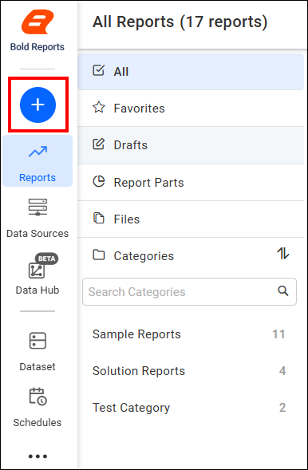
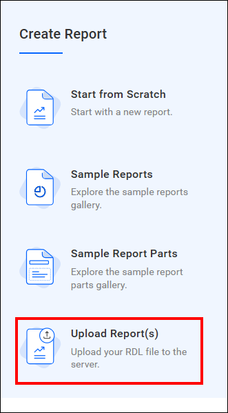
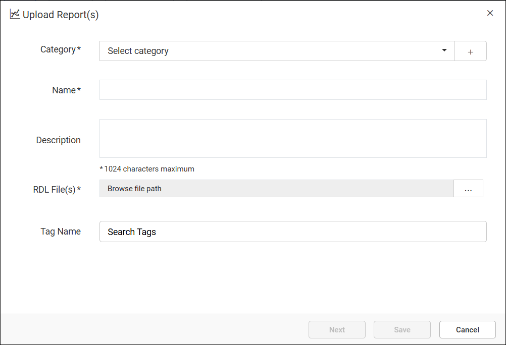
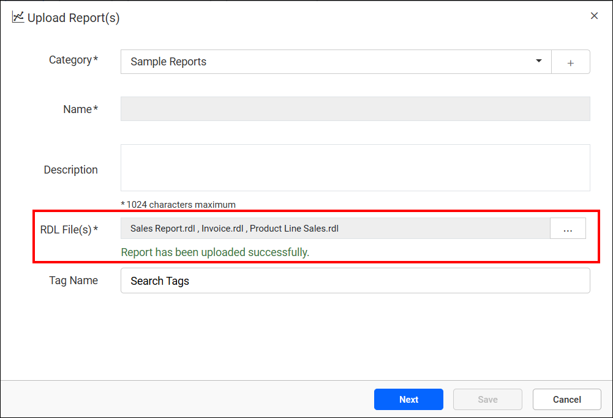
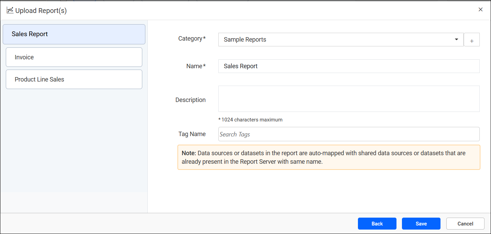
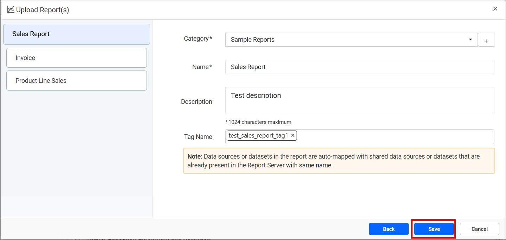

# Upload RDL reports to the Report Server

**Uploading a report** adds one or more existing RDL report files to the {{site.productNameTM}} On-Premises Report Server. You can then view, share, and manage them alongside reports created directly in Report Designer. Use this option when you already have a designed report file and want to bring it onto the server without rebuilding it from scratch.

You select a category, add tags, upload single or multiple RDL files, and configure each report's name, description, and category before saving it.

## What is report upload?

Report upload in {{site.productNameTM}} Report Server imports an existing `.rdl` report definition file into the server's content library. The file can come from Web Report Designer, Visual Studio, or the SSRS Report Builder. Unlike creating a report from scratch, uploading skips the design phase entirely.

The report file already contains its layout, data source, and dataset definitions. The upload flow only asks you to organize and label it.

You can upload a single report or several RDL files in one operation. When you upload multiple files together, the server automatically names each report after its source file. A follow-up dialog then lets you review and adjust the category, description, and tags for each report before saving.

### What can I do with report upload?

With report upload in Report Server, you can:

* Add existing RDL report files to the Report Server without redesigning them.
* Upload multiple reports in a single operation to save time during migrations or bulk imports.
* Organize uploaded reports into categories as part of the upload flow.
* Tag reports, creating new tags on the fly, to make them easier to find later.

## How do I upload a report to Report Server?

You upload reports to {{site.productNameTM}} Report Server from the `[+]` icon in the left side panel.

1. Click the `[+]` icon in the left side panel, then select the `Upload Report(s)` option.
    
    

2. Select a category, enter a description, upload one or more RDL files, and create or choose tags to organize the reports.
    > Click `New Tag` to create a tag that doesn't already exist.

    
    

    > When multiple reports are uploaded together, the Name field is disabled and auto-filled using each `.rdl` file's name.

3. Click the `Next` button to open a dialog for configuring each uploaded report individually.
    > The left panel lists every uploaded report. Select a report to update its name, category, description, and tags.

    

4. Click the `Save` button to add the reports to the Report Server.
    

## What are the key features of report upload?

Report upload in {{site.productNameTM}} Report Server offers these features:

* **Bulk upload**: Upload multiple RDL files in a single operation instead of adding reports one at a time, which is useful when migrating reports from another environment.
* **Per-report configuration**: After uploading, a dedicated dialog lets you review and adjust the name, category, description, and tags for each report individually before saving.
* **Category assignment**: Every uploaded report is placed into a category during the upload flow, keeping the report library organized from the moment a report is added.
* **Tagging**: Apply existing tags or create new ones during upload, making reports easier to search for and group later.

## When should I upload a report?

Upload a report to {{site.productNameTM}} Report Server when you already have an RDL file. Common use cases:

* **Migrating reports between environments**: Teams moving from a development or staging server to production can upload previously exported RDL files instead of recreating reports.
* **Importing reports built outside Web Report Designer**: Reports authored in Visual Studio or the SSRS Report Builder can be uploaded directly to the Report Server without modification.
* **Bulk-loading a report library**: When setting up a new site or category, administrators can upload many reports at once and organize them during the same flow.
* **Restoring reports from a backup**: Previously downloaded RDL files can be re-uploaded to recover a report that was removed, or to recreate it in another category.

## Who should use this guide?

This {{site.productNameTM}} Report Server upload guide is intended for:

* Report authors who design reports outside {{site.productNameTM}} and need to add them to the server.
* Administrators migrating reports between sites or environments.
* Business users importing reports shared by a colleague or another team.
* Anyone bulk-loading a set of existing RDL files into a category.

## What do I need before uploading a report?

Before you upload a report to {{site.productNameTM}} Report Server:

* Have one or more valid `.rdl` report files ready to upload.
* Have permission to add reports to the target category. Contact your administrator if the upload option isn't available.
* Know the category and any tags you want to assign, though these can also be adjusted after upload.

No additional server-side setup is required to upload a report.

## What are the limits of report upload?

Report upload in {{site.productNameTM}} Report Server has these considerations and limitations:

* Only valid RDL report files can be uploaded through this option; other file types should use the [file upload](https://help.boldreports.com/enterprise-reporting/designer-guide/manage-content/reports/file-upload/) option instead.
* When multiple reports are uploaded together, the Name field is auto-filled from the file name and can't be edited until the per-report configuration step.
* Uploading a report doesn't validate its data source or dataset connections. Verify these after upload if the report was designed against a different environment.

## FAQ

### Can I upload multiple reports at once?

Yes. Select multiple RDL files in the upload dialog, and configure each report's name, category, description, and tags individually in the follow-up dialog.

### What happens if I don't assign a category during upload?

Every report must belong to a category, so you're required to choose one during the upload flow before the report can be saved.

### Can I upload a report created with the SSRS Report Builder?

Yes. Reports created using the SSRS Report Builder can be uploaded to the Report Server the same way as reports designed in Web Report Designer.

### Can I change a report's category or tags after uploading it?

Yes. Use the [Update Report](../update-report/) option from the report's context menu to change its category, description, tags, or report file after upload.

### What's the difference between uploading a report and creating one?

Uploading adds an existing RDL file to the server, while [creating a report](../create-report/) designs a new one from scratch in Web Report Designer. See also [Edit report in Web Report Designer](../edit-report/) for making changes to an uploaded report.

## How do I get help with uploading reports?

If you run into issues while uploading reports to {{site.productNameTM}} Report Server, refer to the related articles below for tasks like updating or editing an uploaded report. For help with permissions, file compatibility, or server configuration, contact {{site.productNameTM}} support.

## What's next?

Once a report is uploaded to the Report Server, you can:

* [View the report](../view-report/) in the Report Viewer to check its output before sharing it.
* [Edit the report](../edit-report/) in Web Report Designer if you need to make changes after upload.
