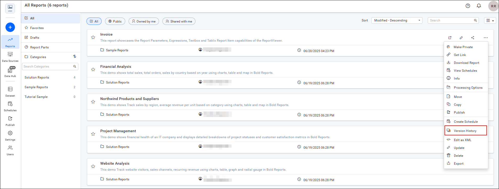
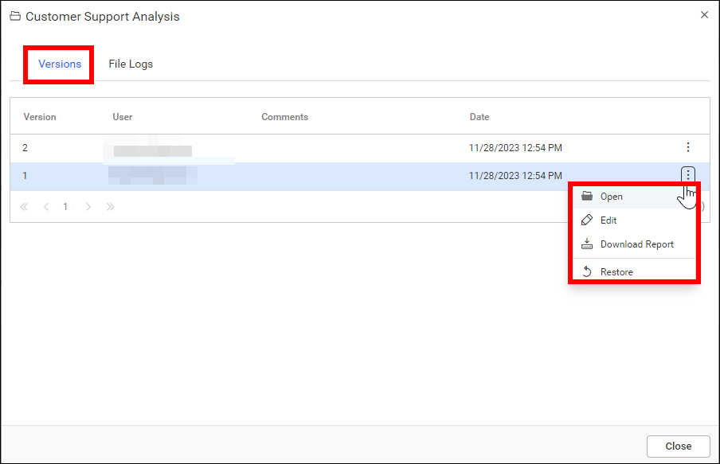
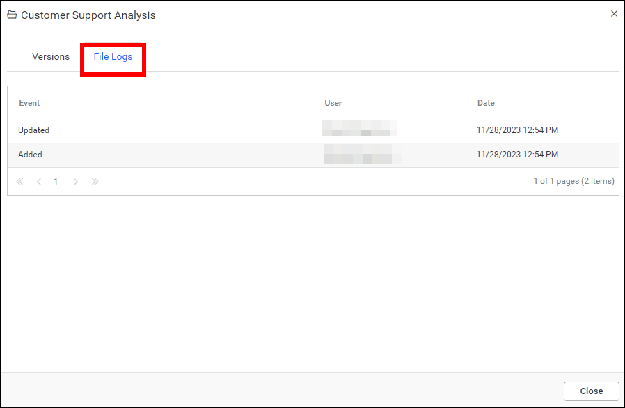

# Version history of a report in Report Server

You can view the version history of a report in {{site.productNameTM}} On-Premises Edition and roll back to an older version. The Report Server maintains versions and file logs for each report for every change made to the report.

## How do I open the version history of a report?

You open a report's version history in Report Server from the report's context menu. Click the **Version History** option in the context menu.

## Versions

Report Server creates a new version for each change in the `.rdl` file. You can open, edit, or download each version individually. At any time, you can roll the report back to an older version.

## File logs

Report Server logs the modifications for each change in the report, including changes in the event, user, and date, in the log files.

## Frequently asked questions

### When does Report Server create a new report version?

{{site.productNameTM}} Report Server creates a new version for each change in the report's `.rdl` file.

### Can I restore an older version of a report?

Yes. At any time, you can roll the report back to an older version from its version history.

## See also

* [Update a report](../update-report/)
* [Download a report](../download-report/)
* [Report information](https://help.boldreports.com/enterprise-reporting/designer-guide/manage-content/reports/report-info/)
