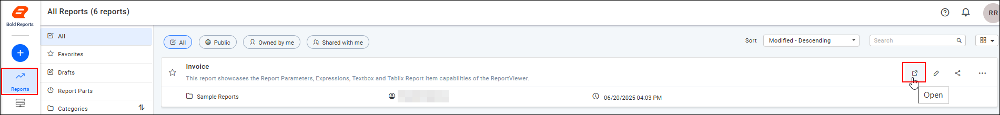
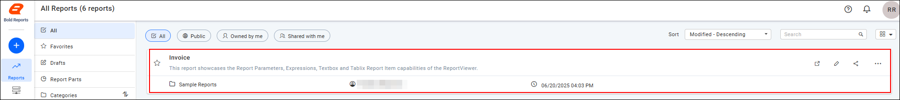
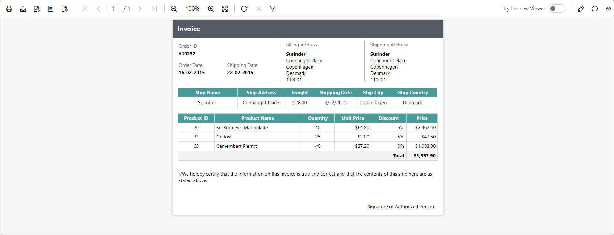
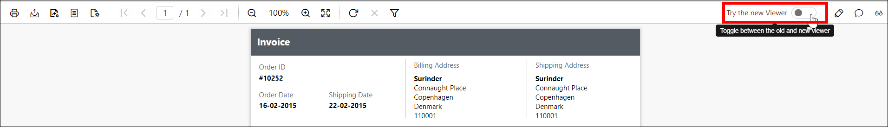
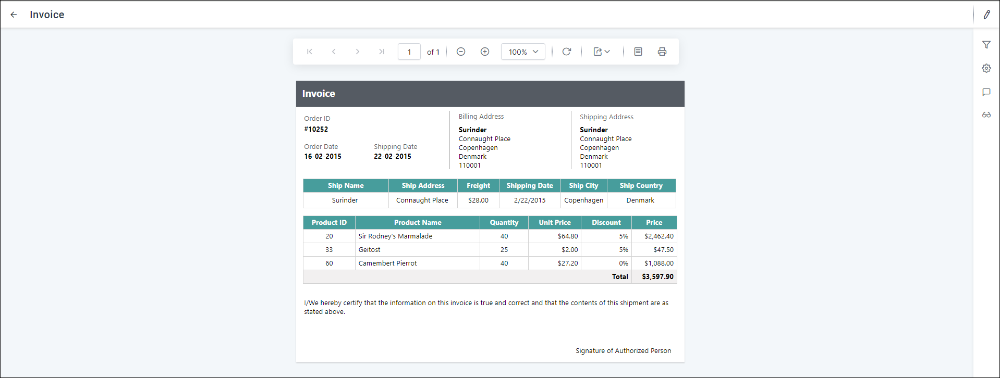
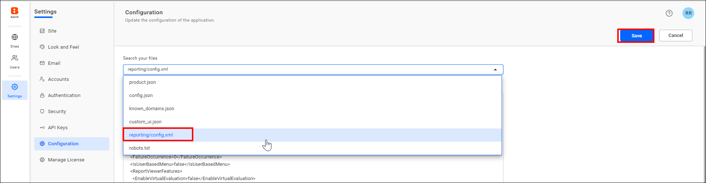
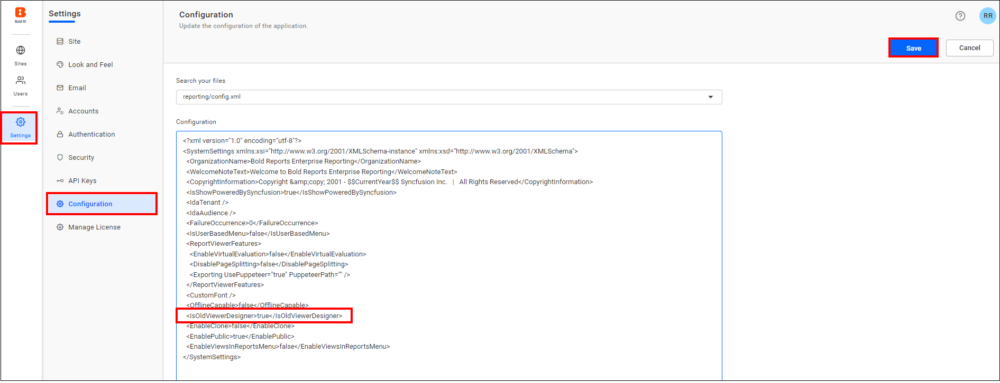
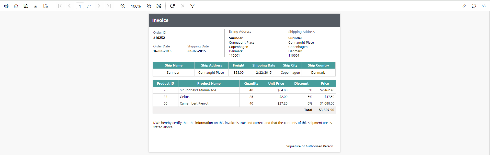

# View reports in the Report Server Report Viewer

**Viewing a report** opens it in the {{site.productNameTM}} Report Viewer directly from the Report Server, so you can display and interact with its output without leaving the browser. Use this when you need to check a report's current results without opening it for editing.

You can open a report in the Report Viewer, switch between viewer modes, and learn what changed with the new Report Viewer introduced in v6.1.

> **Note:** Starting from v6.1, reports display by default in the new Report Viewer; the old viewer's appearance has been deprecated. See [Breaking changes from v6.x](#breaking-changes-from-v6x) below.

## What is the Report Viewer?

The Report Viewer is the read-only surface {{site.productNameTM}} uses to render a published report's output. It displays the report using its existing data source and dataset connections, without exposing the design surface. Viewing a report never risks changing its layout or definition.

You can switch between the new and old viewer look using a toggle in the page header, or by setting a default viewer preference on your user profile.

### What can I do with the Report Viewer?

With the {{site.productNameTM}} Report Viewer, you can:

* Open and view any report you have permission to access.
* Interact with report parameters directly from the viewer, if the report defines any.
* Switch between viewer modes from the page header or your saved user profile preference.
* Check a report's current output before sharing, exporting, or publishing further changes.

## How do I view a report in Report Server?

You view a report in {{site.productNameTM}} Report Server by opening it from the report list.

1. Click the `Open` icon, or click the report tile in the list, to open the report.
    
    

2. Review the report, which opens in the Report Viewer.
    

    > **Note:** You can switch viewer modes using the `toggle` option in the page header, or by setting your preferred viewer mode under [Viewer / Designer preference](./../../../../administrator-guide/user-profile/) on the user profile page.
    > 

## Breaking changes from v6.x

{{site.productNameTM}} v6.1 changed the default Report Viewer. These are the breaking changes:

* From v6.1, reports display by default using the `new Report Viewer`. The `old viewer` look has been `deprecated`.
   

* If you still prefer the old viewer look, navigate to `Settings -> Configuration -> reporting/config.xml`, set the `IsOldViewerDesigner` node to **true**, and save the changes. `<IsOldViewerDesigner>true</IsOldViewerDesigner>`
   
   

* The report viewer then looks as follows:
   

* If you previously saved a viewer preference on the user profile page, that saved preference is no longer considered, and the related options are no longer available.

## What are the key features of the Report Viewer?

The {{site.productNameTM}} Report Viewer offers these features:

* **New Report Viewer (v6.1 and later)**: Reports render using the updated viewer by default, replacing the deprecated old viewer look.
* **Configurable viewer preference**: Set a default viewer mode on your user profile, or switch modes on the fly using the page header toggle.
* **Parameter interaction**: Reports that define parameters can be adjusted directly from the viewer without reopening the report.
* **Read-only rendering**: The viewer displays report output without exposing the design surface, so viewing a report never risks changing its definition.

## When should I view a report?

Open a report in the {{site.productNameTM}} Report Viewer for these common use cases:

* **Checking report output before sharing**: Confirm a report renders correctly and shows current data before sending it to others.
* **Reviewing scheduled or published reports**: Open a scheduled or published report to verify its output.
* **Temporarily reverting to the old viewer after upgrading**: Administrators can switch back to the old viewer look for a transition period following an upgrade to v6.1 or later.
* **Auditing output consistency during a viewer transition**: Compare how a report renders in the new and old viewer while your organization completes its transition to v6.1 or later.

## Who should use this guide?

This {{site.productNameTM}} Report Viewer guide is intended for:

* Business users checking report results.
* Report authors verifying report output after publishing.
* Administrators managing viewer preferences and configuration after an upgrade.

## What do I need before viewing a report?

To view a report in {{site.productNameTM}} Report Server, you need:

* Permission to access the report and its category.

No additional setup is required to view a report.

## What are the limits of the Report Viewer modes?

The {{site.productNameTM}} Report Viewer modes have these considerations and limitations:

* Starting from v6.1, the old viewer is deprecated; reverting to it requires an administrator to update the server configuration file.
* If an administrator reverts the server to the old viewer, previously saved user-profile viewer preferences are no longer considered.
* The old viewer look isn't intended for long-term use and may not receive further updates.

## FAQ

### Will I see the new or old Report Viewer after upgrading to v6.1?

Reports display in the new Report Viewer by default starting from v6.1. The old viewer look is deprecated.

### Can I still use the old viewer?

Yes, temporarily. An administrator can set `IsOldViewerDesigner` to `true` in `reporting/config.xml`, though the old look is deprecated.

### Where do I set my default viewer preference?

On the user profile page, under Viewer/Designer preference, or by using the toggle option in the report page header.

### What happens to my saved viewer preference if an administrator reverts to the old viewer?

Previously saved preferences are no longer considered, and the related preference options are unavailable while the old viewer configuration is active.

## How do I get help with the Report Viewer?

If a report doesn't open in the expected {{site.productNameTM}} Report Viewer mode, or the toggle option isn't behaving as expected, check the viewer preference on your user profile. You can also contact your administrator to confirm the server's viewer configuration.

## Related articles

* [Edit report in Web Report Designer](../edit-report/) if you need to change the report instead of just viewing it.
* [Export Report](../export-report/) to save the report's current output in a format like PDF or Excel.
* [Manage Report Views](../manage-report-views/) to save a specific set of viewer settings for reuse.
* [Viewer / Designer preference](./../../../../administrator-guide/user-profile/) to set your default viewer mode once instead of toggling it each time.
