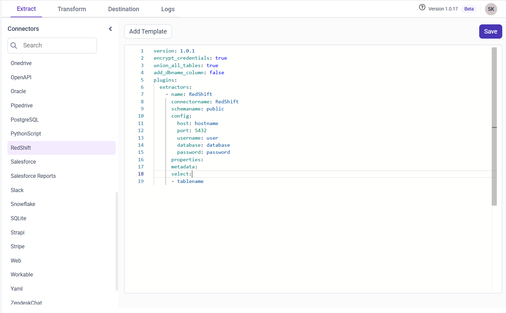
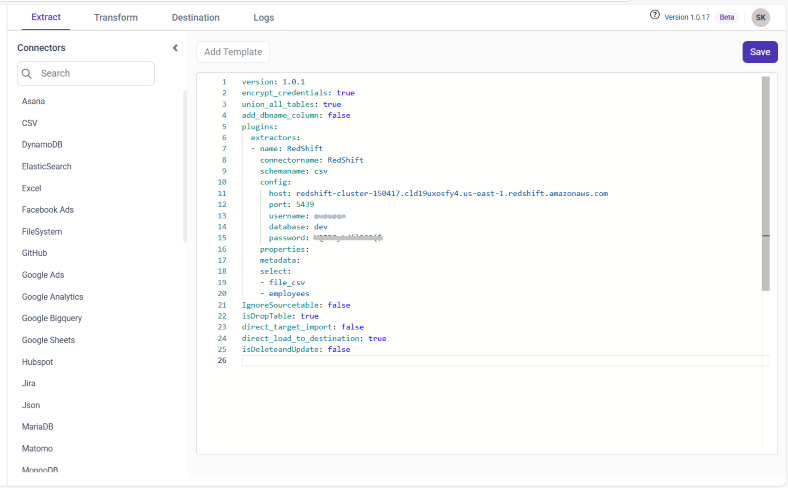

# Connect Amazon Redshift with Bold Data Hub

The Amazon Redshift connector in Bold Data Hub loads data from Amazon Redshift into a {{site.productNameTM}} data source. Amazon Redshift is a cloud-based data warehouse from AWS that uses SQL to analyze large datasets. It's known for fast query performance, easy scalability, and deep integration with other AWS services. Redshift is widely used for reporting, analytics, and big data processing.

## Connection Properties

The Amazon Redshift connector in Bold Data Hub reads the following properties from the `config` section of a YAML file:

```yaml
 connectorname: RedShift
 schemaname: <>
 host: <>
 port: <>
 username: <>
 database: <>
 password: <>
```

### Example Configuration

The following Bold Data Hub YAML template shows a complete Amazon Redshift extractor configuration:

```yaml
version: 1.0.1
destination:
plugins:
  extractors:
    - name: RedShift
      connectorname: RedShift
      schemaname: public
      config:
        host: hostname
        port: 5439
        username: user
        database: database
        password: password
      select:
        - tablename
```

## How do I connect Amazon Redshift in Bold Data Hub?

You connect Amazon Redshift by creating a pipeline in Bold Data Hub and adding the `Amazon Redshift` template to it.

1. Click the `Data Hub` icon on the Navigation Pane.

    

2. Click `Add Pipeline` and enter a name for the new pipeline.

    

3. Select the newly created pipeline and add the `Amazon Redshift` template.

    

4. Update the details required in the template, using the configuration parameters below.

5. Click **Save** and choose the destination to save the pipeline.

    

Creating a pipeline in Bold Data Hub automatically creates a data source in {{site.productNameTM}}. The {{site.productNameTM}} data source is a live data source to the destination database used in Bold Data Hub.

### Configuration Parameters

The Amazon Redshift template in Bold Data Hub uses these parameters:

|Parameters |    Description                                          |
|--------------------------|----------------------------------------------|
| **Host:**                | Specify the hostname of the Amazon Redshift server.    |
| **Port:**                | Specify the port number of the Amazon Redshift server (default is 5439). |
| **Username:**            | Provide the username to authenticate with the Amazon Redshift server. |
| **Password:**            | Provide the password to authenticate with the Amazon Redshift server. |
| **Database:**            | Specify the name of the Amazon Redshift database from which data will be extracted. |
| **Schema Name:**         | Specify the Schema name for connecting to Amazon Redshift. |
| **Select:**            | **Tablename(s):**  Specify the table name list to load tables from the Amazon Redshift server.|

## How do I schedule the Amazon Redshift pipeline?

You schedule the Amazon Redshift pipeline in Bold Data Hub from the schedules tab, or you run it on demand.

1. To configure interval-based scheduling, click the schedules tab, select the created pipeline, click the schedule icon, and configure the schedule.

    

    

2. For an on-demand refresh, click the `Run Now` button.

    

3. Check the schedule history with the history option and the logs.

    

4. Click **Logs** to see whether the run is completed and the data source is created in {{site.productNameTM}}.

    

5. Click the `Edit DataSource` option to view the created tables.

## Frequently asked questions

### What is the default Amazon Redshift port in Bold Data Hub?

The Bold Data Hub Amazon Redshift template uses port 5439 by default.

### Does Bold Data Hub create a {{site.productNameTM}} data source for Amazon Redshift?

Yes. Creating a pipeline in Bold Data Hub automatically creates a live data source in {{site.productNameTM}} for the destination database.

## See also

* [Schedule Bold Data Hub jobs](../../schedule/)
* [Work with Bold Data Hub pipelines](../../working-with-pipelines/)
* [Bold Data Hub connectors list](../)
