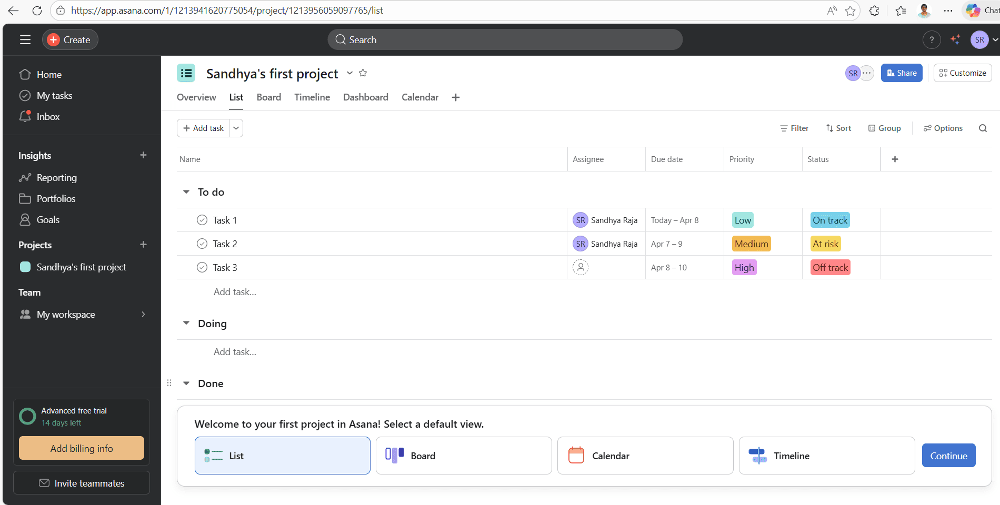
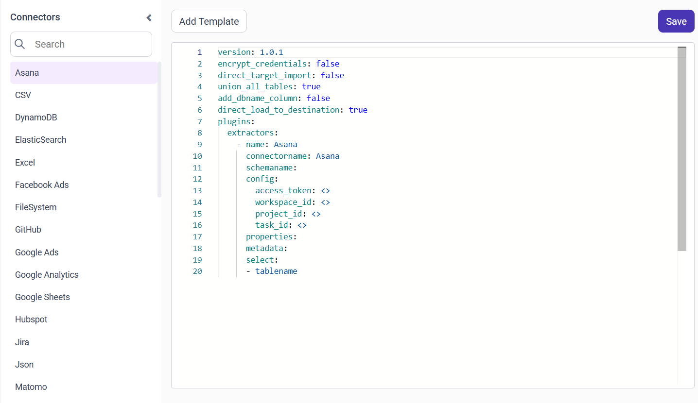
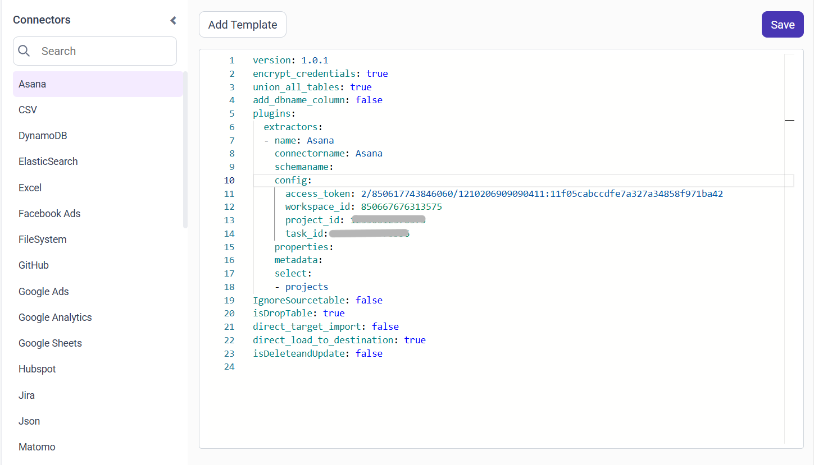

# Connect Asana with Bold Data Hub

The Asana connector in Bold Data Hub loads data from Asana into a {{site.productNameTM}} data source. Asana is a work management tool that helps teams plan, organize, and track tasks and projects in one place. It's used to improve team collaboration and productivity.

## What Asana credentials do I need?

The Bold Data Hub Asana connector needs a personal access token and a workspace ID. A project ID and a task ID are optional, but some tables require them.

### Grab Access Token

You generate the Asana personal access token for Bold Data Hub in the Asana developer console.

1. Go to the [Asana developer console](https://app.asana.com/0/developer-console).
2. Click **+ New Access Token**.
3. Enter a name (for example, "{{site.productNameTM}} Integration").
4. Click **Create Token**.
5. Copy and securely save the token. Use this value for access_token in your YAML.

### Grab WorkSpace ID

You find the Asana workspace ID for Bold Data Hub in your browser's address bar.

1. Log in to your Asana account.

    

2. Open any project or task within the workspace you want to connect.
3. Check the URL in your browser's address bar. The Workspace ID is the number that appears after /0/ in the URL. Example: ``https://app.asana.com/0/{workspaceId}/list``.

### Grab Project ID

You find the Asana project ID for Bold Data Hub in the project's URL.

1. Navigate to the specific project you want to access in Asana.
2. Look at the URL. The Project ID appears directly after the workspace section.  Example: ``https://app.asana.com/0/850617776313575/1204832734671154``
    (Project ID: 1204832734671154)

### Grab Task ID

You find the Asana task ID for Bold Data Hub in the task's URL.

1. Open a specific task.
2. Note the last number in the URL, which is the task ID. Example: ``https://app.asana.com/0/850617776313575/1204832734671160``
    (Project ID: 1204832734671160 )

## Connection Properties

The Asana connector in Bold Data Hub reads the following properties from the `config` section of a YAML file:

```yaml
 access_token: <your_access_token>
 workspace_id: <your_workspace_id>
 project_id: <optional_project_id>
 task_id: <optional_task_id>
```

### Example Configuration

The following Bold Data Hub YAML template shows a complete Asana extractor configuration:

```yaml
version: 1.0.1
encrypt_credentials: false
union_all_tables: true
add_dbname_column: false
plugins:
  extractors:
    - name: Asana
      connectorname: Asana
      schemaname:
      config:
        access_token: your-access-token
        workspace_id: your-workspace-id
        project_id: your-project-id
        task_id: your-task-id
      properties:
          metadata:
      select:
        - tablename

```

## How do I connect Asana in Bold Data Hub?

You connect Asana by creating a pipeline in Bold Data Hub and adding the Asana connector template to it.

1. Click the `Bold Data Hub` icon on the Navigation Pane.

    

2. Click `Add Pipeline` and enter a name for the new pipeline.

    

3. Select the newly created pipeline and choose the Asana connector. Double-click it, or click the **Add Template** option, to add the template.

    

4. Paste the access token into the access_token property and add the other details, using the configuration parameters below.

    

5. Click **Save** and choose the destination to save the pipeline.

    

Creating a pipeline in Bold Data Hub automatically creates a data source in {{site.productNameTM}}. The {{site.productNameTM}} data source is a live data source to the destination database used in Bold Data Hub.


>**Note:**
For tasks and sections, projectID is required.
For stories, taskID is required.

### Configuration Parameters

The Asana template in Bold Data Hub uses these parameters:

|  Parameters |  Description                                     |
|--------------------------------|---------------------------------------------|
| **Access Token:**                | Provide your Asana Personal Access Token. This is used for authenticating API requests. |
| **Workspace ID:**                 | Specify the workspace ID in Asana where your project is located. |
| **Project ID:**             |(Optional) Provide the specific project ID within the workspace whose tasks and sections you want to access. |
| **Task  ID:**             |(Optional) Specify a particular task ID if you want to fetch data for a stories. |
| **Select:**                  |    **Tablename(s):**         Provide one object. Valid values are: projects, tasks, sections, stories, tags, teams, users. |

## How do I schedule the Asana pipeline?

You schedule the Asana pipeline in Bold Data Hub from the schedules tab, or you run it on demand.

1. To configure interval-based scheduling, click the schedules tab, select the created pipeline, click the schedule icon, and configure the schedule.

    

    

2. For an on-demand refresh, click the `Run Now` button.

    

3. Check the schedule history with the history option and the logs.

    

4. Click **Logs** to see whether the run is completed and the data source is created in {{site.productNameTM}}.

    

5. Click the `Edit DataSource` option to view the created tables.

## Frequently asked questions

### Which Asana tables can Bold Data Hub load?

The Bold Data Hub Asana connector loads one object per selection. Valid values are projects, tasks, sections, stories, tags, teams, and users.

### When are the Asana project ID and task ID required?

The project ID is required for tasks and sections. The task ID is required for stories.

## See also

* [Schedule Bold Data Hub jobs](../../schedule/)
* [Work with Bold Data Hub pipelines](../../working-with-pipelines/)
* [Bold Data Hub connectors list](../)
