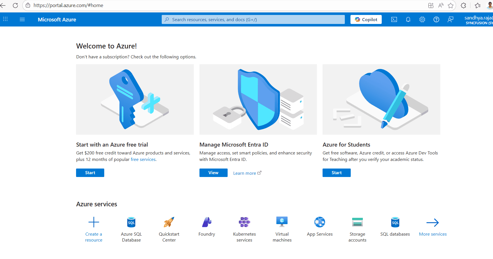
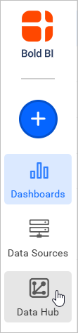
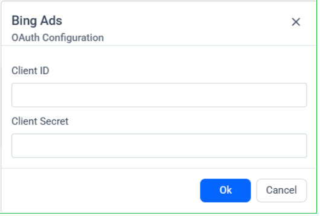
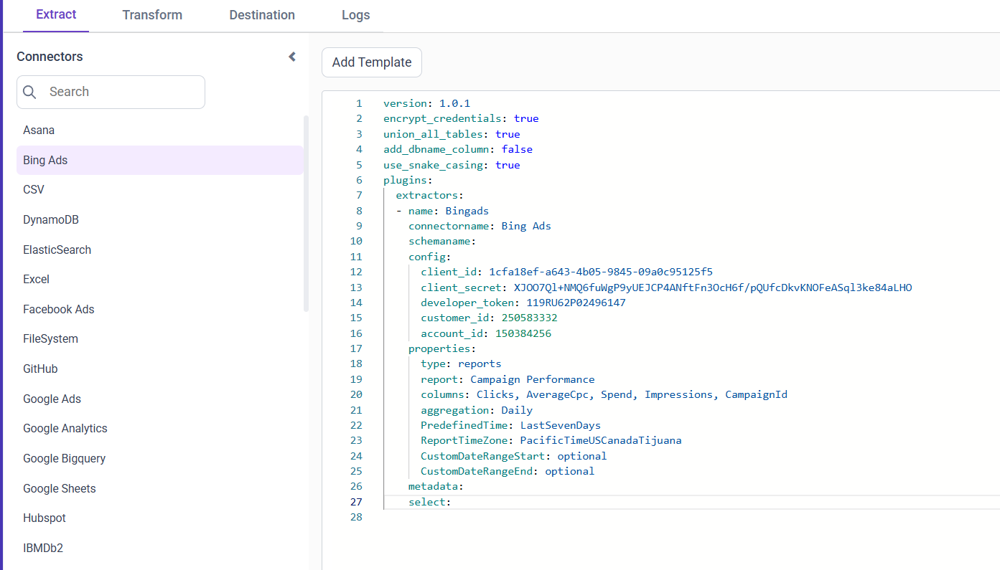

# Connect Microsoft (Bing) Ads with Bold Data Hub

The Microsoft (Bing) Ads connector in Bold Data Hub loads data from Microsoft Advertising (formerly Bing Ads) into a {{site.productNameTM}} data source. Microsoft Advertising is a platform for creating and managing ads across the Microsoft Search Network.

## What credentials do I need for Microsoft (Bing) Ads?

The Bold Data Hub Microsoft (Bing) Ads connector needs a Microsoft Advertising account with API access and a Microsoft Entra ID (formerly Azure AD) application for OAuth.

### Get Developer Token

You get the developer token for Bold Data Hub from Microsoft Advertising.

1. Sign in to [Microsoft Advertising](https://ads.microsoft.com).
2. Go to Tools > Developer Token.
3. Request and copy your Developer Token.

### Register a Microsoft Entra ID Application (Client ID and Secret)

You register a Microsoft Entra ID application in the Azure portal to get the client ID and client secret for Bold Data Hub.

1. Go to the [Azure portal](https://portal.azure.com).

    

2. Navigate to Microsoft Entra ID (formerly Azure Active Directory) > App registrations > New registration.
3. Name the app, choose supported account types, and set a redirect URI (for example, `https://localhost` or your app's redirect URL).
4. After creating the app, copy the Application (client) ID.
5. Go to Certificates & secrets > New client secret. Copy the Client Secret value.

### Find Customer ID and Account ID

You find the Customer ID and Account ID for Bold Data Hub in the Microsoft Advertising UI. Use the account switcher or the Account settings page to copy the numeric Customer ID and Account ID.

## Connection Properties

The Microsoft (Bing) Ads connector in Bold Data Hub reads the following properties from the `config` section of a YAML file:

```yaml
Connectorname: Bing Ads
Client_id: Azure AD Application (client) ID
Client_secret: Azure AD client secret
Developer_token: Microsoft Advertising Developer Token
Customer_id: Microsoft Advertising Customer ID
Account_id: Microsoft Advertising Account ID
```

### How does incremental mode work for reports?

The Microsoft (Bing) Ads reporting endpoints support date-based incremental loads in Bold Data Hub. In the provided template, reports are aggregated Daily and can use either a predefined date window or a custom date range.

Key options used by the template:

```yaml
  type: reports
  report: Campaign Performance
  aggregation: 'Daily'
  ReportTimeZone: 'PacificTimeUSCanadaTijuana'
  # Use ONE of the following time options:
  PredefinedTime: 'LastSevenDays'   # predefined window
  # OR
  # CustomDateRangeStart: 'YYYY-MM-DD'
  # CustomDateRangeEnd:   'YYYY-MM-DD'
```

**Notes**:

* Include at least one dimension column (for example, TimePeriod, CampaignId, CampaignName). Without a dimension, the API rejects the query.
* Use PredefinedTime for rolling windows or CustomDateRangeStart/End for fixed windows.

## Example Configuration

The following Bold Data Hub YAML template shows a complete Microsoft (Bing) Ads extractor configuration:

```yaml
version: 1.0.1
encrypt_credentials: false
direct_target_import: false
union_all_tables: true
add_dbname_column: false
direct_load_to_destination: true
use_snake_casing: true
plugins:
  extractors:
    - name: Bingads
      connectorname: Bing Ads
      config:
        access_token: <ACCESS_TOKEN>
        refresh_token: <REFRESH_TOKEN>
        client_id: <CLIENT_ID>
        client_secret: <CLIENT_SECRET>
        developer_token: <DEVELOPER_TOKEN>
        customer_id: <CUSTOMER_ID>
        account_id: <ACCOUNT_ID>
      properties:
        type: reports
        report: Campaign Performance
        columns: Clicks, AverageCpc, Spend, Impressions, CampaignId
        aggregation: 'Daily'
        ReportTimeZone: 'PacificTimeUSCanadaTijuana'
        # Choose ONE date option:
        PredefinedTime: 'LastSevenDays'
        # CustomDateRangeStart: '2025-09-01'
        # CustomDateRangeEnd:   '2025-09-30'
        # At least one dimension is required:
```

## How do I connect Microsoft (Bing) Ads in Bold Data Hub?

You connect Microsoft (Bing) Ads by creating a pipeline in Bold Data Hub and authenticating the Bing Ads connector with OAuth.

1. Click the `Bold Data Hub` icon on the Navigation Pane.

    

2. Click `Add Pipeline` and enter a name for the new pipeline.

    

3. Double-click the Bing Ads connector. An Authentication Setup window opens.

    

4. Enter the Client ID and Client Secret and click **Ok**.
5. Click **Allow** in the authorization window to accept the scopes requested by Bold DataHub.
6. Update the developer token and IDs in the template. Adjust the columns and date window as needed, then save to the {{site.productNameTM}} Data Store.

    

Creating a pipeline in Bold Data Hub automatically creates a data source in {{site.productNameTM}}. The {{site.productNameTM}} data source is a live data source to the destination database used in Bold Data Hub.


## Which reports does the template include?

The Bold Data Hub Microsoft (Bing) Ads template includes the Campaign Performance report with Daily aggregation.

1. Campaign Performance (Daily aggregation)
2. You can add other performance reports similarly (for example, Ad Group Performance, Ad Performance, Keyword Performance) by changing properties.report and selecting valid columns for that report.

## How do I schedule the Microsoft (Bing) Ads pipeline?

You schedule the Microsoft (Bing) Ads pipeline in Bold Data Hub from the schedules tab, or you run it on demand.

1. To configure interval-based scheduling, click the schedules tab, select the created pipeline, click the schedule icon, and configure the schedule.

    

    

2. For an on-demand refresh, click the `Run Now` button.

    

3. Check the schedule history with the history option and the logs.

    

4. Click **Logs** to see whether the run is completed and the data source is created in {{site.productNameTM}}.

    

5. Click the `Edit DataSource` option to view the created tables.

## Frequently asked questions

### Why does the Microsoft Advertising API reject my report query?

The query needs at least one dimension column, such as TimePeriod, CampaignId, or CampaignName. Without a dimension, the API rejects the query.

### Can I load a fixed date range instead of a rolling window?

Yes. Use CustomDateRangeStart and CustomDateRangeEnd for fixed windows, or PredefinedTime for rolling windows.

## Reference

1. [Microsoft Advertising API get started guide](https://learn.microsoft.com/advertising/guides/get-started)
2. [OAuth with Microsoft identity platform (v2)](https://learn.microsoft.com/advertising/guides/authentication-oauth)
3. [Microsoft Advertising developer token](https://learn.microsoft.com/advertising/guides/get-started#developer-token)
4. [Microsoft Advertising reports guide](https://learn.microsoft.com/advertising/guides/reports)
5. [Register an app in Microsoft Entra ID](https://learn.microsoft.com/azure/active-directory/develop/quickstart-register-app)

## See also

* [Schedule Bold Data Hub jobs](../../schedule/)
* [Work with Bold Data Hub pipelines](../../working-with-pipelines/)
* [Bold Data Hub connectors list](../)
