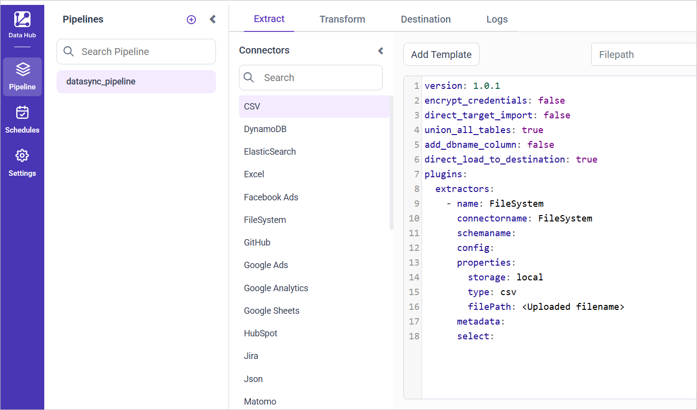
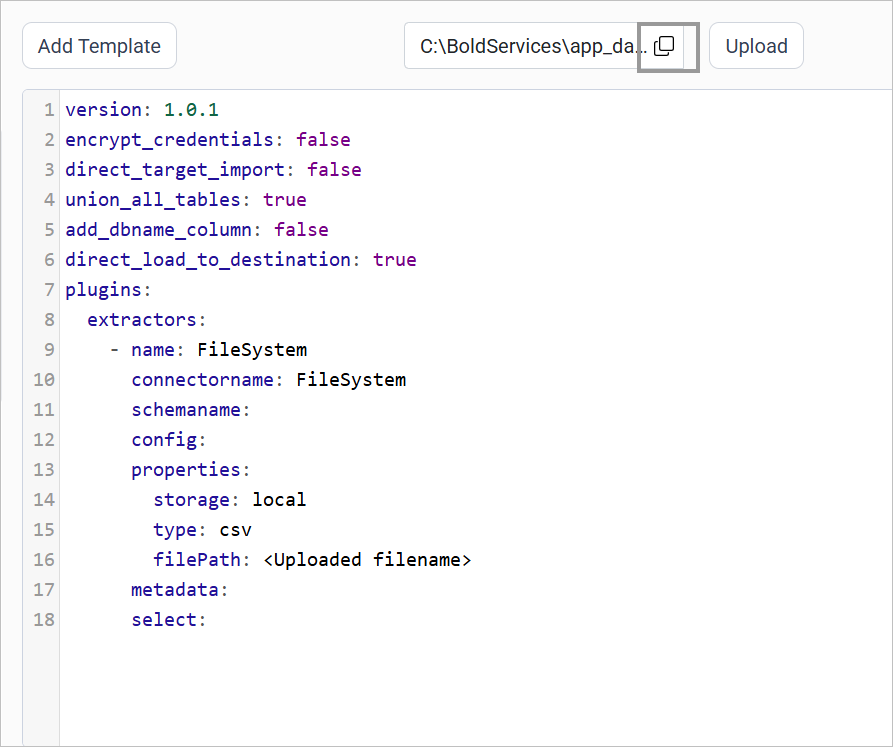
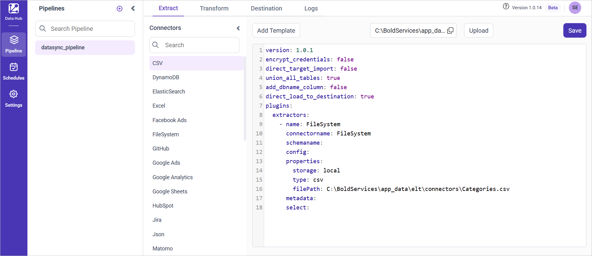

# Connect a CSV file with Bold Data Hub

The Bold Data Hub CSV connector loads data from a CSV (Comma Separated Values) file into Bold Reports<sup>®</sup>. A CSV file is a simple text file that stores data in a table format. Each line represents a row, and a comma separates each value in the row. CSV files are commonly used to import and export data between applications like Excel, databases, and reporting tools.

## Example Configuration

The Bold Data Hub CSV connector uses the `FileSystem` extractor with `type: csv`, as this YAML template shows:

```yaml
version: 1.0.1
encrypt_credentials: false
union_all_tables: true
add_dbname_column: false
use_snake_casing: true
plugins:
  extractors:
  - name: FileSystem
      connectorname: FileSystem
      schemaname:
      config:
      properties:
        storage: local
        type: csv
        filePath: C:\BoldServices\app_data\elt\connectors\products.csv
      metadata:
      select:
```

## How do I connect a CSV file in Bold Data Hub?

You connect a CSV file by creating a pipeline in Bold Data Hub, adding the `CSV` template, and pointing the filePath property to your uploaded file.

1. Click the `Data Hub` icon on the Navigation Pane.

    

2. Click `Add Pipeline` and enter a name for the new pipeline.

    

3. Select the newly created pipeline and add the `CSV` template.

    

4. Click the **Upload File** button to upload your CSV file.

    

5. Copy the file path and paste it into the filePath property.

    

    

6. Click **Save** and choose the destination to save the pipeline.

    

Creating a pipeline in Bold Data Hub automatically creates a data source in Bold Reports<sup>®</sup>. The Bold Reports<sup>®</sup> data source is a live data source to the destination database used in Bold Data Hub.


## How do I schedule the CSV pipeline?

You schedule the CSV pipeline in Bold Data Hub from the schedules tab, or you run it on demand.

1. To configure interval-based scheduling, click the schedules tab, select the created pipeline, click the schedule icon, and configure the schedule.

    

    

2. For an on-demand refresh, click the `Run Now` button.

    

3. Check the schedule history with the history option and the logs.

    

4. Click **Logs** to see whether the run is completed and the data source is created in Bold Reports<sup>®</sup>.

    

## Frequently asked questions

### Which extractor does the Bold Data Hub CSV connector use?

The Bold Data Hub CSV template uses the `FileSystem` extractor with `storage: local` and `type: csv`.

### Does a CSV pipeline create a Bold Reports<sup>®</sup> data source?

Yes. Creating a pipeline in Bold Data Hub automatically creates a live data source in Bold Reports<sup>®</sup> for the destination database.

## See also

* [Excel connector for Bold Data Hub](../excel/)
* [Schedule Bold Data Hub jobs](../../schedule/)
* [Bold Data Hub connectors list](../)
