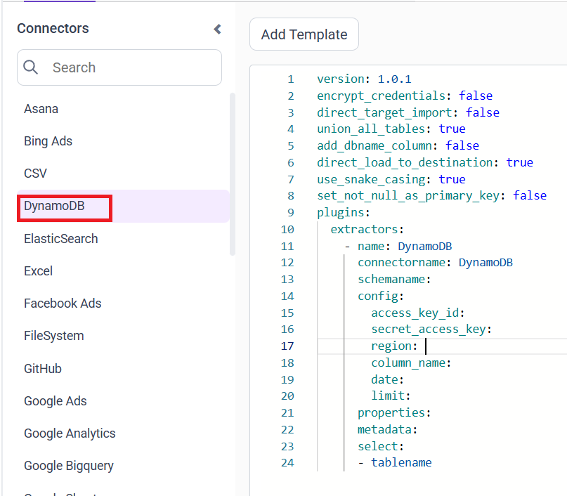
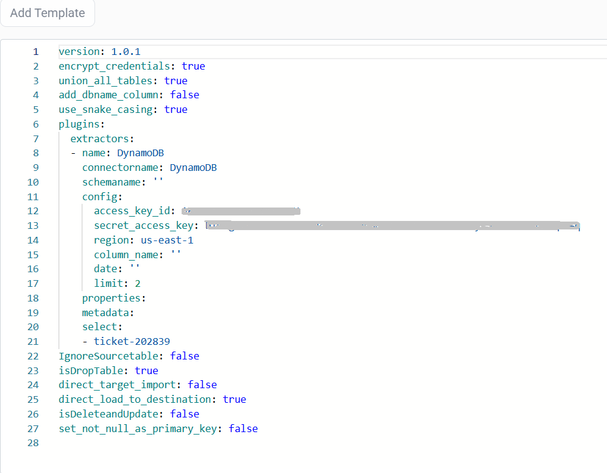

# Connect Amazon DynamoDB with Bold Data Hub

The Bold Data Hub DynamoDB connector loads data from Amazon DynamoDB into {{site.productNameTM}}. Amazon DynamoDB is a fully managed NoSQL database service that offers fast and predictable performance at any scale. It stores data as key-value and document items and automatically handles scaling, availability, and infrastructure.

## Connection Properties

The DynamoDB connector in Bold Data Hub reads the following properties from the `config` section of a YAML file:

```yaml
 access_key_id: <your access key>
 secret_access_key: <your secret key>
 region: <region>
 column_name: <column-name>
 date: <date>
 limit: <limit>
```

### Example Configuration

The following Bold Data Hub YAML template shows a complete DynamoDB extractor configuration:

```yaml
version: 1.0.1
encrypt_credentials: false
plugins:
  extractors:
    - name: DynamoDB
      connectorname: DynamoDB
      schemaname:
      config:
        access_key_id: YOUR_ACCESS_KEY
        secret_access_key: YOUR_SECRET_KEY
        region: <aws-Region>
        column_name: ''
        date: ''
        limit: 10
      properties:
      metadata:
      select:
      - tablename
```

## How do I connect DynamoDB in Bold Data Hub?

You connect Amazon DynamoDB by creating a pipeline in Bold Data Hub and adding the `DynamoDB` template to it.

1. Click the `Data Hub` icon on the Navigation Pane.

    

2. Click `Add Pipeline` and enter a name for the new pipeline.

    

3. Select the newly created pipeline and add the `DynamoDB` template.

    

4. Update the details required in the template, using the configuration parameters below.

5. Click **Save** and choose the destination to save the pipeline.

    

Creating a pipeline in Bold Data Hub automatically creates a data source in {{site.productNameTM}}. The {{site.productNameTM}} data source is a live data source to the destination database used in Bold Data Hub.


### Configuration Parameters

The DynamoDB template in Bold Data Hub uses these parameters:

|  Parameters |  Description                                     |
|--------------------------------|---------------------------------------------|
| **Access Key ID:**                | Provide your AWS Access Key ID used to authenticate the DynamoDB connection. |
| **Secret Access Key:**                 | Provide your AWS Secret Access Key associated with the above access key. |
| **Region:**             |Enter the AWS region where your DynamoDB table is hosted. Example: ap-south-1. |
| **Column Name:**             |Attribute name used for date-based filtering. Activated only when both column_name and date are provided. Example: column_name: created_at  |
| **Date:**             |The date value used for filtering. Date-based filtering occurs only when paired with a non-empty column_name. Example: date: 2025-06-10  |
| **Limit:**             |Maximum number of items returned per DynamoDB scan request. Used when no date or column filters are provided. Enables limited scans with pagination. |
| **Select:**                  |    **Tablename(s):**      Specify the table name to load data.|

## How do I schedule the DynamoDB pipeline?

You schedule the DynamoDB pipeline in Bold Data Hub from the schedules tab, or you run it on demand.

1. To configure interval-based scheduling, click the schedules tab, select the created pipeline, click the schedule icon, and configure the schedule.

    

    

2. For an on-demand refresh, click the `Run Now` button.

    

3. Check the schedule history with the history option and the logs.

    

4. Click **Logs** to see whether the run is completed and the data source is created in {{site.productNameTM}}.

    

5. Click the `Edit DataSource` option to view the created tables.

## Frequently asked questions

### When does the DynamoDB connector filter by date?

The Bold Data Hub DynamoDB connector filters by date only when both column_name and date are provided.

### What does the limit property do?

The limit property sets the maximum number of items returned per DynamoDB scan request. It is used when no date or column filters are provided, and enables limited scans with pagination.

## See also

* [Amazon Redshift connector for Bold Data Hub](../amazon-redshift/)
* [Schedule Bold Data Hub jobs](../../schedule/)
* [Bold Data Hub connectors list](../)
