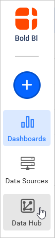
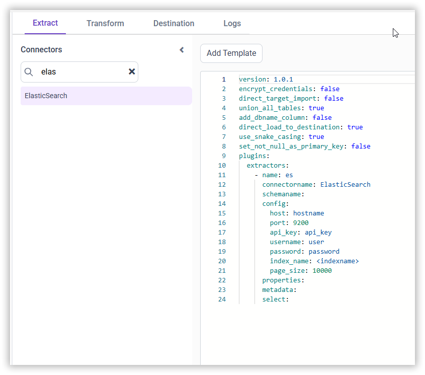

# Connect ElasticSearch with Bold Data Hub

The Bold Data Hub ElasticSearch connector loads data from an ElasticSearch cluster into {{site.productNameTM}}. ElasticSearch is a distributed, RESTful search and analytics engine that handles logs, metrics, search indexes, and application monitoring data. It is commonly used for real-time search, logging, analytics, and large-scale data ingestion.

## What ElasticSearch credentials do I need?

The Bold Data Hub ElasticSearch connector needs the host, port, and authentication details of your cluster. ElasticSearch supports both **API Key Authentication** and **Username/Password (Basic Auth)**, depending on how your cluster is configured.

### Steps to obtain connection details

Gather these ElasticSearch connection details before you configure Bold Data Hub:

1. Host & Port
    * For Elastic Cloud deployments, the host URL is provided in the cluster dashboard.
    * The port is usually 9200, unless otherwise configured.
2. API Key Authentication
    * Open the Elastic Cloud Console.
    * Navigate to Management > Security > API Keys.
    * Click **Create API Key**.
    * Enter a suitable name (for example, `boldbi-access-key`).
    * Copy the generated API Key and store it securely.
3. Username/Password
    * The default username in Elastic Cloud is: elastic.
    * Reset or copy the password from Elastic Cloud under Security Settings.

## Connection Properties

The ElasticSearch connector in Bold Data Hub reads the following properties from the `config` section of the YAML file:

```yaml
 ConnectorName**: ElasticSearch
 host**: hostname
 port**: 9200
 api_key**: api_key
 username**: user
 password**: password
 index_name**: <indexname>
 page_size**: 10000
```

## How do I connect ElasticSearch in Bold Data Hub?

You connect ElasticSearch by creating a pipeline in Bold Data Hub and adding the **ElasticSearch** template to it.

1. Click the **Bold Data Hub** icon in the left navigation panel.

    

2. Click **Add Pipeline** and enter a name for your new pipeline.

    

3. Select the newly created pipeline and add the **ElasticSearch** template.

    

4. Enter the `host`, `port`, `credentials`, and `index_name` in the template.

5. Click **Save**, then choose the destination database.

    

Creating a pipeline in Bold Data Hub automatically creates a data source in {{site.productNameTM}}. The {{site.productNameTM}} data source is a live data source to the destination database used in Bold Data Hub. For more information, see [Relationship between Bold Data Hub Pipeline and Associated Data Sources in Bold BI](https://help.boldbi.com/working-with-data-sources/working-with-bold-data-hub/relationship-between-bold-data-hub-pipeline-and-associated-data-sources-in-boldbi/).

**Warning:**
  1. The `Encrypt_Credentials` property should be set to false when updating the new access token on the template. If you have modified other properties, such as 'select' or 'account id', the `Encrypt_Credentials` property must be set to true.

## How do I schedule the ElasticSearch pipeline?

You schedule the ElasticSearch pipeline in Bold Data Hub from the schedules tab, or you run it on demand.

1. To configure interval-based scheduling, click the schedules tab, select the created pipeline, click the schedule icon, and configure the schedule.

    

    

2. For an on-demand refresh, click the `Run Now` button.

    

3. Check the schedule history with the history option and the logs.

    

4. Click **Logs** to see whether the run is completed and the data source is created in {{site.productNameTM}}.

    

5. Click the `Edit DataSource` option to view the created tables.

## Frequently asked questions

### Which authentication methods does the ElasticSearch connector support?

The Bold Data Hub ElasticSearch connector supports API Key Authentication and Username/Password (Basic Auth), depending on how your cluster is configured.

### Which port does ElasticSearch use?

The port is usually 9200, unless your cluster is configured otherwise.

## See also

* [Schedule Bold Data Hub jobs](../../schedule/)
* [Work with Bold Data Hub pipelines](../../working-with-pipelines/)
* [Bold Data Hub connectors list](../)
