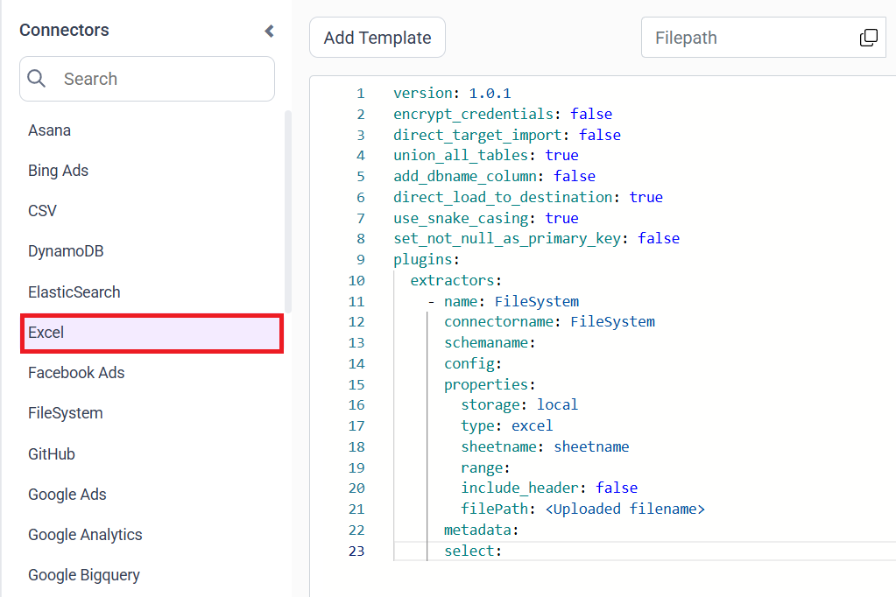
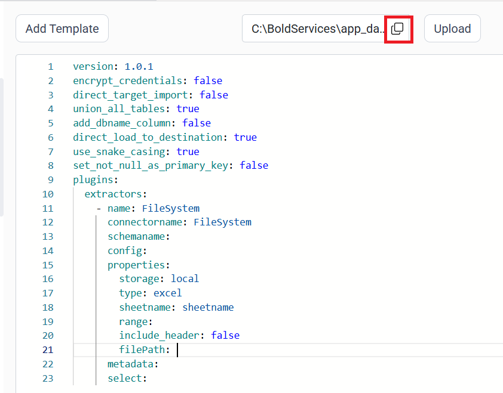
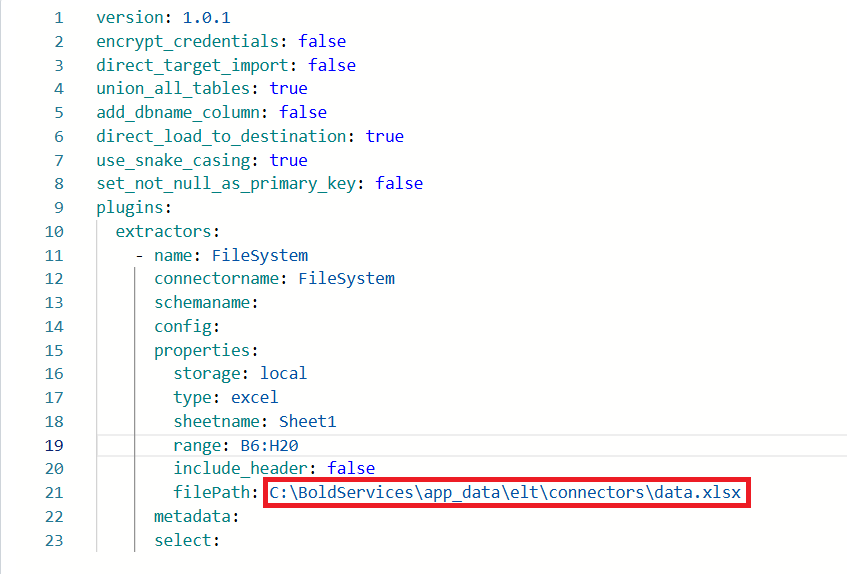

# Connect an Excel file with Bold Data Hub

The Bold Data Hub Excel connector loads data from an Excel workbook into Bold Reports<sup>®</sup>. Excel is a spreadsheet tool used to store and organize data in tables. It helps you analyze information using formulas, filters, and functions. You can also visualize your data through charts, graphs, and pivot tables.

## Example Configuration

The Bold Data Hub Excel connector uses the `FileSystem` extractor with `type: excel`, as this YAML template shows:

```yaml
version: 1.0.1
encrypt_credentials: false
union_all_tables: true
add_dbname_column: false
use_snake_casing: true
plugins:
  extractors:
  - name: FileSystem
      connectorname: FileSystem
      schemaname:
      config:
      properties:
        storage: local
        type: excel
        sheetname: Sheet1
        range: B6:H20
        include_header: true
        filePath: C:\BoldServices\app_data\elt\connectors\orderdata.xlsx
      metadata:
      select:
```

## How do I connect an Excel file in Bold Data Hub?

You connect an Excel file by creating a pipeline in Bold Data Hub, adding the `Excel` template, and pointing the filePath property to your uploaded workbook.

1. Click the `Data Hub` icon on the Navigation Pane.

    

2. Click `Add Pipeline` and enter a name for the new pipeline.

    

3. Select the newly created pipeline and add the `Excel` template.

    

4. Click the **Upload File** button to upload your Excel file.

    

5. Copy the file path and paste it into the filePath property. Also, enter the appropriate sheet name.

    

    

6. Click **Save** and choose the destination to save the pipeline.

    

Creating a pipeline in Bold Data Hub automatically creates a data source in Bold Reports<sup>®</sup>. The Bold Reports<sup>®</sup> data source is a live data source to the destination database used in Bold Data Hub.


### Configuration Parameters

The Excel template in Bold Data Hub uses these parameters:

|  Parameters |  Description                                     |
|--------------------------------|---------------------------------------------|
| **sheetname:**                | Specify the name of the Excel sheet from which the data should be read. |
| **range:**                 | Specify the cell range to extract data from a specific area of the sheet. If include_header is true, the first row from the specified range will be treated as column header. It is useful when headers are not in  first row. |
| **include_header:**             |Controls whether the first row should be treated as column names. If it is set to true,the first row is read as column headers. By default it is false and the first row is treated as data, and generic column names are assigned. |

## How do I schedule the Excel pipeline?

You schedule the Excel pipeline in Bold Data Hub from the schedules tab, or you run it on demand.

1. To configure interval-based scheduling, click the schedules tab, select the created pipeline, click the schedule icon, and configure the schedule.

    

    

2. For an on-demand refresh, click the `Run Now` button.

    

3. Check the schedule history with the history option and the logs.

    

4. Click **Logs** to see whether the run is completed and the data source is created in Bold Reports<sup>®</sup>.

    

## Frequently asked questions

### Can the Excel connector read a header row that is not the first row?

Yes. Set the range property to start at the header row and set include_header to true. The first row of the range is then treated as the column header.

### What happens when include_header is false?

By default, include_header is false. The first row is treated as data, and generic column names are assigned.

## See also

* [CSV connector for Bold Data Hub](../csv/)
* [Schedule Bold Data Hub jobs](../../schedule/)
* [Bold Data Hub connectors list](../)
