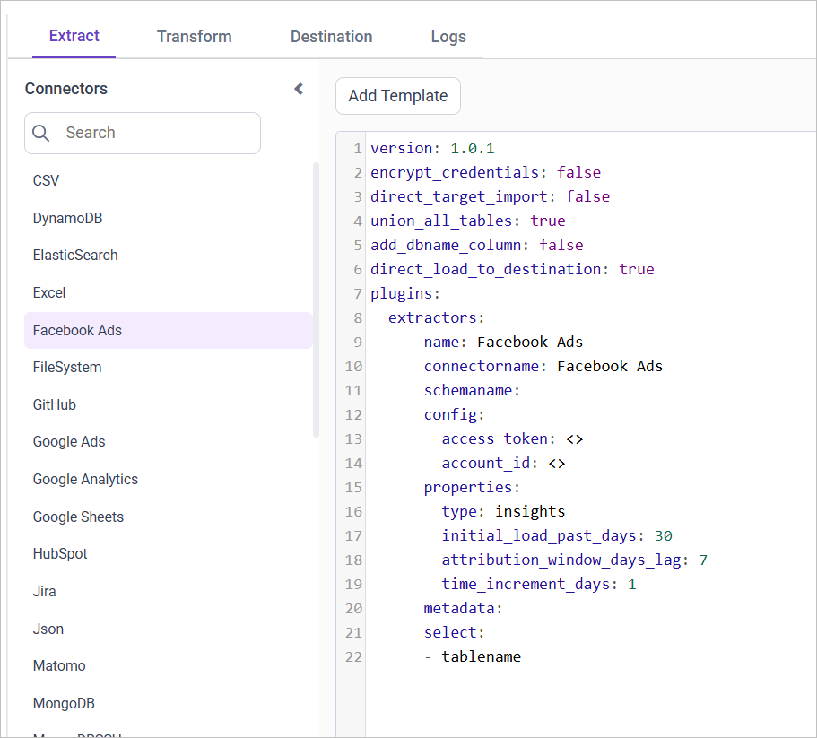
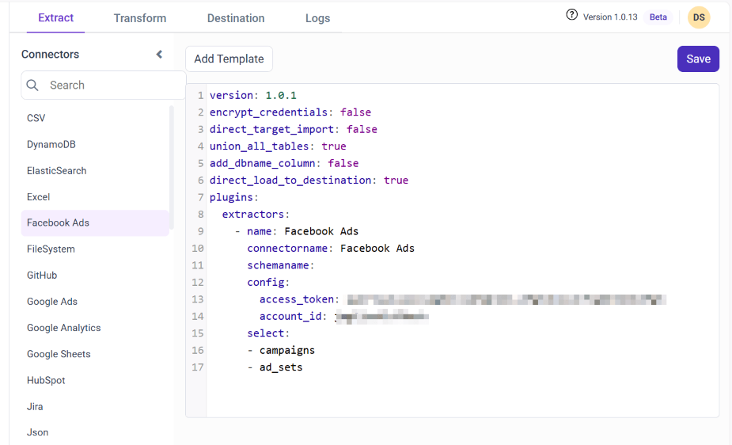

# Connect Facebook Ads with Bold Data Hub

The Bold Data Hub Facebook Ads connector loads ad data from your Facebook Ads account into {{site.productNameTM}}. Facebook Ads is the advertising platform for targeted ads on Facebook and its affiliated apps, such as Instagram and Messenger.

## What Facebook Ads credentials do I need?

The Bold Data Hub Facebook Ads connector needs your Facebook Ads account ID, an access token, and the App ID and App secret of a Meta developer app.

### Grab Account ID

You find the Facebook Ads account ID for Bold Data Hub in Ads Manager.

1. Ensure you have Ads Manager activated for your Facebook account.

2. Locate your account ID, which is a lengthy number. You can find it by clicking the Account Overview dropdown in Ads Manager or by checking the link address. For example, ``adsmanager.facebook.com/adsmanager/manage/accounts?act={accountId}``.

3. Copy the account ID.

### Grab Access_Token

You get the Facebook Ads access token for Bold Data Hub from Meta for Developers and the Graph API Explorer.

1. Sign up for a developer account at [Meta for Developers](https://developers.facebook.com).
2. Log in to your developer account and click **My Apps** in the top right corner.
3. Create an app, choose **Other** as the type, select **`Business`** as the category, and click **Next**.
4. Enter the name of your app and select the associated business manager account.
5. Navigate to the **`Basic`** settings in the left-hand side menu.
6. Copy the **`App ID`** and **`App secret`**.
7. Open the [Graph API Explorer](https://developers.facebook.com/tools/explorer/) to obtain a short-lived access token.
8. Select the created app, add **`ads_read`** and **`lead_retrieval`** permissions, and generate a short-lived access token.
9. Copy the access token.

## Connection Properties

The Facebook Ads connector in Bold Data Hub reads the following properties from the `config` section of a YAML file:

```yaml
Connectorname: FacebookAds
Access_token: FacebookAds access token
Client_id: Client’s id
Client_secret: Client’s secret
Account_id: FacebookAds Account ID
```

## Does the Facebook Ads connector support incremental mode?

In Bold Data Hub, Facebook ads doesn't support incremental mode, and Facebook insights supports incremental mode.

```yaml
properties:
        type: insights
        initial_load_past_days: 30
        attribution_window_days_lag: 7
        time_increment_days: 1
```

Incremental mode loads only the new data instead of the entire dataset. In the example, the initial load is set to 30 days, so it loads the data for the past 30 days. The load is then incremented daily, because the time increment day is set to one. The attribution window sets how far back the system goes to consider data attribution.

## Example Configuration

The following Bold Data Hub YAML templates show Facebook Ads extractor configurations for ads and for insights.

### Facebook ads

The Facebook ads template loads the resources listed in the `select` property:

```yaml
version: 1.0.1
encrypt_credentials: false
plugins:
  extractors:
    - name: fb_data
      connectorname: FacebookAds
      config:
        access_token: <ACCESS TOKEN>
        client_id: <CLIENT ID>
        client_secret: <CLIENT SECRET>
        account_id: <ACCOUNT ID>
      select:
        - ads
        - ads1
```

### Facebook insights

The Facebook insights template uses `type: insights` with the incremental mode properties:

```yaml
version: 1.0.1
encrypt_credentials: false
plugins:
  extractors:
    - name: fb_data
      connectorname: FacebookAds
      config:
        access_token: <ACCESS TOKEN>
        client_id: <CLIENT ID>
        client_secret: <CLIENT SECRET>
        account_id: <ACCOUNT ID>
      properties:
        type: insights
        initial_load_past_days: 30
        attribution_window_days_lag: 7
        time_increment_days: 1
```

## How do I connect Facebook Ads in Bold Data Hub?

You connect Facebook Ads by creating a pipeline in Bold Data Hub and adding the `Facebook Ads` template to it.

1. Click the `Bold Data Hub` icon on the Navigation Pane.

    

2. Click `Add Pipeline` and enter a name for the new pipeline.

    

3. Select the newly created project and add the `Facebook Ads` template.

    

4. Update the access token and account ID in the template, and update the resources in the `select` property.

5. Click **Save** and choose the destination to save the pipeline.

    

The Facebook Ads connector supports these resources:

```js
The available resources are supported in Facebook Ads
- campaigns
- ads
- ad_creatives
- leads
- ad_sets
 ```

Creating a pipeline in Bold Data Hub automatically creates a data source in {{site.productNameTM}}. The {{site.productNameTM}} data source is a live data source to the destination database used in Bold Data Hub.


>**Warning:**

    1. The `Encrypt_Credentials` property should be set to false when updating the new access token on the template. If you have modified other properties, such as 'select' or 'account id', the `Encrypt_Credentials` property must be set to true.  
    2. The default lifetime of the access token is 1 hour. Therefore, you need to convert it to a long-lived access token to use the same token for 60 days. Existing tables should be maintained even if the token has expired or is being used as an invalid token.

## How do I schedule the Facebook Ads pipeline?

You schedule the Facebook Ads pipeline in Bold Data Hub from the schedules tab, or you run it on demand.

1. To configure interval-based scheduling, click the schedules tab, select the created pipeline, click the schedule icon, and configure the schedule.

    

    

2. For an on-demand refresh, click the `Run Now` button.

    

3. Check the schedule history with the history option and the logs.

    

4. Click **Logs** to see whether the run is completed and the data source is created in {{site.productNameTM}}.

    

5. Click the `Edit DataSource` option to view the created tables, such as 'Campaigns' and 'Adsets' tables.

## Frequently asked questions

### How long does a Facebook access token last?

The default lifetime of the access token is 1 hour. Convert it to a long-lived access token to use the same token for 60 days.

### Which Facebook permissions does the access token need?

Add the **`ads_read`** and **`lead_retrieval`** permissions when you generate the access token in the Graph API Explorer.

## Reference

1. [Facebook Get Started](https://developers.facebook.com/docs/graph-api/get-started)
2. [Long-Lived Access Token](https://developers.facebook.com/docs/facebook-login/guides/access-tokens/get-long-lived/)

## See also

* [Google Ads connector for Bold Data Hub](../google-ads/)
* [Schedule Bold Data Hub jobs](../../schedule/)
* [Bold Data Hub connectors list](../)
