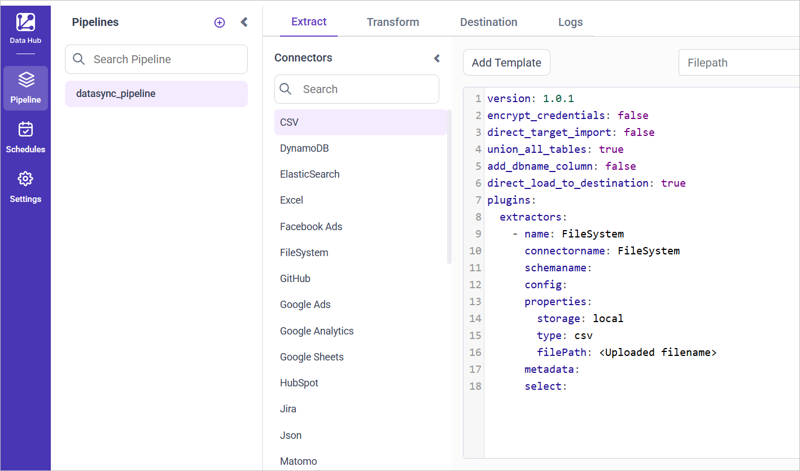
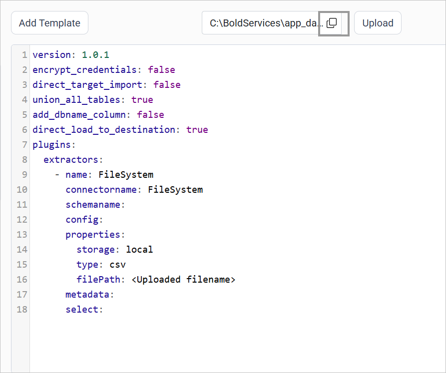
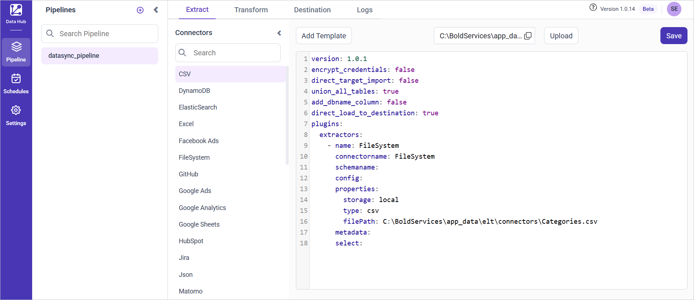
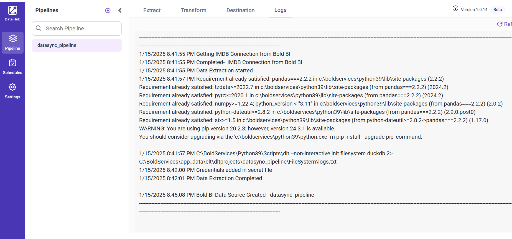
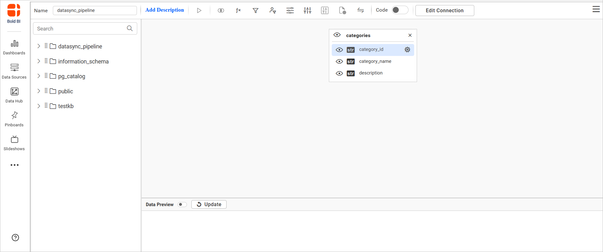

# Load local files with the Bold Data Hub FileSystem connector

The Bold Data Hub FileSystem connector streams files from the local ``filesystem`` into {{site.productNameTM}} by using the reader source.

## Which file types does the FileSystem connector support?

The Bold Data Hub FileSystem reader source supports these file types:

* Csv files
* Excel files
* Json files
* yaml files

## Example Configuration

The following Bold Data Hub YAML template shows a FileSystem extractor configuration:

```yaml
version: 1
encrypt_credentials: false
plugins:
  extractors:
    - name: FileSystem
      connectorname: FileSystem
      config:
      properties:
        type: <csv/excel/jsonl>
        filepath: <Paste the copied file path>
        # sheetname is required for excel type
        sheetname:
```

## How do I connect FileSystem, CSV, Excel, JSON, or YAML files in Bold Data Hub?

You connect local files by creating a pipeline in Bold Data Hub, adding a file connector template, and pointing the filePath property to your uploaded file.

1. Click the `Bold Data Hub` icon on the Navigation Pane.

    

2. Click `Add Pipeline` and enter a name for the new pipeline.

    

3. Select the newly created pipeline and choose the Filesystem / CSV / Excel / JSON / YAML connector. Double-click it, or click the **Add Template** option, to add the template.

    

4. Click the **Upload File** button to upload your Excel or CSV file.

    

5. Copy the file path and paste it into the filePath property. If it's an Excel file, add the sheet name. Otherwise, remove the sheet name if you use the Filesystem connector.

    

    

6. Click **Save** and choose the destination to save the pipeline.

    

7. The pipeline is saved and starts automatically. Click **Logs** to see whether the run is completed and the data source is created in {{site.productNameTM}}.

    

Creating a pipeline in Bold Data Hub automatically creates a data source in {{site.productNameTM}}. The {{site.productNameTM}} data source is a live data source to the destination database used in Bold Data Hub.


## How do I schedule the FileSystem pipeline?

You schedule the FileSystem pipeline in Bold Data Hub from the schedules tab, or you run it on demand.

1. To configure interval-based scheduling, click the schedules tab, select the created pipeline, click the schedule icon, and configure the schedule.

    

    

2. For an on-demand refresh, click the `Run Now` button.

    

3. Check the schedule history with the history option and the logs.

    

4. Click **Logs** to see whether the run is completed and the data source is created in {{site.productNameTM}}.

    

5. Click the `Edit DataSource` option to view the created tables.

    

## Frequently asked questions

### Is the sheet name required for the FileSystem connector?

The sheet name is required only for the excel type. Remove it for other file types.

### Does the FileSystem pipeline run right after I save it?

Yes. The pipeline is saved and starts automatically. Check **Logs** to confirm the run completed.

## See also

* [CSV connector for Bold Data Hub](../csv/)
* [Excel connector for Bold Data Hub](../excel/)
* [Bold Data Hub connectors list](../)
