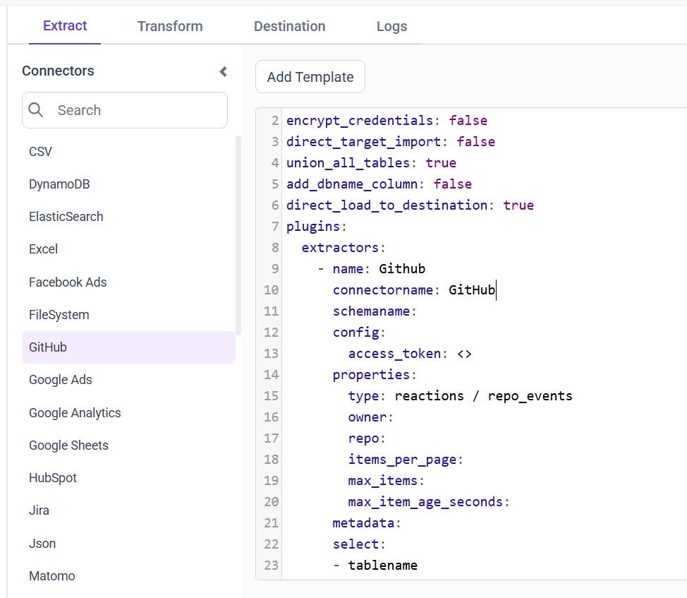
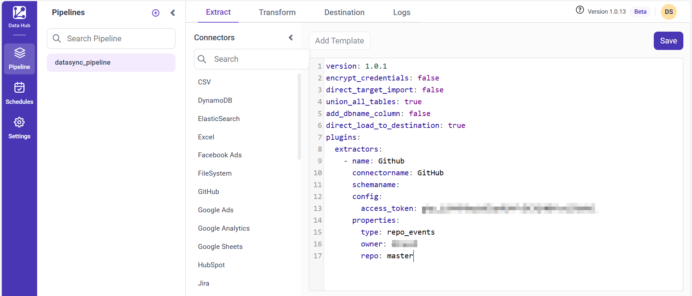

# Connect GitHub with Bold Data Hub

The Bold Data Hub GitHub connector loads data on issues or pull requests from any GitHub repository into {{site.productNameTM}} by using the GitHub API.

## How do I get a GitHub access token?

You create the GitHub API token for Bold Data Hub as a personal access token in your GitHub developer settings.

1. Click your profile picture in the top right corner.
2. Choose **Settings**.
3. Select **Developer settings** from the left panel.
4. Under **Personal access tokens**, click **Generate a personal access token** (preferably under Tokens (classic)).
5. Check the following scopes to grant permissions to the token:

   * `public_repo`: Limits access to public repositories.
   * `read:repo_hook`: Grants read and ping access to hooks in public or private repositories.
   * `read:org`: Read-only access to organization membership, organization projects, and team membership.
   * `read:user`: Grants access to read a user's profile data.
   * `read:project`: Grants read-only access to user and organization projects.
   * `read:discussion`: Allows read access for team discussions.

6. Click **Generate token**.
7. Copy the token and save it for future use.

## Connection Properties

The GitHub connector in Bold Data Hub reads the following properties from the `config` section of a YAML file:

```yaml
Connector name: GitHub
Access_token: Access token
Type: Reactions/repo_events
Owner: Owner
Repo: Repository Name
Items_per_page: Items per page
Max_items: Maximum number of items
```

## Example Configuration

The following Bold Data Hub YAML templates show GitHub extractor configurations for repository events and for reactions.

**`Repo_events:`**

```yaml
version: 1
encrypt_credentials: false
plugins:
  extractors:
    - name: Github
      connectorname: Github
      config:
        access_token: <ACCESS TOKEN>
      properties:
        type: <REPO EVENTS>
        owner: <OWNER>
```

**`Reactions:`**

```yaml
version: 1
encrypt_credentials: false
plugins:
  extractors:
    - name: Github
      connectorname: Github
      config:
        access_token: <ACCESS TOKEN>
      properties:
        type: <REACTIONS>
        owner: <OWNER>
        repo: <REPO NAME>
        items_per_page: <ITEMS PER PAGE>
        max_items: <MAX NO OF ITEMS>
        max_items_age_seconds: <MAX ITEM AGE SECONDS>
```

## How do I connect GitHub in Bold Data Hub?

You connect GitHub by creating a project in Bold Data Hub and adding the `GitHub` template to it.

1. Click the `Bold Data Hub` icon on the Navigation Pane.

    

2. Click `Add Project` and enter a name for the new project.

    

3. Select the newly created project and add the `GitHub` template.

    

4. Update the access token and repo in the template and save it to the Data Store.

    

Creating a pipeline in Bold Data Hub automatically creates a data source in {{site.productNameTM}}. The {{site.productNameTM}} data source is a live data source to the destination database used in Bold Data Hub.


>**Warning:**

    1. The `Encrypt_Credentials` property should be set to false when updating the new access token on the template. If you have modified other properties, such as 'select' or 'account id', the `Encrypt_Credentials` property must be set to true.  
    2. The default lifetime of the access token is 1 hour. Therefore, you need to convert it to a long-lived access token to use the same token for 60 days. Existing tables should be maintained even if the token has expired or is being used as an invalid token.

## How do I schedule the GitHub pipeline?

You schedule the GitHub pipeline in Bold Data Hub from the schedules tab, or you run it on demand.

1. To configure interval-based scheduling, click the schedules tab, select the created pipeline, click the schedule icon, and configure the schedule.

    

    

2. For an on-demand refresh, click the `Run Now` button.

    

3. Check the schedule history with the history option and the logs.

    

4. Click **Logs** to see whether the run is completed and the data source is created in {{site.productNameTM}}.

    

5. Click the `Edit DataSource` option to view the created tables.

## Frequently asked questions

### Which GitHub data types can Bold Data Hub load?

The Bold Data Hub GitHub connector supports the Reactions and repo_events types, set in the type property.

### Which token scopes does the GitHub connector need?

Grant the `public_repo`, `read:repo_hook`, `read:org`, `read:user`, `read:project`, and `read:discussion` scopes to the token.

## See also

* [Jira connector for Bold Data Hub](../jira/)
* [Schedule Bold Data Hub jobs](../../schedule/)
* [Bold Data Hub connectors list](../)
