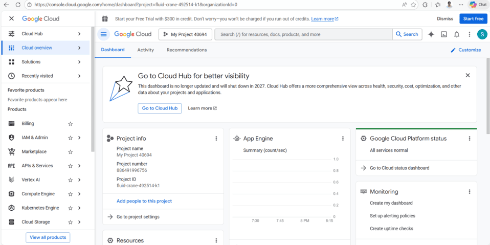
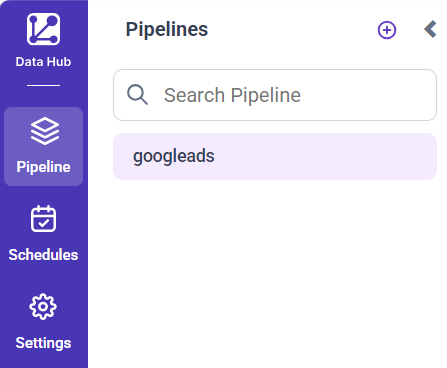
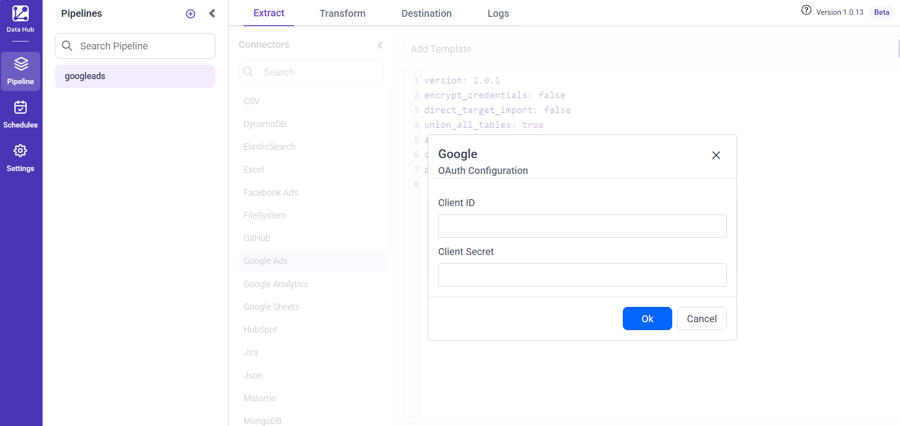
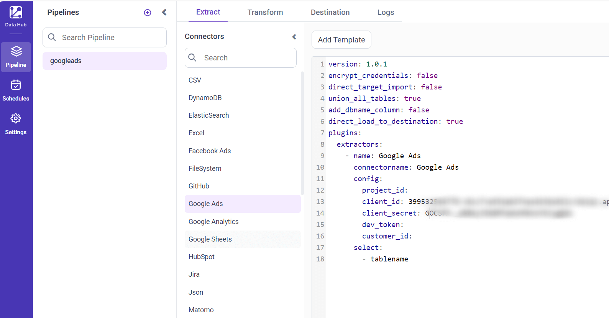
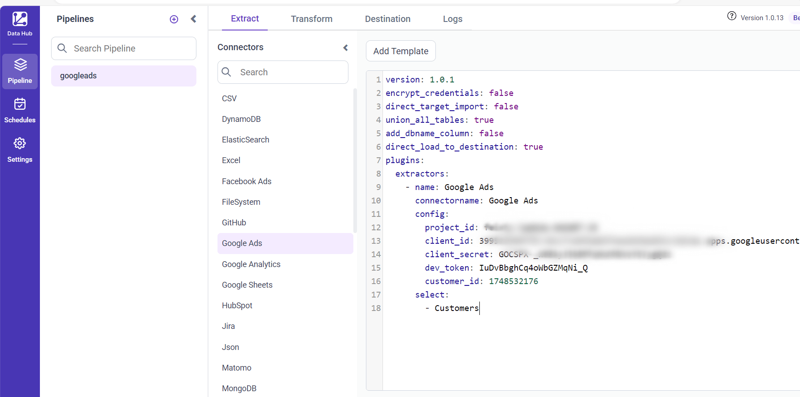
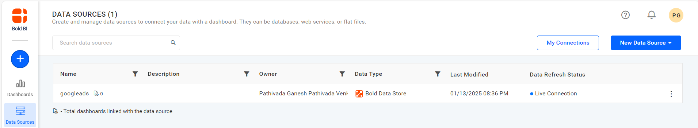
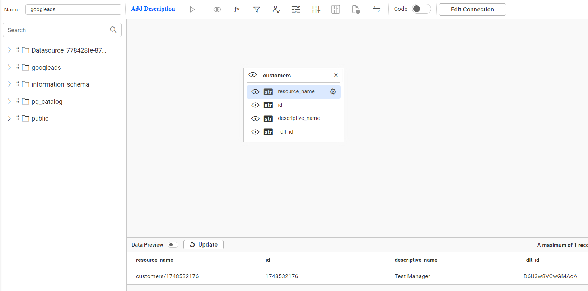

# Connect Google Ads with Bold Data Hub

The Bold Data Hub Google Ads connector loads ad campaign data from Google Ads into {{site.productNameTM}}. Google Ads is an online advertising service that tracks ad performance and audience engagement across Google platforms.

## How do I get Google OAuth 2.0 credentials?

You get the Google OAuth 2.0 client ID and client secret for Bold Data Hub from the Google Cloud console of your GCP account.

1. Sign in to [https://console.cloud.google.com](https://console.cloud.google.com).

    

2. Ensure you're logged in with the Google account associated with your project.
3. Select the project for which you want to find the OAuth 2.0 credentials.
4. In the left-hand navigation menu, go to **APIs & Services** and then select **Credentials**.
5. On the **Credentials** page, review the list of your credentials. Click the name of the OAuth 2.0 client ID you're interested in.
6. View the **Client ID** and **Client secret** on the details page that opens for that client ID.

## Connection Properties

The Google Ads connector in Bold Data Hub reads the following properties from the `config` section of a YAML file:

```yaml
Connectorname: Google Ads
project_id: Project ID
client_id: Client id
client_secret: client secret
dev_token: dev token
customer_id: customer id
```

## How do I connect Google Ads in Bold Data Hub?

You connect Google Ads by creating a project in Bold Data Hub and authenticating the Google Ads template with your OAuth 2.0 credentials.

1. Click the `Data Hub` icon on the Navigation Pane.

    

2. Click the plus icon and enter a name for the new project.

    

3. Select the newly created project.

    

4. Enter the `Client ID` and `Client Secret` and click **Ok**. The template is added with the credentials.

    

5. Update the details required in the template, using the configuration parameters below, and save it to the {{site.productNameTM}} Data Store.

    

### Configuration Parameters

The Google Ads template in Bold Data Hub uses these parameters:

|  Parameters |  Description                                     |
|--------------------------------|---------------------------------------------|
| **Project ID:**                | Specify the Google Cloud Project ID associated with your Google Ads account. |
| **Client ID:**                 | Provide the client ID obtained from your Google Cloud Console for authenticating API access. |
| **Client Secret:**             | Provide the client secret obtained from your Google Cloud Console for authenticating API access. |
| **Dev Token:**                 | Specify the developer token assigned to your Google Ads account for accessing the API. |
| **Customer ID:**               | Provide the Google Ads customer ID of the account you want to access data for. |
| **Select:**                  |    **Tablename(s):**         Specify the resources to load data from the Google Ads. |

## How do I schedule the Google Ads pipeline?

You schedule the Google Ads pipeline in Bold Data Hub from the schedules tab, or you run it on demand.

1. To configure interval-based scheduling, click the schedules tab, select the created pipeline, click the schedule icon, and configure the schedule.

    

    

2. For an on-demand refresh, click the `Run Now` button.

    

3. Check the schedule history with the history option and the logs.

    

4. Confirm that the ETL process created the data source in {{site.productNameTM}}.

    

5. Click the `Edit DataSource` option to view the created table(s), such as the 'votes' table.

    

## Frequently asked questions

### What does the Google Ads connector need to authenticate?

The Bold Data Hub Google Ads connector needs the project ID, the OAuth 2.0 client ID and client secret, a developer token, and the Google Ads customer ID.

### Where do I find the Google Ads client ID and client secret?

In the Google Cloud console, go to **APIs & Services** > **Credentials** and open your OAuth 2.0 client ID.

## See also

* [Google Analytics connector for Bold Data Hub](../google-analytics/)
* [Schedule Bold Data Hub jobs](../../schedule/)
* [Bold Data Hub connectors list](../)
