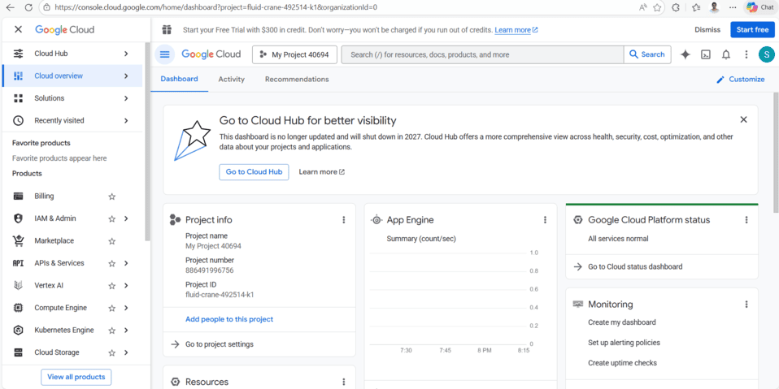
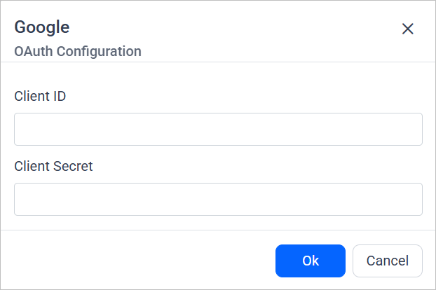
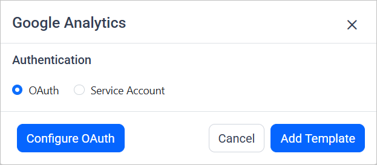
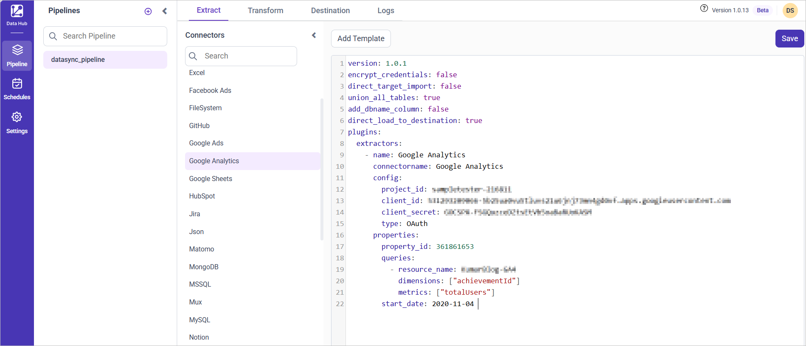
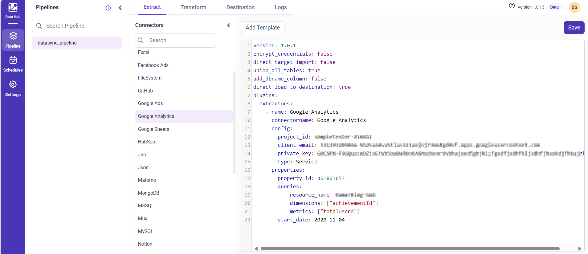
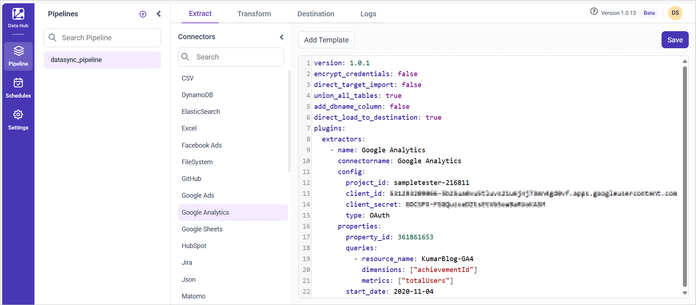

# Connect Google Analytics with Bold Data Hub

The Bold Data Hub Google Analytics connector loads web analytics data from Google Analytics into {{site.productNameTM}}. Google Analytics tracks user engagement with your website or application. You can authenticate with OAuth or with a service account.

## Service Account Credential

Service account credentials for the Bold Data Hub Google Analytics connector are more suitable for server-to-server interactions.

### Grab Google Service Account Credentials

You get Google service account credentials for Bold Data Hub from the Google Cloud console of your GCP account.

1. Sign in to [https://console.cloud.google.com](https://console.cloud.google.com).

    

2. Create a service account if necessary.
3. Enable the **Google Analytics API** (refer to Google documentation for detailed instructions).
4. Generate credentials:
    * Navigate to **IAM & Admin** in the console's left panel, and then select **Service Accounts**.
    * Find the service account you want to use and click the three-dot menu under the **Actions** column.
    * Create a new JSON key by selecting **Manage Keys** > **ADD KEY** > **CREATE**.
    * Download the ".json" file containing the necessary credentials for future use.

## How do I share the Google Analytics property with the API?

You share the Google Analytics property by adding the service account or OAuth email as a user with at least viewer privileges. Bold Data Hub can then read the property.

>**Note:** For service account authentication, use the `client_email`.

1. Log into your Google Analytics account.
2. Choose the website property you wish to share.
3. In the lower-left corner, click the **Admin** tab.
4. In the **Account** column, go to **Account Access Management**.
5. Click the blue **+** icon in the top right corner of the screen.
6. Choose **Add users** and enter the email from the service account or OAuth authentication methods. Make sure to grant at least viewer privileges.
7. Click **Add** in the top right corner to complete the process.

## Connection Properties

The Google Analytics connector in Bold Data Hub reads the following properties from the `config` section of a YAML file:

```yaml
Connectorname: Google_analytics
project_id: ID of the project
client_email: Email of the client
private_key: Private key
```

### Example Configuration

The following Bold Data Hub YAML template shows a complete Google Analytics extractor configuration:

```yaml
version: 1.0.1
encrypt_credentials: false
plugins:
  extractors:
    - name: Google_analytics_data
      connectorname: Google Analytics
      config:
        project_id: <PROJECT ID>
        client_email: <CLIENT EMAIL>
        private_key: <PRIVATE KEY>
      properties:
        property_id: <PROPERTY ID>
        query:
          - resource_name: sample_analytics_data1
            dimensions: ["browser", "city"]
            metrics: ["totalUsers", "transactions"]
          - resource_name: sample_analytics_data2
            dimensions: ["browser", "city", "dateHour"]
            metrics: ["totalUsers"]
        start_date: <START DATE>
```

## How do I connect Google Analytics in Bold Data Hub?

You connect Google Analytics in Bold Data Hub with either OAuth authentication or service authentication.

### OAuth Authentication with Google Analytics

OAuth authentication with Google Analytics in Bold Data Hub uses your client ID and client secret.

1. Double-click the connector. An Authentication Setup window opens.

    

2. Enter the Client ID and Client Secret and click **Ok**.

    

3. Click **Allow** in the authorization window to accept the scopes requested by Bold DataHub.

4. Update the project ID, client ID, and client secret in the template, and update the resources in the `properties` property.

5. Click **Save** and choose the destination to save the pipeline.

    

Creating a pipeline in Bold Data Hub automatically creates a data source in {{site.productNameTM}}. The {{site.productNameTM}} data source is a live data source to the destination database used in Bold Data Hub.


#### Service Authentication with Google Analytics

Service authentication with Google Analytics in Bold Data Hub uses the client email and private key from your service account.

1. Click the `Bold Data Hub` icon on the Navigation Pane.

    

2. Click `Add Project` and enter a name for the new project.

    

3. Select the newly created project and add the `Google Analytics` template.

    

4. Update the project ID, client email, and private key secret in the template. Also, update the resources in the `properties` property and save it to the {{site.productNameTM}} Data Store.

    

>**Warning:**

    1. The `Encrypt_Credentials` property should be set to false when updating the new access token on the template. If you have modified other properties, such as 'select' or 'account id', the `Encrypt_Credentials` property must be set to true.  
    2. The default lifetime of the access token is 1 hour. Therefore, you need to convert it to a long-lived access token to use the same token for 60 days. Existing tables should be maintained even if the token has expired or is being used as an invalid token.

## How do I schedule the Google Analytics pipeline?

You schedule the Google Analytics pipeline in Bold Data Hub from the schedules tab, or you run it on demand.

1. To configure interval-based scheduling, click the schedules tab, select the created pipeline, click the schedule icon, and configure the schedule.

    

    

2. For an on-demand refresh, click the `Run Now` button.

    

3. Check the schedule history with the history option and the logs.

    

4. Click **Logs** to see whether the run is completed and the data source is created in {{site.productNameTM}}.

    

5. Click the `Edit DataSource` option to view the created tables.

## Frequently asked questions

### Which email do I share the Google Analytics property with?

For service account authentication, share the property with the `client_email` of the service account, and grant at least viewer privileges.

### Which authentication methods does the Google Analytics connector support?

The Bold Data Hub Google Analytics connector supports OAuth authentication and service account authentication.

## See also

* [Google Ads connector for Bold Data Hub](../google-ads/)
* [Google BigQuery connector for Bold Data Hub](../google-bigquery/)
* [Bold Data Hub connectors list](../)
