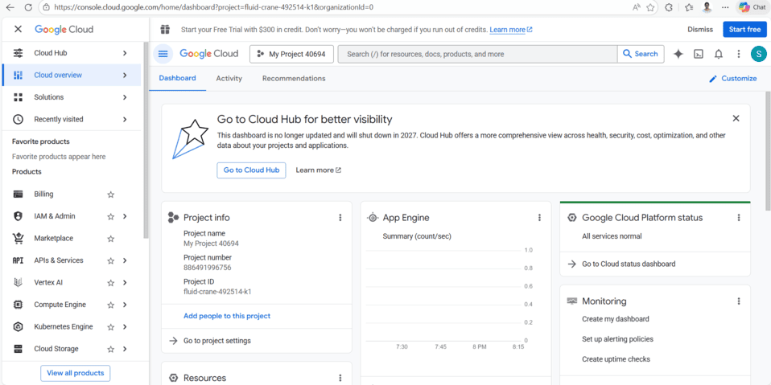
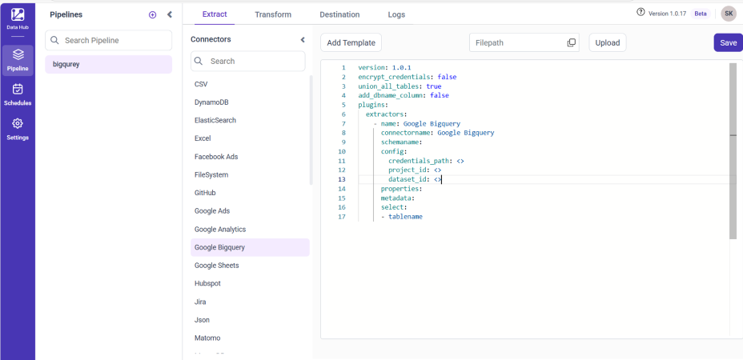
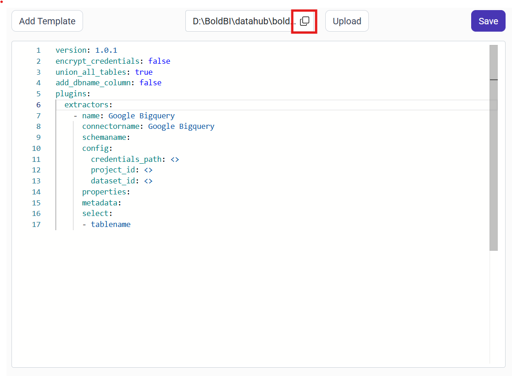
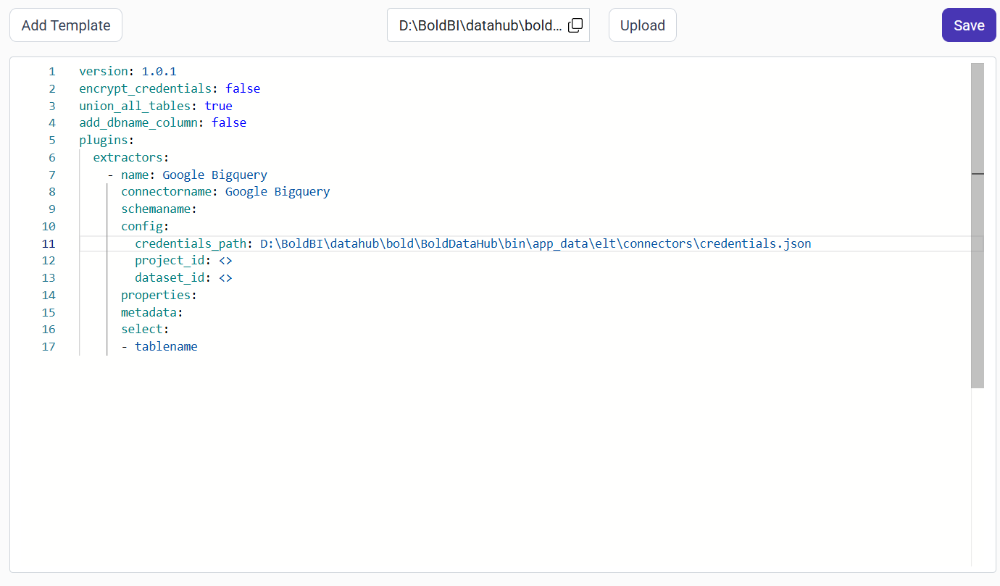
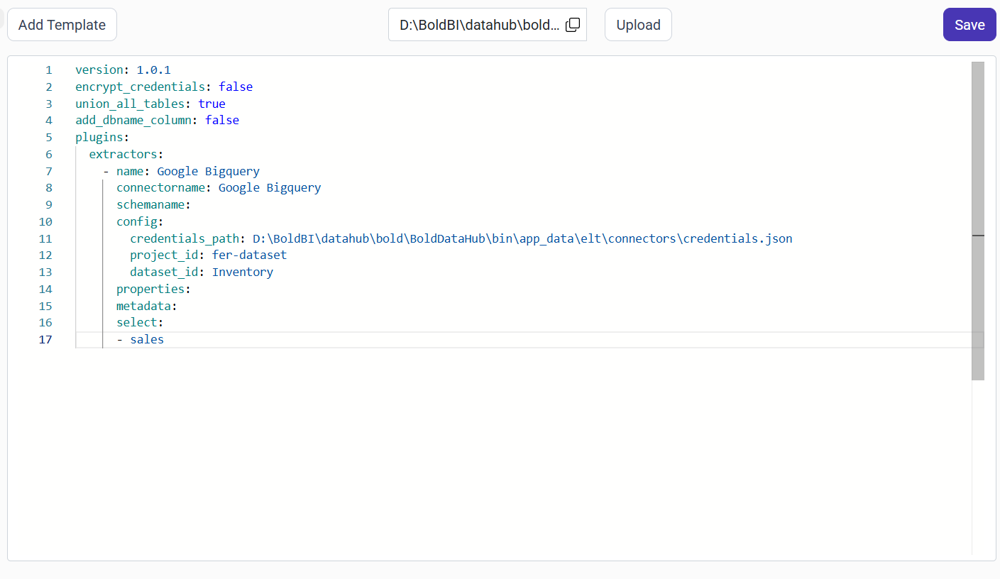
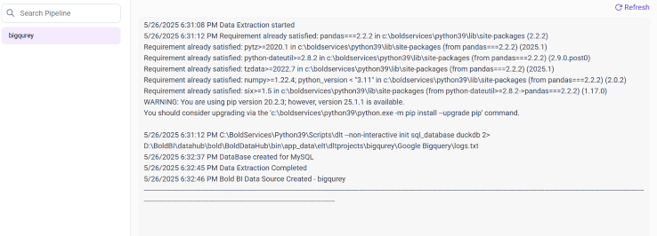
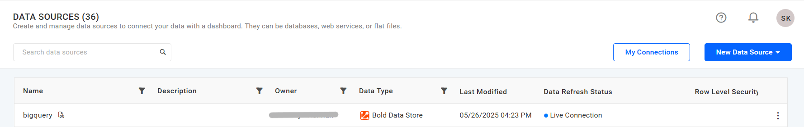

# Connect Google BigQuery with Bold Data Hub

The Bold Data Hub Google BigQuery connector loads data from BigQuery datasets into {{site.productNameTM}}. Google BigQuery is a fully managed, serverless data warehouse for fast SQL-based querying of large datasets. It is designed to handle massive volumes of data, making it ideal for advanced analytics and reporting use cases.

## Service Account Credential

Service account credentials for the Bold Data Hub Google BigQuery connector are more suitable for server-to-server interactions.

### Grab Google Service Account Credentials

You get Google service account credentials for Bold Data Hub from the Google Cloud console of your GCP account.

1. Sign in to [https://console.cloud.google.com](https://console.cloud.google.com).

    

2. Create a service account if necessary.
3. Enable the **BigQuery API** (refer to Google documentation for detailed instructions).
4. Generate credentials:
    * Navigate to **IAM & Admin** in the console's left panel, then select **Service Accounts**.
    * Find the service account you want to use and click the three-dot menu under the **Actions** column.
    * Create a new JSON key by selecting **Manage Keys** > **ADD KEY** > **CREATE**.
    * Download the `.json` file containing the necessary credentials for future use.

## How do I share the Google BigQuery project with the API?

You share the Google BigQuery project by granting the service account's `client_email` access in Google Cloud IAM. Bold Data Hub can then read your datasets.

1. Log into your [Google Cloud Console](https://console.cloud.google.com).
2. Navigate to the project that contains your BigQuery datasets.
3. In the left-hand menu, go to **IAM & Admin > IAM**.
4. Click the **"+ Grant Access"** button at the top.
5. In the **New principals** field, enter the `client_email` from the service account.
6. Assign the required role(s):
   * **BigQuery Data Viewer**: to view datasets and tables.
   * **BigQuery Read Session User**: to enable fast and efficient reads via the BigQuery Storage AP.
   * *(Optional)* **BigQuery Admin**: for full read-write access to BigQuery resources.
7. Click **Save** to complete the process.

## Connection Properties

The Google BigQuery connector in Bold Data Hub reads the following properties from the `config` section of a YAML file:

```yaml
credentials_path: Path to your service account JSON file  
project_id: ID of your Google Cloud project  
dataset_id: ID of the dataset in BigQuery
```

### Example Configuration

The following Bold Data Hub YAML template shows a complete Google BigQuery extractor configuration:

```yaml
version: 1.0.1
encrypt_credentials: false
union_all_tables: true
add_dbname_column: false
plugins:
  extractors:
    - name: Google Bigquery
      connectorname: Google Bigquery
      schemaname:
        config:
          credentials_path: C:\\Path\\To\\ServiceAccount.json
          project_id: your-project-id
          dataset_id: your-dataset-id
        properties:
          metadata:
            select:
              - your_table_name
```

## How do I connect Google BigQuery in Bold Data Hub?

You connect Google BigQuery by creating a pipeline in Bold Data Hub, adding the Google BigQuery template, and pointing the credentials_path property to your uploaded JSON key file.

1. Click the `Bold Data Hub` icon on the Navigation Pane.

    

2. Click `Add Pipeline` and enter a name for the new pipeline.

    

3. Select the newly created pipeline and choose the Google BigQuery connector. Double-click it, or click the **Add Template** option, to add the template.

    

4. Click the **Upload File** button to upload your credentials JSON file.

    

5. Copy the file path of the JSON file and paste it into the credentials_path property.

    

    

    

6. Click **Save** and choose the destination to save the pipeline.

    

7. The pipeline is saved and starts automatically. Click **Logs** to see whether the run is completed and the data source is created in {{site.productNameTM}}.

    

Creating a pipeline in Bold Data Hub automatically creates a data source in {{site.productNameTM}}. The {{site.productNameTM}} data source is a live data source to the destination database used in Bold Data Hub.



>**Warning:**

    1. The `Encrypt_Credentials` property should be set to false when updating the new access token on the template. If you have modified other properties, such as 'select' or 'account id', the `Encrypt_Credentials` property must be set to true.  
    2. The default lifetime of the access token is 1 hour. Therefore, you need to convert it to a long-lived access token to use the same token for 60 days. Existing tables should be maintained even if the token has expired or is being used as an invalid token.

### Configuration Parameters

The Google BigQuery template in Bold Data Hub uses these parameters:

|  Parameters |  Description                                     |
|--------------------------------|---------------------------------------------|
| **Project ID:**                | Specify the Google Cloud Project ID associated with your BigQuery account. |
| **Credentials Path:**                 | Provide the local path to your Google Cloud service account .json key file. |
| **Dataset ID:**             |Specify the ID of the BigQuery dataset that contains the tables you want to access. |
| **Select:**                  |    **Tablename(s):**         Provide one or more table names from which to load data in the BigQuery dataset. |

## How do I schedule the Google BigQuery pipeline?

You schedule the Google BigQuery pipeline in Bold Data Hub from the schedules tab, or you run it on demand.

1. To configure interval-based scheduling, click the schedules tab, select the created pipeline, click the schedule icon, and configure the schedule.

    

    

2. For an on-demand refresh, click the `Run Now` button.

    

3. Check the schedule history with the history option and the logs.

    

4. Click **Logs** to see whether the run is completed and the data source is created in {{site.productNameTM}}.

    

5. Click the `Edit DataSource` option to view the created tables.

## Frequently asked questions

### Which BigQuery roles does the service account need?

Assign **BigQuery Data Viewer** and **BigQuery Read Session User** to the service account. **BigQuery Admin** is optional, for full read-write access.

### How does Bold Data Hub authenticate with Google BigQuery?

The Bold Data Hub Google BigQuery connector uses a service account JSON key file, set in the credentials_path property.

## See also

* [Google Analytics connector for Bold Data Hub](../google-analytics/)
* [Google Sheets connector for Bold Data Hub](../google-sheets/)
* [Bold Data Hub connectors list](../)
