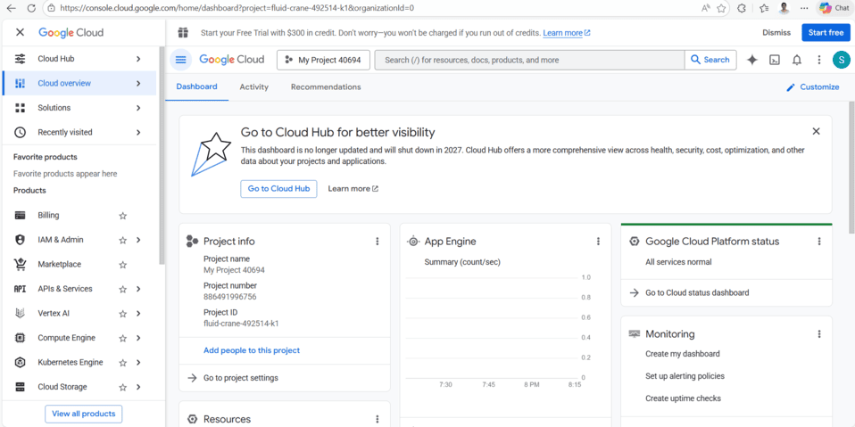
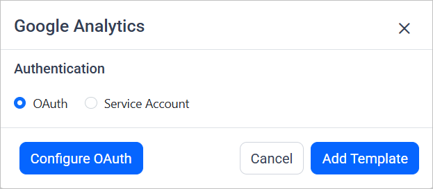
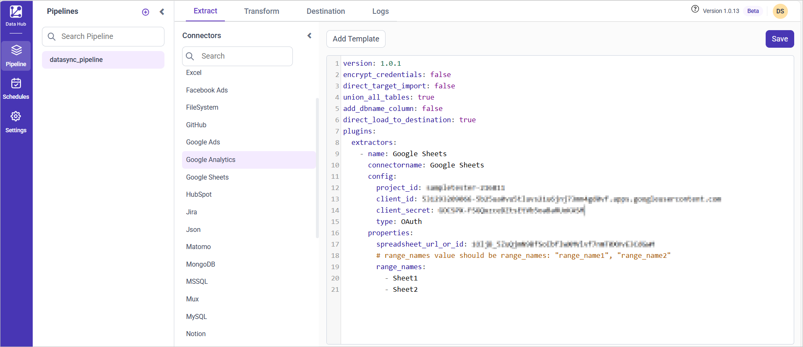
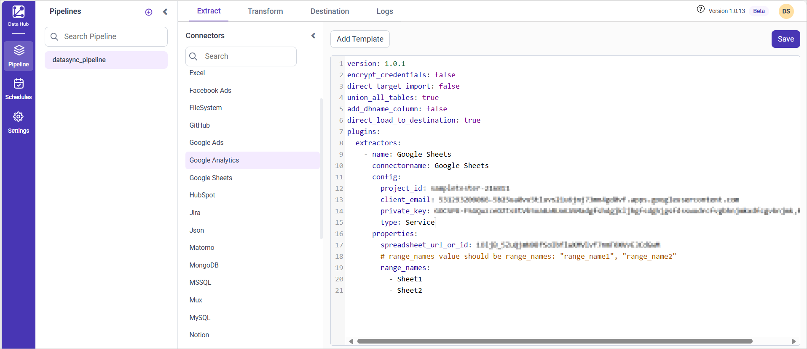
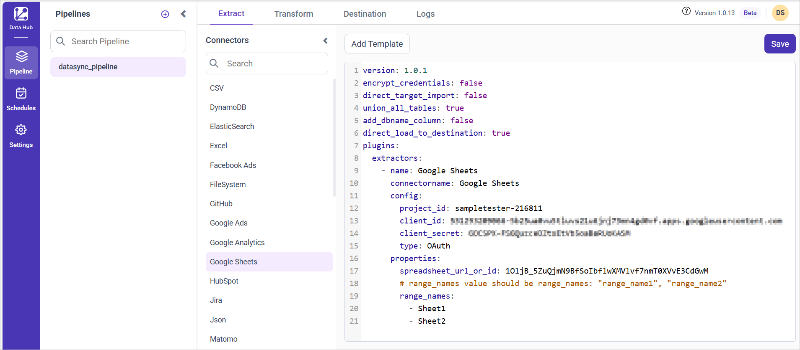

# Connect Google Sheets with Bold Data Hub

The Bold Data Hub Google Sheets connector loads spreadsheet data from Google Sheets into {{site.productNameTM}}. Google Sheets is a cloud-based spreadsheet application in the Google Workspace suite. You can authenticate with OAuth or with a service account.

## Service Account Credential

Service account credentials for the Bold Data Hub Google Sheets connector are better suited for server-to-server interactions. Therefore, we recommend using service account credentials.

### Google Service Account Credentials

You get Google service account credentials for Bold Data Hub from the Google Cloud console of your GCP account.

1. Sign in to [https://console.cloud.google.com](https://console.cloud.google.com).

    

2. Create a service account if needed.
3. Enable the **Google Sheets API** (refer to Google documentation for comprehensive instructions).
4. Generate credentials:
    * Go to **IAM & Admin** in the console's left panel, then choose **Service Accounts**.
    * Locate the service account you plan to use, and click the three-dot menu under the **Actions** column next to it.
    * Create a new JSON key by selecting **Manage Keys** > **ADD KEY** > **CREATE**.
    * Download the ".json" file containing the necessary credentials for future use.

## Connection Properties

The Google Sheets connector in Bold Data Hub reads the following properties from the `config` section of a YAML file:

```yaml
Connectorname: GoogleSheets
project_id: Project ID
client_email: Client Email
private_key: Private Key
spreadsheet_url_or_id: Spreadsheet URL or ID
Range_names: Ranges of the names
spreadsheet_identifier: `spreadsheet_identifier = "https://docs.google.com/spreadsheets/d/1VTtCiYgxjAwcIw7UM1_BSaxC3rzIpr0HwXZwd2OlPD4/edit?usp=sharing"`
```

### Example Configuration

The following Bold Data Hub YAML template shows a complete Google Sheets extractor configuration:

```yaml
version: 1.0.1
encrypt_credentials: false
plugins:
  extractors:
    - name: Google Sheets
      connectorname: Google Sheets
      config:
        project_id:
        client_email:
        private_key:
      properties:
        spreadsheet_url_or_id:
        # range_names value should be range_names: "range_name1", "range_name2"
        range_names:
```

## How do I connect Google Sheets in Bold Data Hub?

You connect Google Sheets in Bold Data Hub with either OAuth authentication or service authentication.

### OAuth Authentication with Google Sheets

OAuth authentication with Google Sheets in Bold Data Hub uses your client ID and client secret.

1. Double-click the connector. An Authentication Setup window opens.

    

2. Enter the Client ID and Client Secret and click **Ok**.

    

3. Click **Allow** in the authorization window to accept the scopes requested by Bold DataHub.

4. Update the project ID, client ID, and client secret in the template, and update the resources in the `properties` property.

5. Click **Save** and choose the destination to save the pipeline.

    

Creating a pipeline in Bold Data Hub automatically creates a data source in {{site.productNameTM}}. The {{site.productNameTM}} data source is a live data source to the destination database used in Bold Data Hub.


#### Service Authentication with Google Sheets

Service authentication with Google Sheets in Bold Data Hub uses the client email and private key from your service account.

1. Click the `Bold Data Hub` icon on the Navigation Pane.

    

2. Click `Add Project` and enter a name for the new project.

    

3. Select the newly created project and add the `Google Sheets` template.

    

4. Update the project ID, client email, and private key in the template. Also, update the resources in the `properties` property and save it to the Data Store.

    

>**Warning:**

    1. The `Encrypt_Credentials` property should be set to false when updating the new access token on the template. If you have modified other properties, such as 'select' or 'account id', the `Encrypt_Credentials` property must be set to true.  
    2. The default lifetime of the access token is 1 hour. Therefore, you need to convert it to a long-lived access token to use the same token for 60 days. Existing tables should be maintained even if the token has expired or is being used as an invalid token.

## How do I schedule the Google Sheets pipeline?

You schedule the Google Sheets pipeline in Bold Data Hub from the schedules tab, or you run it on demand.

1. To configure interval-based scheduling, click the schedules tab, select the created pipeline, click the schedule icon, and configure the schedule.

    

    

2. For an on-demand refresh, click the `Run Now` button.

    

3. Check the schedule history with the history option and the logs.

    

4. Click **Logs** to see whether the run is completed and the data source is created in {{site.productNameTM}}.

    

5. Click the `Edit DataSource` option to view the created tables.

## Frequently asked questions

### Which authentication method is recommended for Google Sheets?

For the Bold Data Hub Google Sheets connector, service account credentials are recommended because they are better suited for server-to-server interactions.

### How do I specify multiple ranges in the Google Sheets template?

Set the range_names value as a list, for example `range_names: "range_name1", "range_name2"`.

## See also

* [Excel connector for Bold Data Hub](../excel/)
* [Google BigQuery connector for Bold Data Hub](../google-bigquery/)
* [Bold Data Hub connectors list](../)
