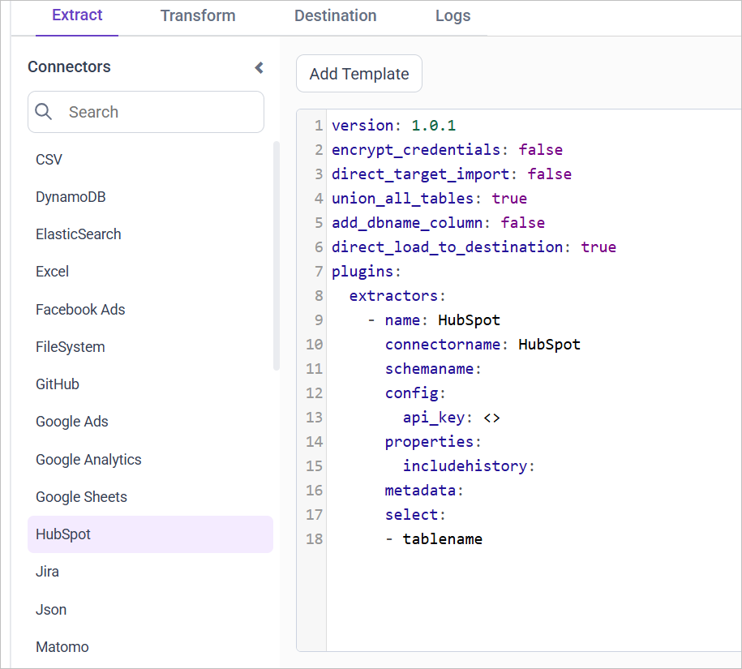

# Connect HubSpot with Bold Data Hub

The Bold Data Hub HubSpot connector loads CRM data from HubSpot into Bold Reports<sup>®</sup>. HubSpot is a customer relationship management (CRM) and inbound marketing platform.

## How do I get HubSpot credentials?

You authenticate the Bold Data Hub HubSpot connector with a private app access token that you create in HubSpot.

>**Note**: As of November 30, 2022, HubSpot API Keys are being deprecated and are no longer supported. Instead, it is recommended to authenticate using a private app access token or OAuth access token. Follow these steps to create a private app and get an authentication token before running the pipeline:

1. In HubSpot, click the settings icon to access settings.
2. Under `Account Setup` in the left sidebar, choose `Integrations` > `Private Apps`.
3. Select `Create a private app`.
4. In the `Basic Info` tab, enter a name and description.
5. In the `Scopes` tab, grant:
   * Read scopes for CMS, CRM, and Settings.
   * Permissions for: `business-intelligence`, `actions`, `crm.export`, `e-commerce`, `oauth`, `tickets`.
6. Click `Create app` > `Continue Creating`.
7. Click `Show token` and copy it.

## Connection Properties

The HubSpot connector in Bold Data Hub reads the following properties from the `config` section of a YAML file:

```yaml
ConnectorName: HubSpot
api_key: API key
```

### Example Configuration

The following Bold Data Hub YAML template shows a complete HubSpot extractor configuration:

```yaml
version: 1.0.1
encrypt_credentials: false
plugins:
  extractors:
    - name: HubSpot_data
      connectorname: HubSpot
      config:
         api_key: <API KEY>
      select:
        -Table1
        -Table2
      properties:
         includehistory: <true/false>
```

## How do I connect HubSpot in Bold Data Hub?

You connect HubSpot by creating a project in Bold Data Hub and adding the `Hubspot` template to it.

1. Click the `Bold Data Hub` icon on the Navigation Pane.

    

2. Click `Add Project` and enter a name for the new project.

    

3. Select the newly created project and add the `Hubspot` template.

    

4. Update the API Key in the template, and update the resources in the `select` property.

5. Click **Save** and choose the destination to save the pipeline.

Creating a pipeline in Bold Data Hub automatically creates a data source in Bold Reports<sup>®</sup>. The Bold Reports<sup>®</sup> data source is a live data source to the destination database used in Bold Data Hub.


### Which HubSpot resources can I load?

The Bold Data Hub HubSpot connector supports these resources in the `select` property:

```js
The available resources are supported in Hubspot
- contacts
- companies
- deals
- tickets
- products
- quotes
- hubspot_events_for_objects
 ```

>**Warning:**

    1. The `Encrypt_Credentials` property should be set to false when updating the new access token on the template. If you have modified other properties, such as 'select' or 'account id', the `Encrypt_Credentials` property must be set to true.  
    2. The default lifetime of the access token is 1 hour. Therefore, you need to convert it to a long-lived access token to use the same token for 60 days. Existing tables should be maintained even if the token has expired or is being used as an invalid token.

## How do I schedule the HubSpot pipeline?

You schedule the HubSpot pipeline in Bold Data Hub from the schedules tab, or you run it on demand.

1. To configure interval-based scheduling, click the schedules tab, select the created pipeline, click the schedule icon, and configure the schedule.

    

    

2. For an on-demand refresh, click the `Run Now` button.

    

3. Check the schedule history with the history option and the logs.

    

4. Click **Logs** to see whether the run is completed and the data source is created in Bold Reports<sup>®</sup>.

    

5. Click the `Edit DataSource` option to view the created tables.

## Frequently asked questions

### Can I use a HubSpot API key with Bold Data Hub?

HubSpot API Keys are deprecated as of November 30, 2022, and are no longer supported. Use a private app access token or an OAuth access token instead.

### Which HubSpot scopes does the private app need?

Grant read scopes for CMS, CRM, and Settings, and permissions for `business-intelligence`, `actions`, `crm.export`, `e-commerce`, `oauth`, and `tickets`.

## See also

* [Salesforce connector for Bold Data Hub](../salesforce/)
* [Schedule Bold Data Hub jobs](../../schedule/)
* [Bold Data Hub connectors list](../)
