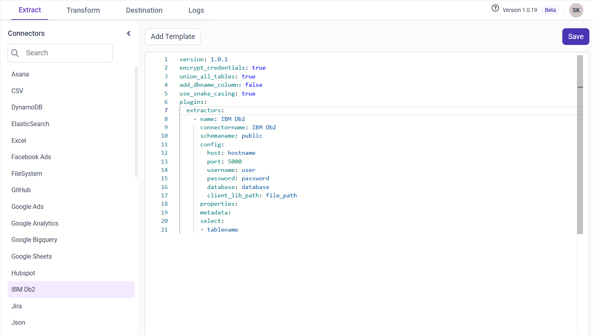
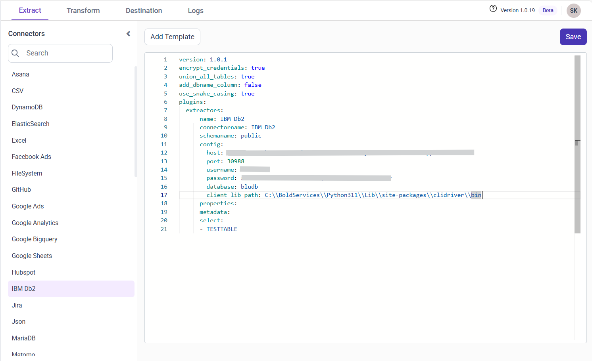

# Connect IBM Db2 with Bold Data Hub

The Bold Data Hub IBM Db2 connector loads data from an IBM Db2 database into {{site.productNameTM}}. IBM Db2 is a scalable, enterprise-grade relational database system that supports SQL for managing structured data. It handles both transactional and analytical workloads and integrates well with IBM Cloud, making it ideal for reporting and data warehousing.

## How do I get IBM Db2 credentials?

You find the IBM Db2 connection details for Bold Data Hub in the Service Credentials section of your IBM Cloud database instance.

1. Log in to your IBM Cloud account on the [IBM Cloud login page](https://cloud.ibm.com/login).
2. Navigate to the Resource List from the dashboard.
3. Under Databases, locate and select your IBM Db2 instance.
4. Inside the selected database, go to the Service Credentials section.
5. Copy the connection details you need, such as:
    * Hostname
    * Port Number
    * Database Name
    * Username
    * Password

## Connection Properties

The IBM Db2 connector in Bold Data Hub reads the following properties from the `config` section of a YAML file:

```yaml
 connectorname: IBM Db2
 schemaname: public
 host: hostname
 port: 5000
 username: user
 password: password
 database: database
 client_lib_path : file_path
```

### Example Configuration

The following Bold Data Hub YAML template shows a complete IBM Db2 extractor configuration:

```yaml
version: 1.0.1
destination:
plugins:
  extractors:
    - name: IBM Db2
      connectorname: IBM Db2
      schemaname: public
      config:
        host: hostname
        port: 5000
        username: user
        password: password
        database: database
        client_lib_path : file_path
      select:
        - tablename
```

## How do I connect IBM Db2 in Bold Data Hub?

You connect IBM Db2 by creating a pipeline in Bold Data Hub and adding the `IBM Db2` template to it.

1. Click the `Data Hub` icon on the Navigation Pane.

    

2. Click `Add Pipeline` and enter a name for the new pipeline.

    

3. Select the newly created pipeline and add the `IBM Db2` template.

    

4. Update the details required in the template, using the configuration parameters below.

5. Click **Save** and choose the destination to save the pipeline.

    

Creating a pipeline in Bold Data Hub automatically creates a data source in {{site.productNameTM}}. The {{site.productNameTM}} data source is a live data source to the destination database used in Bold Data Hub.

### Configuration Parameters

The IBM Db2 template in Bold Data Hub uses these parameters:

|Parameters |    Description                                          |
|--------------------------|----------------------------------------------|
| **Host:**                | Specify the hostname of the IBM Db2 server.    |
| **Port:**                | Specify the port number of the IBM Db2 server (default is 5000). |
| **Username:**            | Provide the username to authenticate with the IBM Db2 server. |
| **Password:**            | Provide the password to authenticate with the IBM Db2 server. |
| **Database:**            | Specify the name of the IBM Db2 database from which data will be extracted. |
| **Schema Name:**         | Specify the Schema name for connecting to IBM Db2. |
| **Client_lib_path:**     | Enter the IBM client library path. |
| **Select:**              | **Tablename(s):**  Specify the table name list to load tables from the IBM Db2 server.|

## How do I schedule the IBM Db2 pipeline?

You schedule the IBM Db2 pipeline in Bold Data Hub from the schedules tab, or you run it on demand.

1. To configure interval-based scheduling, click the schedules tab, select the created pipeline, click the schedule icon, and configure the schedule.

    

    

2. For an on-demand refresh, click the `Run Now` button.

    

3. Check the schedule history with the history option and the logs.

    

4. Click **Logs** to see whether the run is completed and the data source is created in {{site.productNameTM}}.

    

5. Click the `Edit DataSource` option to view the created tables.

## Frequently asked questions

### What is the default IBM Db2 port in Bold Data Hub?

The Bold Data Hub IBM Db2 template uses port 5000 by default.

### Does the IBM Db2 connector need a client library?

Yes. Enter the IBM client library path in the client_lib_path property.

## See also

* [Amazon Redshift connector for Bold Data Hub](../amazon-redshift/)
* [Schedule Bold Data Hub jobs](../../schedule/)
* [Bold Data Hub connectors list](../)
