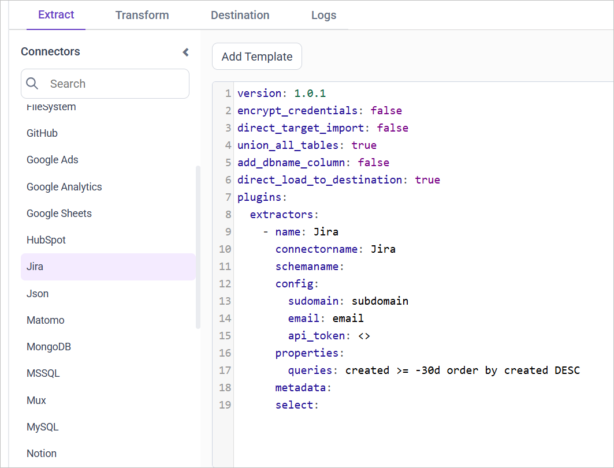

# Connect Jira with Bold Data Hub

The Bold Data Hub Jira connector loads project and task data from Jira into {{site.productNameTM}}. Jira by ``atlassian`` helps teams manage projects and tasks, prioritize work, and collaborate.

## How do I get a Jira API token?

You create the Jira API token for Bold Data Hub in the security settings of your Atlassian account.

1. Log in to your Jira account.
2. Navigate to the Jira project you have created.
3. Click your profile picture in the top right corner, and choose `Manage Account`.
4. Go to the `Security` tab and select `Create and manage API tokens`.
5. Click `Create API Token`, enter a descriptive name, and click the `Create` button.
6. Safely copy the newly generated access token.

## Connection Properties

The Jira connector in Bold Data Hub reads the following properties from the `config` section of a YAML file:

```yaml
connector_name: jira
subdomain: Sub-Domain
email: Email account
api_token: API token
Queries: Queries
```

### Example Configuration

The following Bold Data Hub YAML template shows a complete Jira extractor configuration:

```yaml
version:
encrypt_credentials: false
plugins:
  extractors:
    - name: jiradb
      connectorname: Jira
      config:
        subdomain: <SUB DOMAIN>
        email: <MAIL ID>
        api_token: <API TOKEN>
      properties:
        # queries: "created >= -30d order by created DESC"
        queries: <QUERY>
```

## How do I connect Jira in Bold Data Hub?

You connect Jira by creating a project in Bold Data Hub and adding the `Jira` template to it.

1. Click the `Bold Data Hub` icon on the Navigation Pane.

    

2. Click `Add Project` and enter a name for the new project.

    

3. Select the newly created project and add the `Jira` template.

    

4. Update the subdomain, email, and API token in the template, and update the resources in the `select` property.

5. Click **Save** and choose the destination to save the pipeline.

Creating a pipeline in Bold Data Hub automatically creates a data source in {{site.productNameTM}}. The {{site.productNameTM}} data source is a live data source to the destination database used in Bold Data Hub.

### Which Jira resources can I load?

The Bold Data Hub Jira connector supports these resources in the `select` property:

```js
The available resources are supported in Jira
- issues
- users
- ad_creatives
- projects
 ```

>**Warning:**

    1. The `Encrypt_Credentials` property should be set to false when updating the new access token on the template. If you have modified other properties, such as 'select' or 'account id', the `Encrypt_Credentials` property must be set to true.  
    2. The default lifetime of the access token is 1 hour. Therefore, you need to convert it to a long-lived access token to use the same token for 60 days. Existing tables should be maintained even if the token has expired or is being used as an invalid token.

## How do I schedule the Jira pipeline?

You schedule the Jira pipeline in Bold Data Hub from the schedules tab, or you run it on demand.

1. To configure interval-based scheduling, click the schedules tab, select the created pipeline, click the schedule icon, and configure the schedule.

    

    

2. For an on-demand refresh, click the `Run Now` button.

    

3. Check the schedule history with the history option and the logs.

    

4. Click **Logs** to see whether the run is completed and the data source is created in {{site.productNameTM}}.

    

5. Click the `Edit DataSource` option to view the created tables.

## Frequently asked questions

### What does the Jira connector need to authenticate?

The Bold Data Hub Jira connector needs your Jira subdomain, the email of your account, and an API token.

### How do I limit which Jira issues are loaded?

Set the queries property in the template. For example, `created >= -30d order by created DESC` is shown as a sample query in the template.

## See also

* [GitHub connector for Bold Data Hub](../github/)
* [Asana connector for Bold Data Hub](../asana/)
* [Bold Data Hub connectors list](../)
