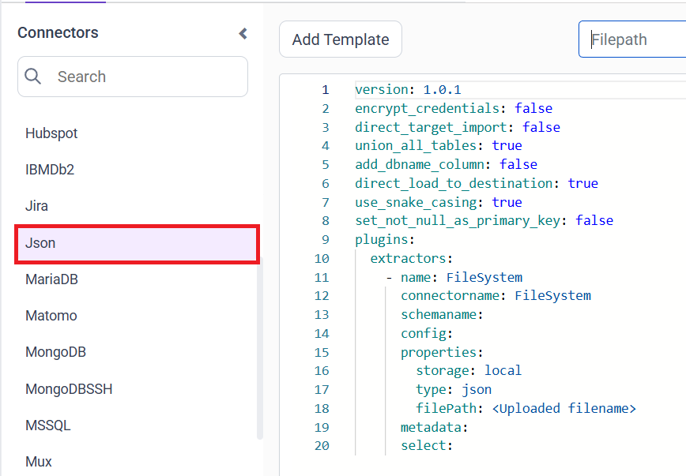
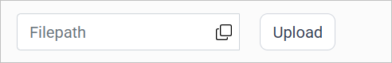
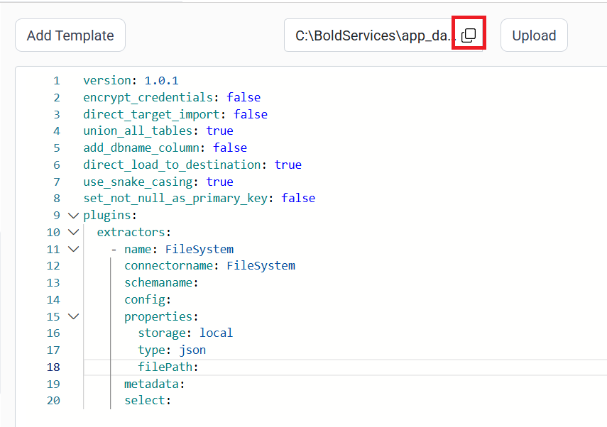
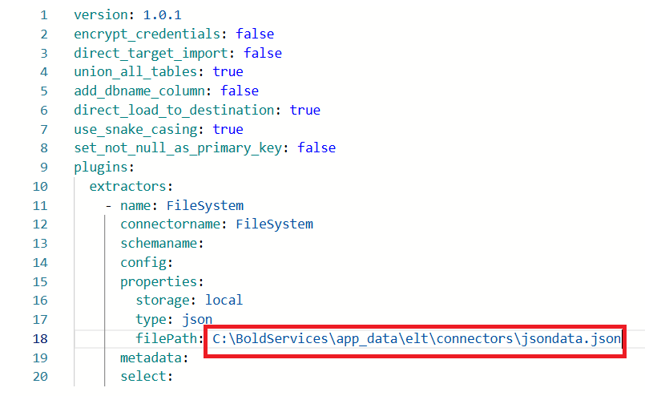

# Connect a JSON file with Bold Data Hub

The Bold Data Hub JSON connector loads data from a JSON file into Bold Reports<sup>®</sup>. JSON is a lightweight text format used to store and exchange data. It is widely used in web APIs and applications because it is simple and structured. It is easy for humans to read and write, and easy for machines to parse and generate.

## Example Configuration

The Bold Data Hub JSON connector uses the `FileSystem` extractor with `type: json`, as this YAML template shows:

```yaml
version: 1.0.1
encrypt_credentials: false
union_all_tables: true
add_dbname_column: false
use_snake_casing: true
plugins:
  extractors:
  - name: FileSystem
      connectorname: FileSystem
      schemaname:
      config:
      properties:
        storage: local
        type: json
        filePath: C:\BoldServices\app_data\elt\connectors\mockdata.json
      metadata:
      select:
```

## How do I connect a JSON file in Bold Data Hub?

You connect a JSON file by creating a pipeline in Bold Data Hub, adding the `JSON` template, and pointing the filePath property to your uploaded file.

1. Click the `Data Hub` icon on the Navigation Pane.

    

2. Click `Add Pipeline` and enter a name for the new pipeline.

    

3. Select the newly created pipeline and add the `JSON` template.

    

4. Click the **Upload File** button to upload your JSON file.

    

5. Copy the file path and paste it into the filePath property.

    

    

6. Click **Save** and choose the destination to save the pipeline.

    

Creating a pipeline in Bold Data Hub automatically creates a data source in Bold Reports<sup>®</sup>. The Bold Reports<sup>®</sup> data source is a live data source to the destination database used in Bold Data Hub.


## How do I schedule the JSON pipeline?

You schedule the JSON pipeline in Bold Data Hub from the schedules tab, or you run it on demand.

1. To configure interval-based scheduling, click the schedules tab, select the created pipeline, click the schedule icon, and configure the schedule.

    

    

2. For an on-demand refresh, click the `Run Now` button.

    

3. Check the schedule history with the history option and the logs.

    

4. Click **Logs** to see whether the run is completed and the data source is created in Bold Reports<sup>®</sup>.

    

## Frequently asked questions

### Which extractor does the Bold Data Hub JSON connector use?

The Bold Data Hub JSON template uses the `FileSystem` extractor with `storage: local` and `type: json`.

### Does a JSON pipeline create a Bold Reports<sup>®</sup> data source?

Yes. Creating a pipeline in Bold Data Hub automatically creates a live data source in Bold Reports<sup>®</sup> for the destination database.

## See also

* [CSV connector for Bold Data Hub](../csv/)
* [FileSystem connector for Bold Data Hub](../file-system/)
* [Bold Data Hub connectors list](../)
