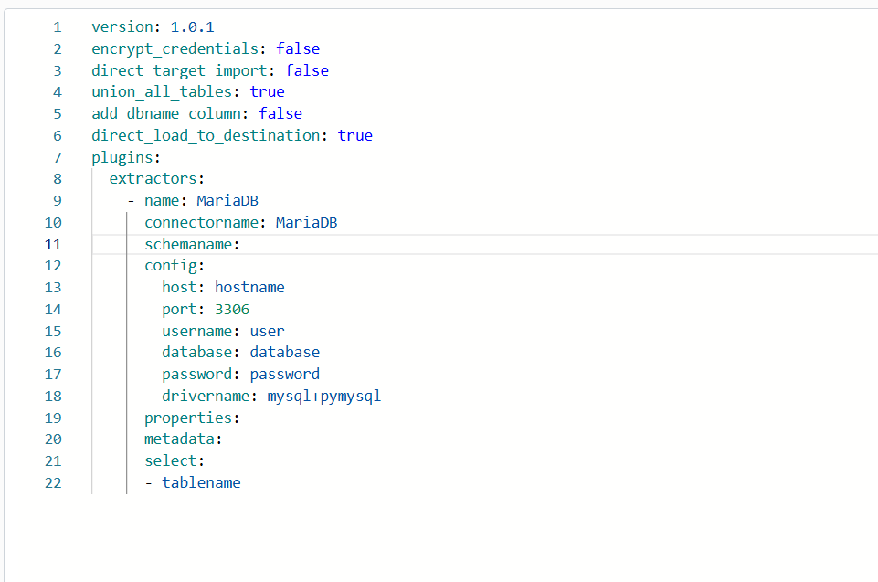
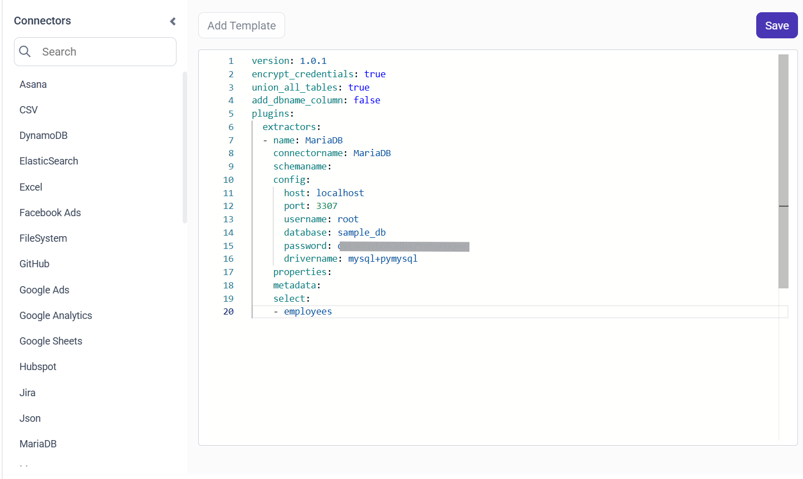

# Connect MariaDB with Bold Data Hub

The Bold Data Hub MariaDB connector loads data from a MariaDB database into Bold Reports<sup>®</sup>. MariaDB is an open-source relational database management system based on SQL (Structured Query Language). It is widely used for web applications, data warehousing, and e-commerce due to its reliability, performance, and rich feature set.

## Connection Properties

The MariaDB connector in Bold Data Hub reads the following properties from the `config` section of a YAML file:

```yaml
Connectorname: MariaDB
host: Hostname or IP address of the server
port: Server running port
username: Username
password: Password
database: Database
drivername: mysql+pymysql
```

### Example Configuration

The following Bold Data Hub YAML template shows a complete MariaDB extractor configuration:

```yaml
version: 1.0.1
encrypt_credentials: false
direct_target_import: false
union_all_tables: true
add_dbname_column: false
direct_load_to_destination: true
plugins:
  extractors:
    - name: MariaDB
      connectorname: MariaDB
      schemaname:
      config:
        host: hostname
        port: 3306
        username: user
        database: database
        password: password
        drivername: mysql+pymysql
      properties:
      metadata:
      select:
        - tablename
```

## How do I connect MariaDB in Bold Data Hub?

You connect MariaDB by creating a project in Bold Data Hub and adding the `MariaDB` template to it.

1. Click the `Data Hub` icon on the Navigation Pane.

    

2. Click `Add Project` and enter a name for the new project.

    

3. Select the newly created project and add the `MariaDB` template.

    

4. Update the details required in the template, using the configuration parameters below.

5. Click **Save** and choose the destination to save the pipeline.

    

Creating a pipeline in Bold Data Hub automatically creates a data source in Bold Reports<sup>®</sup>. The Bold Reports<sup>®</sup> data source is a live data source to the destination database used in Bold Data Hub.

### Configuration Parameters

The MariaDB template in Bold Data Hub uses these parameters:

|Parameters |    Description                                          |
|--------------------------|----------------------------------------------|
| **Host:**                | Specify the hostname of the MariaDB server.    |
| **Port:**                | Specify the port number of the MariaDB server (default is 3306). |
| **Username:**            | Provide the username to authenticate with the MariaDB server. |
| **Password:**            | Provide the password to authenticate with the MariaDB server. |
| **Database:**            | Specify the name of the MariaDB database from which data will be extracted. |
| **Driver Name:**         | Specify the driver name for connecting to MariaDB (e.g., mysql+pymysql). |
|    **Select:**     |                                  **Tablename(s):**       Specify the table name list to load tables from the MariaDB server.|

## How do I schedule the MariaDB pipeline?

You schedule the MariaDB pipeline in Bold Data Hub from the schedules tab, or you run it on demand.

1. To configure interval-based scheduling, click the schedules tab, select the created pipeline, click the schedule icon, and configure the schedule.

    

    

2. For an on-demand refresh, click the `Run Now` button.

    

3. Check the schedule history with the history option and the logs.

    

4. Click **Logs** to see whether the run is completed and the data source is created in Bold Reports<sup>®</sup>.

    

5. Click the `Edit DataSource` option to view the created tables.

## Frequently asked questions

### What is the default MariaDB port in Bold Data Hub?

The Bold Data Hub MariaDB template uses port 3306 by default.

### Which driver does the MariaDB connector use?

The MariaDB template uses the `mysql+pymysql` driver name.

## See also

* [MySQL connector for Bold Data Hub](../mysql/)
* [Schedule Bold Data Hub jobs](../../schedule/)
* [Bold Data Hub connectors list](../)
