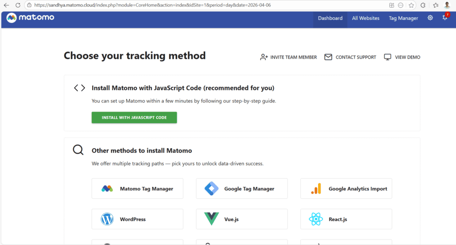
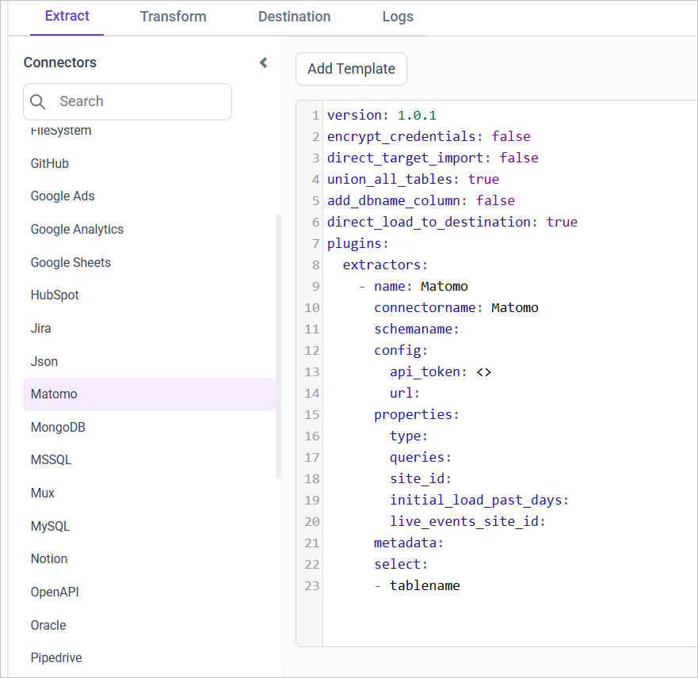

# Connect Matomo with Bold Data Hub

The Bold Data Hub Matomo connector loads web analytics data from ``Matomo`` into {{site.productName}}. ``Matomo`` is a free and open-source web analytics platform for website and application performance insights.

## How do I get Matomo credentials?

The Bold Data Hub Matomo connector needs an auth token, your ``Matomo`` URL, and the site ID. You get them from your ``Matomo`` account.

1. Sign in to ``Matomo``.

    

2. Click the Administration settings icon at the top right.
3. Navigate to **Personal > Security** in the left menu.
4. Find and select **Auth Tokens > Create a New Token**.
5. Verify with your password.
6. Add a descriptive label for your new token.
7. Click **Create New Token**. Your token is displayed.
8. Copy the access token.
9. Note your ``Matomo`` URL, which is the web address in your browser when logged into ``Matomo``, typically `mycompany.matomo.cloud`.
10. Find the `site_id`, a unique ID for each monitored site in ``Matomo``, in the URL or via ``Administration > Measureables > Manage under ID``.

## Connection Properties

The Matomo connector in Bold Data Hub reads the following properties from the `config` section of a YAML file:

```yaml
connector_name: Matomo
Api_token: Access token
url: URL
queries: Queries
Site_id: ID of the site
Live_events_site_id: ID of the Live events site
```

### Example Configuration

The following Bold Data Hub YAML template shows a complete Matomo extractor configuration:

```yaml
version: 1.0.1
encrypt_credentials: false
plugins:
  extractors:
    - name: Matomo_data
      connectorname: Matomo
      config:
        api_token: <API TOKEN>
        url: <URL>
      properties:
        type: <REPORTS/VISITS>
        queries: <QUERIES>
        site_id: <SITE ID>
        initial_load_past_days: <LOAD PAST DAYS>
        live_events_site_id: <LIVE EVENTS SITE ID>
```

## How do I connect Matomo in Bold Data Hub?

You connect Matomo by creating a project in Bold Data Hub and adding the `Matomo` template to it.

1. Click the `Bold Data Hub` icon on the Navigation Pane.

    

2. Click `Add Project` and enter a name for the new project.

    

3. Select the newly created project and add the `Matomo` template.

    

4. Update the API token and URL in the template, and update the resources in the `select` property.

5. Click **Save** and choose the destination to save the pipeline.

Creating a pipeline in Bold Data Hub automatically creates a data source in {{site.productNameTM}}. The {{site.productNameTM}} data source is a live data source to the destination database used in Bold Data Hub.

### Which Matomo resources can I load?

The Bold Data Hub Matomo connector supports these resources in the `select` property:

```js
The available resources are supported in Matomo
- matomo_reports
- matomo_visits

 ```

>**Warning:**

    1. The `Encrypt_Credentials` property should be set to false when updating the new access token on the template. If you have modified other properties, such as 'select' or 'account id', the `Encrypt_Credentials` property must be set to true.  
    2. The default lifetime of the access token is 1 hour. Therefore, you need to convert it to a long-lived access token to use the same token for 60 days. Existing tables should be maintained even if the token has expired or is being used as an invalid token.

## How do I schedule the Matomo pipeline?

You schedule the Matomo pipeline in Bold Data Hub from the schedules tab, or you run it on demand.

1. To configure interval-based scheduling, click the schedules tab, select the created pipeline, click the schedule icon, and configure the schedule.

    

    

2. For an on-demand refresh, click the `Run Now` button.

    

3. Check the schedule history with the history option and the logs.

    

4. Click **Logs** to see whether the run is completed and the data source is created in {{site.productNameTM}}.

    

5. Click the `Edit DataSource` option to view the created tables.

## Frequently asked questions

### Where do I find the Matomo site ID?

The `site_id` is a unique ID for each monitored site in ``Matomo``. Find it in the URL or under ``Administration > Measureables > Manage under ID``.

### Which Matomo data types can Bold Data Hub load?

The Bold Data Hub Matomo connector supports the matomo_reports and matomo_visits resources.

## See also

* [Google Analytics connector for Bold Data Hub](../google-analytics/)
* [Schedule Bold Data Hub jobs](../../schedule/)
* [Bold Data Hub connectors list](../)
