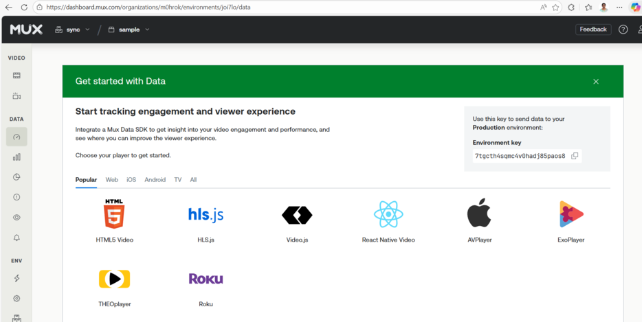
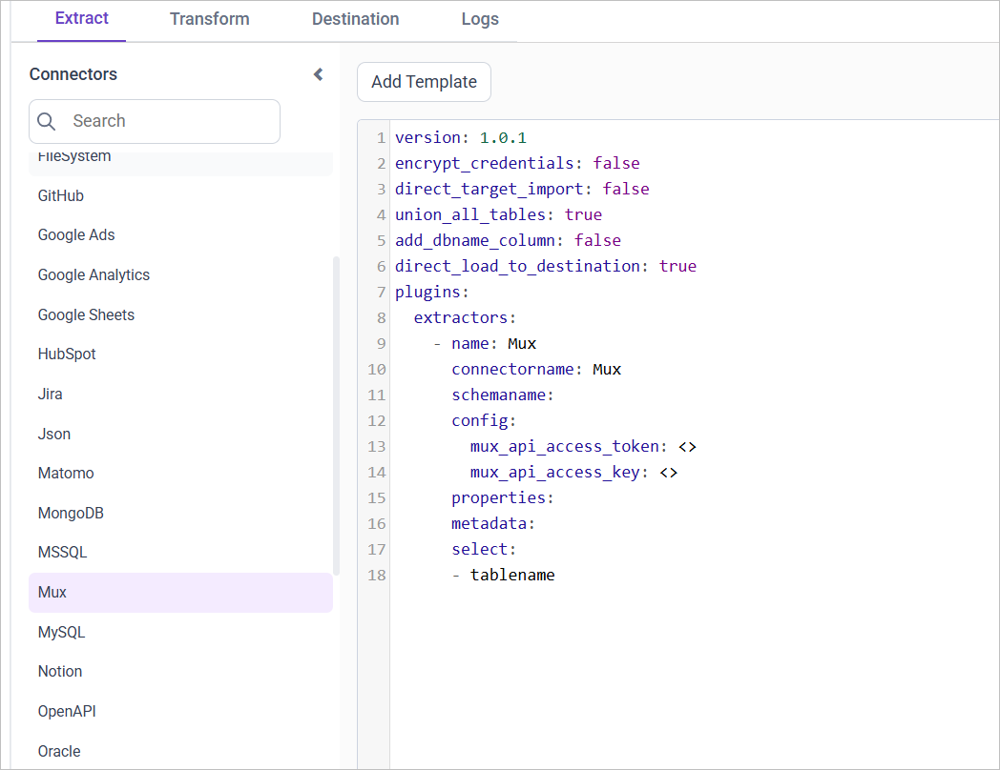
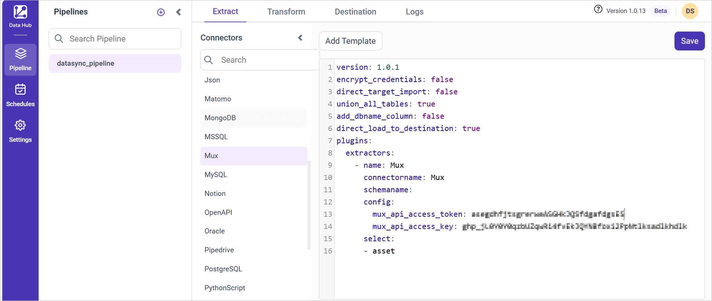

# Connect Mux with Bold Data Hub

The Bold Data Hub Mux connector loads data from your ``Mux`` account into {{site.productName}}. ``Mux`` is a video technology platform that provides infrastructure and tools to build and stream video content.

## How do I get Mux API credentials?

You generate the Mux API access token and secret key for Bold Data Hub in your Mux account settings.

1. Sign in to ``mux.com``.

    

2. Click **Settings** at the bottom left, then select **Access Token**.
3. Select **Generate new token**.
4. Assign read permissions for `Mux` videos and data, and give the token a name.
5. Click **Generate token**.
6. Copy the API access token and secret key for later configuration.

## Connection Properties

The Mux connector in Bold Data Hub reads the following properties from the `config` section of a YAML file:

```yaml
connector_name: Mux
Mux_api_access_token: Access token
mux_api_secret_key: API secret key
```

### Example Configuration

The following Bold Data Hub YAML template shows a complete Mux extractor configuration:

```yaml
version: 1.0.1
encrypt_credentials: false
plugins:
  extractors:
    - name: mux_data
      connectorname: Mux
      config:
        mux_api_access_token: <API TOKEN>
        mux_api_secret_key: <SECRET KEY>
      select:
       -views/assets
```

## How do I connect Mux in Bold Data Hub?

You connect Mux by creating a project in Bold Data Hub and adding the `Mux` template to it.

1. Click the `Bold Data Hub` icon on the Navigation Pane.

    

2. Click `Add Project` and enter a name for the new project.

    

3. Select the newly created project and add the `Mux` template.

    

4. Update the Mux API access token and key in the template, and update the resources in the `select` property.
5. Click **Save** and choose the destination to save the pipeline.

    

Creating a pipeline in Bold Data Hub automatically creates a data source in {{site.productNameTM}}. The {{site.productNameTM}} data source is a live data source to the destination database used in Bold Data Hub.

### Which Mux resources are supported?

The Bold Data Hub Mux connector supports the following resources:

```js
The available resources are supported in Mux
- asset
- video
- view
 ```

>**Warning:**

    1. The `Encrypt_Credentials` property should be set to false when updating the new access token on the template. If you have modified other properties, such as 'select' or 'account id', the `Encrypt_Credentials` property must be set to true.  
    2. The default lifetime of the access token is 1 hour. Therefore, you need to convert it to a long-lived access token to use the same token for 60 days. Existing tables should be maintained even if the token has expired or is being used as an invalid token.

## How do I schedule the Mux pipeline?

You schedule the Mux pipeline in Bold Data Hub from the schedules tab, or you run it on demand.

1. To configure interval-based scheduling, click the schedules tab, select the created pipeline, click the schedule icon, and configure the schedule.

    

    

2. For an on-demand refresh, click the `Run Now` button.

    

3. Check the schedule history with the history option and the logs.

    

4. Click **Logs** to see whether the run is completed and the data source is created in {{site.productNameTM}}.

    

5. Click the `Edit DataSource` option to view the created tables.

## Frequently asked questions

### Which Mux resources can Bold Data Hub load?

The Bold Data Hub Mux connector supports the asset, video, and view resources.

### How long does the Mux access token last?

The default lifetime of the access token is 1 hour. Convert it to a long-lived access token to use the same token for 60 days.

## See also

* [Schedule Bold Data Hub jobs](../../schedule/)
* [Work with Bold Data Hub pipelines](../../working-with-pipelines/)
* [Bold Data Hub connectors list](../)
