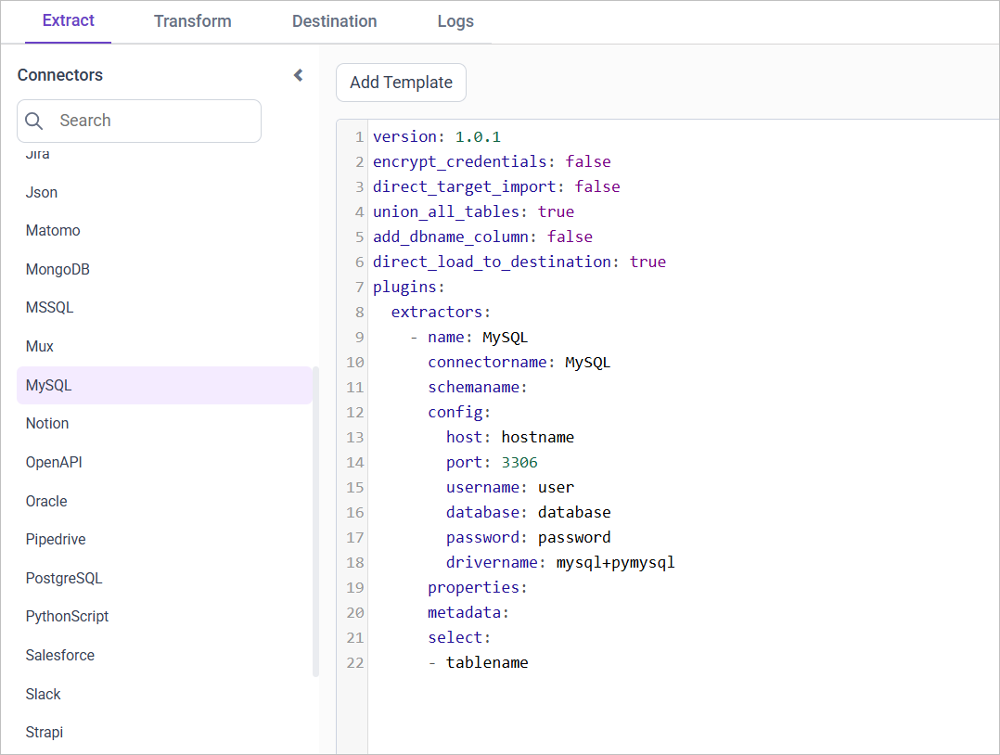
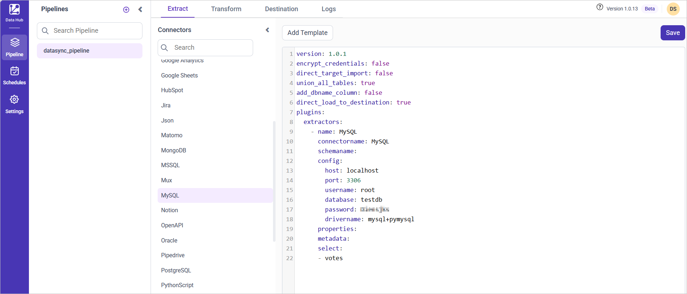

# Connect MySQL with Bold Data Hub

The Bold Data Hub MySQL connector loads data from a MySQL database into {{site.productNameTM}}. [MySQL](https://www.mysql.com/) is a relational database management system based on SQL (Structured Query Language). You can use MySQL for a wide range of purposes, including data warehousing, e-commerce, and logging applications.

## Connection Properties

The MySQL connector in Bold Data Hub reads the following properties from the `config` section of a YAML file:

```yaml
Connectorname: MySQL
host: Hostname or IP address of the server
port: Server running port
username: Username
password: Password
database: Database
drivername: mysql+pymysql
```

## How do I connect MySQL in Bold Data Hub?

You connect MySQL by creating a project in Bold Data Hub and adding the `MySQL` template to it.

1. Click the `Data Hub` icon on the Navigation Pane.

    

2. Click `Add Project` and enter a name for the new project.

    

3. Select the newly created project and add the `MySQL` template.

    

4. Update the required details in the template, using the configuration parameters below.
5. Click **Save** and choose the destination to save the pipeline.

    

Creating a pipeline in Bold Data Hub automatically creates a data source in {{site.productNameTM}}. The {{site.productNameTM}} data source is a live data source to the destination database used in Bold Data Hub.

### Configuration Parameters

The MySQL template in Bold Data Hub uses these parameters:

|Parameters |    Description                                          |
|--------------------------|----------------------------------------------|
| **Host:**                | Specify the hostname of the MySQL server.    |
| **Port:**                | Specify the port number of the MySQL server (default is 3306). |
| **Username:**            | Provide the username to authenticate with the MySQL server. |
| **Password:**            | Provide the password to authenticate with the MySQL server. |
| **Database:**            | Specify the name of the MySQL database from which data will be extracted. |
| **Driver Name:**         | Specify the driver name for connecting to MySQL (e.g., mysql+pymysql). |
|    **Select:**     |                                  **Tablename(s):**       Specify the table name list to load tables from the MySQL server.|
| [**Metadata:**](#metadata-properties) (Optional)  | **Replication Method:**  Specify the replication method for the table(s). Options include FULL or INCREMENTAL. |
|| **Replication Key:**   Specify the replication key for incremental replication. This key helps in identifying new or updated records.|
|| **Replication Value:**  Specify the replication value to start the incremental replication from a particular point. |

## How do I schedule the MySQL pipeline?

You schedule the MySQL pipeline in Bold Data Hub from the schedules tab, or you run it on demand.

1. To configure interval-based scheduling, click the schedules tab, select the created pipeline, click the schedule icon, and configure the schedule.

    

    

2. For an on-demand refresh, click the `Run Now` button.

    

3. Check the schedule history with the history option and the logs.

    

4. Click **Logs** to see whether the run is completed and the data source is created in {{site.productNameTM}}.

    

5. Click the `Edit DataSource` option to view the created tables.

## Metadata Properties

The metadata section of the Bold Data Hub MySQL template defines the mode of data refresh. There are two modes: INCREMENTAL and FULL_TABLE. Both modes support only DateTime datatype columns.

## INCREMENTAL

The INCREMENTAL mode in Bold Data Hub fetches data from the date column set in the replication key, starting from the date set in the replication value. Once you schedule the pipeline, the replication value is updated automatically from the imported data.

```yaml
metadata:
  TableName:
    replication_method: INCREMENTAL
    replication_key: Column name
    replication_value: column value that data starts from
```

## FULL_TABLE

The FULL_TABLE mode in Bold Data Hub fetches data from the date column set in the replication key, starting from the date set in the replication value. Once you schedule the pipeline, the replication value is updated based on the interval_type and interval_value from the imported data.

For example, set interval_type as 'year' and interval_value as '1'. The first schedule fetches the records from Jan 1, 2000 to Dec 31, 2000. The next schedule fetches the records from Jan 1, 2001 to Dec 31, 2001, and so on.

```yaml
metadata:
  TableName:
    replication_method: FULL_TABLE
    replication_key: Column name
    replication_value: column value that data starts from
    interval_type: days/hours/minutes/year/month
    interval_value: integer value to add in interval type
```

### Example Configuration

The following Bold Data Hub YAML templates show complete MySQL extractor configurations for each refresh mode.

### INCREMENTAL

```yaml
version: 1.0.1
encrypt_credentials: false
plugins:
  extractors:
    - name: tap_postgres
      connectorname: MySQL
      config:
        host: Hostname or IP address of the server
        port: Server running port
        username: Username
        password: Password
        database: Database
        drivername: mysql+pymysql
      select:
        - TABLE1
        - TABLE2
      metadata:
        TABLE1:
          replication_method: INCREMENTAL
          replication_key: last_modified_on
          replication_value: 2023-07-19 00:00:00
        TABLE2:
          replication_method: INCREMENTAL
          replication_key: last_modified_on
          replication_value: 2023-07-19 00:00:00
```

### FULL_TABLE

```yaml
version: 1.0.1
encrypt_credentials: false
plugins:
  extractors:
    - name: tap_postgres
      connectorname: MySQL
      config:
        host: Hostname or IP address of the server
        port: Server running port
        username: Username
        password: Password
        database: Database
        drivername: mysql+pymysql
      select:
        - TABLE1
        - TABLE2
      metadata:
        TABLE1:
          replication_method: FULL_TABLE
          replication_key: last_modified_on
          replication_value: 2023-07-19 00:00:00
          interval_type: days
          interval_value: 6
        TABLE2:
          replication_method: FULL_TABLE
          replication_key: last_modified_on
          replication_value: 2023-07-19 00:00:00
          interval_type: days
          interval_value: 6
```

## Frequently asked questions

### Which refresh modes does the MySQL connector support?

The Bold Data Hub MySQL connector supports two refresh modes: INCREMENTAL and FULL_TABLE. Both modes support only DateTime datatype columns.

### What is the default MySQL port?

The default port number of the MySQL server is 3306.

## See also

* [Connect MySQL over SSH with Bold Data Hub](../mysqlssh/)
* [Schedule Bold Data Hub jobs](../../schedule/)
* [Work with Bold Data Hub pipelines](../../working-with-pipelines/)
